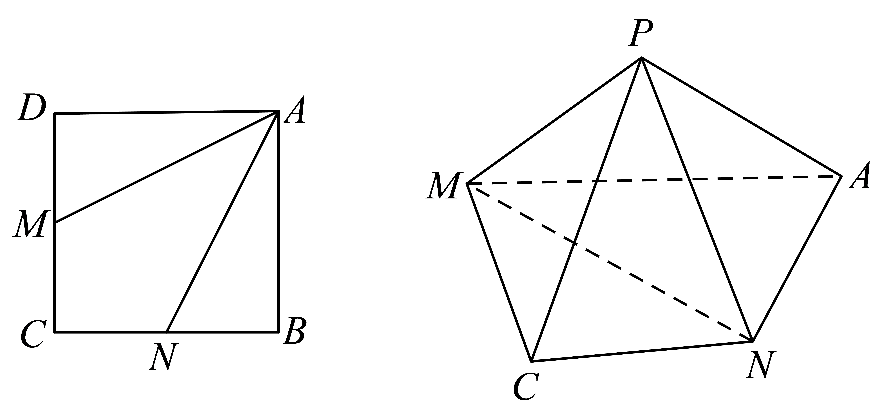

# Mathematics - 题目 2209

**ID**: 0df80c27371542f0815dfe258bde52ee
**年级**: Grade 12
**难度**: Medium
**题型**: Calculation

## 题目
边长为1的正方形 $ABCD$ 中，点M，N分别是DC，BC的中点，现将 $\vartriangle ABN$ ， $△ADM$ 分别沿AN，AM折起，使得B，D两点重合于点P，连接PC，得到四棱锥 $P-AMCN$ .​​​​​​​‌(1)证明：平面 $APN\bot $ 平面 $PMN$ ；(2)求四棱锥 $P-AMCN$ 的体积.

## 解答

1. （1）证明：在正方形 $ABCD$ 中有 $AB⊥BC$ ， $AD\bot DC$ ， $\therefore $  $AP\bot PM$ ，
2. $AP\bot PN$ ，又因为 $PM\cap PN=P$ ，所以 $AP⊥$ 平面 $PMN$ ，而 $AP⊂$ 平面 $APN$ ，
3. 所以平面 $APN\bot $ 平面 $PMN$ .
4. （2）连接MN,由题意可得 $AM=AN=\sqrt {1{{}^{2}}+(\frac {1}{2}){{}^{2}}}=\frac {\sqrt {5}}{2}$ ， $PM=PN=\frac {1}{2}$ ，
5. $MN=\sqrt {MC{{}^{2}}+CN{{}^{2}}}=\frac {\sqrt {2}}{2}$ ，由 $PM{{}^{2}}+PN{{}^{2}}=MN{{}^{2}}$ ，所以 $\vartriangle PMN$ 为直角三角形，即 $S{{}_{\vartriangle PMN}}=\frac {1}{2}\times \frac {1}{2}\times \frac {1}{2}=\frac {1}{8}$ ，
6. $S{{}_{\vartriangle AMN}}=S{{}_{正方形ABCD}}-S{{}_{\vartriangle ABN}}-S{{}_{\vartriangle ADM}}-S{{}_{\vartriangle CMN}}=1-\frac {1}{2}\times 1\times \frac {1}{2}-\frac {1}{2}\times 1\times \frac {1}{2}-\frac {1}{2}\times \frac {1}{2}\times \frac {1}{2}=\frac {3}{8}$ ，
7. 设点 $P$ 到平面 $AMN$ 的距离为 $h$ ，由 $V{{}_{A-PMN}}=V{{}_{P-AMN}}$ 得，
8. $\frac {1}{3}S{{}_{\mathrm{△}PMN}}\cdot PA=\frac {1}{3}S{{}_{\mathrm{△}AMN}}\cdot h$ ，即 $\frac {1}{8}\times 1=\frac {3}{8}h$ ，得 $h=\frac {1}{3}$ ，
9. $V{{}_{P-AMCN}}=\frac {1}{3}(S{{}_{\vartriangle AMN}}+S{{}_{\vartriangle MCN}})h=\frac {1}{3}\times (\frac {3}{8}+\frac {1}{8})\times \frac {1}{3}=\frac {1}{18}$
10. 即四棱锥 $P-AMCN$ 的体积为 $\frac {1}{18}$

## 知识点

**中文**:
  - 平面与平面垂直的判定
  - 棱柱、棱锥、棱台的体积
  - 点与面之间的距离

**English**:
  - Plane-Plane Perpendicularity Determination
  - Volume of Polyhedra
  - Point-Plane Distance

---
