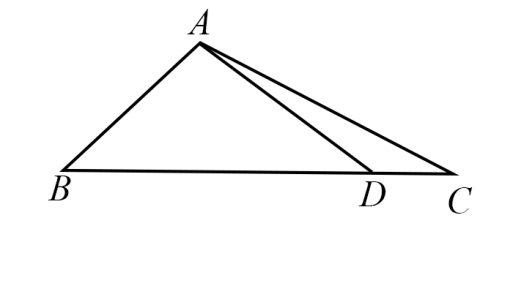

# Mathematics - 题目 957

**ID**: 11137a4ae2cf48ab854b68fa98952d8c
**年级**: Grade 12
**难度**: Medium
**题型**: Calculation

## 题目
在 ${\rm △\mathit{ABC}}$ 中，角A，B，C的对边分别为a，b，c，已知 $a=3,c=\sqrt {2},B=45{}\degree $ ．（1）求 $\sin C$ 的值；​​​​​​​‌（2）在边BC上取一点D，使得 ${\cos}\angle ADC=-\frac {4}{5}$ ，求 ${\tan}\angle DAC$ 的值．

## 解答

1. （1）解法一（通解解法）：正余弦定理综合法
2. 由余弦定理得 $b{^{2}}=a{^{2}}+c{^{2}}-2ac{\cos}B=9+2-2\times 3\times \sqrt {2}\times \frac {\sqrt {2}}{2}=5$ ，所以 $b=\sqrt {5}$ .
3. 由正弦定理得 $\frac {c}{\sin C}=\frac {b}{\sin B}\Rightarrow \sin C=\frac {c\sin B}{b}=\frac {\sqrt {5}}{5}$ .
4. 解法二（最优解法）：几何法
5. 过点A作 $AE\bot BC$ ，垂足为E．在 ${\rm{R}}{\rm{t}}△ABE$ 中，由 $c=\sqrt {2},B=45{}\degree $ ，可得 $AE=BE=1$ ，又 $a=3$ ，所以 $EC=2$ ．
6. 在 ${\rm{R}}{\rm{t}}△ACE$ 中， $AC=\sqrt {AE{^{2}}+EC{^{2}}}=\sqrt {5}$ ，因此 $\sin C=\frac {1}{\sqrt {5}}=\frac {\sqrt {5}}{5}$ ．
7. 
8. （2）解法一（通解解法）：两角和的正弦公式法
9. 由于 ${\cos}\angle ADC=-\frac {4}{5}$ ， $\angle ADC\in \left ({\frac {{\rm{π}}}{2},{\rm{π}}}\right )$ ，所以 $\sin \angle ADC=\sqrt {1-{\cos}{^{2}}\angle ADC}=\frac {3}{5}$ .
10. 由于 $\angle ADC\in \left ({\frac {{\rm{π}}}{2},{\rm{π}}}\right )$ ，所以 $C\in \left ({0,\frac {{\rm{π}}}{2}}\right )$ ，所以 ${\cos}C=\sqrt {1-\sin {^{2}}C}=\frac {2\sqrt {5}}{5}$ .
11. 所以 $\sin \angle DAC=\sin \left ({π-\angle DAC}\right )$  $=\sin \left ({\angle ADC+\angle C}\right )$
12. $=\sin \angle ADC\cdot {\cos}C+{\cos}\angle ADC\cdot \sin C$  $=\frac {3}{5}\times \frac {2\sqrt {5}}{5}+\left ({-\frac {4}{5}}\right )\times \frac {\sqrt {5}}{5}=\frac {2\sqrt {5}}{25}$ .
13. 由于 $\angle DAC\in \left ({0,\frac {{\rm{π}}}{2}}\right )$ ，所以 ${\cos}\angle DAC=\sqrt {1-\sin {^{2}}\angle DAC}=\frac {11\sqrt {5}}{25}$ .
14. 所以 ${\tan}\angle DAC=\frac {\sin \angle DAC}{{\cos}\angle DAC}=\frac {2}{11}$ .
15. 解法二（最优解法）：几何法+两角差的正切公式法
16. 在（1）的解法二的图中，由 ${\cos}\angle ADC=-\frac {4}{5}$ ，可得 ${\cos}\angle ADE={\cos}(π-\angle ADC)=-{\cos}\angle ADC=\frac {4}{5}$ ，从而 $\sin \angle DAE={\cos}\angle ADE=\frac {4}{5},{\tan}\angle DAE=\frac {\sin \angle DAE}{{\cos}\angle DAE}=\frac {4}{3}$ ．
17. 又由（1）可得 ${\tan}\angle EAC=\frac {EC}{AE}=2$ ，所以 ${\tan}\angle DAC={\tan}(\angle EAC-\angle EAD)=\frac {{\tan}\angle EAC-{\tan}\angle EAD}{1+{\tan}\angle EAC\cdot {\tan}\angle EAD}=\frac {2}{11}$ ．
18. 解法三（拓展性解法）：几何法+正弦定理法
19. 在（1）的解法二中可得 $AE=1,CE=2,AC=\sqrt {5}$ ．
20. 在 ${\rm{R}}{\rm{t}}\mathrm{△}ADE$ 中， $AD=\frac {AE}{\sin \angle ADE}=\frac {5}{3},ED=AD{\cos}\angle ADE=\frac {4}{3}$ ，
21. 所以 $CD=CE-DE=\frac {2}{3}$ ．
22. 在 $△ACD$ 中，由正弦定理可得 $\sin \angle DAC=\frac {CD}{AD}\cdot \sin C=\frac {2\sqrt {5}}{25}$ ，
23. 由此可得 ${\tan}\angle DAC=\frac {2}{11}$ ．
24. 解法四（拓展性解法）：构造直角三角形法
25. 如图，作 $AE\bot BC$ ，垂足为E，作 $DG\bot AC$ ，垂足为点G．
26. 
27. 在（1）的解法二中可得 $AE=1,CE=2,AC=\sqrt {5}$ ．
28. 由 ${\cos}\angle ADC=-\frac {4}{5}$ ，可得 ${\cos}\angle ADE=\frac {4}{5},\sin \angle ADE=\sqrt {1-{\cos}{^{2}}\angle ADE}=\frac {3}{5}$ ．
29. 在 ${\rm{R}}{\rm{t}}△ADE$ 中， $AD=\frac {AE}{\sin \angle ADE}=\frac {5}{3},DE=\sqrt {AD{^{2}}-AE{^{2}}}=\frac {4}{3},CD=CE-DE=\frac {2}{3}$ ．
30. 由（1）知 $\sin C=\frac {\sqrt {5}}{5}$ ，所以在 ${\rm{R}}{\rm{t}}△CDG$ 中， $DG=CD\cdot \sin C=\frac {2\sqrt {5}}{15},CG=\sqrt {CD{^{2}}-DG{^{2}}}=\frac {4\sqrt {5}}{15}$ ，从而 $AG=AC-CG=\frac {11\sqrt {5}}{15}$ ．
31. 在 $Rt△ADG$ 中， ${\tan}\angle DAG=\frac {DG}{AG}=\frac {2}{11}$ ．
32. 所以 ${\tan}\angle DAC=\frac {2}{11}$ ．

## 知识点

**中文**:
  - 两角和与差的正切公式
  - 两角和与差的正弦公式
  - 利用正弦定理解三角形
  - 利用余弦定理解三角形

**English**:
  - Tangent of Sum and Difference
  - Sine of Sum and Difference
  - Solving Triangles using Law of Sines
  - Solving Triangles using Law of Cosines

---
