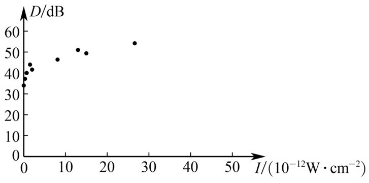

# Mathematics - 题目 104

**ID**: 1472090a46104165898cd8c839278777
**年级**: Grade 12
**难度**: Medium
**题型**: Calculation

## 题目
2022年6月5日是世界环境日，十三届全国人大常委会第三十二次会议表决通过的《中华人民共和国噪声污染防治法》今起施行.​​​​​​​‌噪声污染已经成为影响人们身体健康和生活质量的严重问题，为了解声音强度 $D$ （单位： ${\rm{d}}{\rm{B}}$ ）与声音能量 $I$ （单位： ${\rm{W}}\cdot {\rm{c}}{\rm{m}}{^{-2}}$ ）之间的关系，将测量得到的声音强度 $D$ 和声音能量 $I$ 的数据作了初步处理，得到如图所示的散点图：(1)根据散点图判断， $D=a{{}_{1}}+b{{}_{1}}I$ 与 $D=a{{}_{2}}+b{{}_{2}}{\lg}I$ 哪一个适宜作为声音强度 $D$ 关于声音能量 $I$ 的回归模型？（能给出判断即可，不必说明理由）(2)求声音强度 $D$ 关于声音能量 $I$ 的非线性经验回归方程（请使用题后参考数据作答）；(3)假定当声音强度大于45dB时，会产生噪声污染，城市中某点 $P$ 处共受到两个声源的影响，这两个声源的声音能量分别是 $I{{}_{a}}$ 和 $I{{}_{b}}$ ，且 $\frac {1}{I{{}_{a}}}+\frac {9}{I{{}_{b}}}=10{^{10}}$ .已知点 $P$ 处的声音能量等于 $I{{}_{a}}$ 与 $I{{}_{b}}$ 之和，请根据（2）中的非线性经验回归方程，判断点 $P$ 处是否受到噪声污染，并说明理由.参考数据： ${\overline{I}}=1.04\times 10{^{-11}}$ ， ${\overline{D}}=36.7$ ，令 $W{{}_{i}}={\lg}I{{}_{i}}$ ，有 ${\overline{W}}=\frac {1}{10}\sum \limits_{i=1}^{10}\mathop{W{{}_{i}}}$ ， ${\overline{W}}=-11.4$ ，$\sum \limits_{i=1}^{10}\mathop{(I{{}_{i}}-\bar I){^{2}}}=1.38\times 10{^{-21}}$ ， $\sum \limits_{i=1}^{10}\mathop{(W{{}_{i}}-\bar W){^{2}}}=1.48$ ， $\sum \limits_{i=1}^{10}\mathop{\left ({W{{}_{i}}-\bar W}\right )}\cdot \left ({D{{}_{i}}-\bar D}\right )=7.4$ ，$\sum \limits_{i=1}^{10}\mathop{\left ({I{{}_{i}}-\bar I}\right )}\left ({D{{}_{i}}-\bar D}\right )=6.9\times 10{^{-11}}$ ， $\hat b=\frac {\sum \limits_{i=1}^{n}\mathop{\left ({I{{}_{i}}-\bar I}\right )}\left ({D{{}_{i}}-\bar D}\right )}{\sum \limits_{i=1}^{n}\mathop{\left ({I{{}_{i}}-\bar I}\right ){^{2}}}}$ ， $\hat a=\bar D-\hat b\bar W$ ， ${\lg}2\approx 0.3$ .

## 解答

1. （1）解：散点图近似在一条曲线上，故 $D=a{{}_{2}}+b{{}_{2}}{\lg}I$ 更适合．
2. （2）解：令 $W{{}_{i}}={\lg}I{{}_{i}}$ ， $W={\lg}I$ ，则 $D=a{{}_{2}}+b{{}_{2}}W$ ， $\widehat {b{{}_{2}}}=\frac {\sum \limits_{i=1}^{10}\mathop{(W{{}_{i}}-\bar W)}(D{{}_{i}}-\bar D)}{\sum \limits_{i=1}^{10}\mathop{(W{{}_{i}}-\bar W){^{2}}}}=\frac {7.4}{1.48}=5$ ， $\widehat {a{{}_{2}}}={\overline{D}}-\widehat {b{{}_{2}}}{\overline{W}}=36.7-5\times (-11.4)=93.7$ ，
3. 即 $D$ 关于 $W$ 的回归方程是 $D=93.7+5W$ ，
4. 则 $D$ 关于 $I$ 的非线性经验回归方程是 $D=93.7+5{\lg}I$ ．
5. （3）解：设点 $P$ 处的声音能量为 $I{{}_{1}}$ ，则 $I{{}_{1}}=I{{}_{a}}+I{{}_{b}}$ ，
6. 因为 $I{{}_{a}}>0$ ， $I{{}_{b}}>0$ ， $\frac {1}{I{{}_{a}}}+\frac {9}{I{{}_{b}}}=10{^{10}}$ ，
7. 所以 $I{{}_{1}}=I{{}_{a}}+I{{}_{b}}=10{^{-10}}\left ({\frac {1}{I{{}_{a}}}+\frac {9}{I{{}_{b}}}}\right )\left ({I{{}_{a}}+I{{}_{b}}}\right )=10{^{-10}}\left ({10+\frac {I{{}_{b}}}{I{{}_{a}}}+\frac {9I{{}_{a}}}{I{{}_{b}}}}\right )\geqslant 10{^{-10}}\left ({10+2\sqrt {\frac {I{{}_{b}}}{I{{}_{a}}}\cdot \frac {9I{{}_{a}}}{I{{}_{b}}}}}\right )=16\times 10{^{-10}}$ ，
8. 当且仅当 $I{{}_{b}}=3I{{}_{a}}$ ，即 $I{{}_{a}}=\frac {4}{10{^{10}}}$ ， $I{{}_{b}}=\frac {12}{10{^{10}}}$ 时等号成立，
9. 所以 $D=93.7+5{\lg}I{{}_{1}}\geqslant 93.7+5{\lg}\left ({16\times 10{^{-10}}}\right )=20{\lg}2+43.7\approx 49.7>45$ ，
10. 所以点 $P$ 处会受到噪声污染．

## 知识点

**中文**:
  - 回归直线与回归方程
  - 基本不等式在最值问题中的应用
  - 散点图
  - 最小二乘法

**English**:
  - Regression Line and Equation
  - Application in Extremum Problems
  - Scatter Plot
  - Least Squares Method

---
