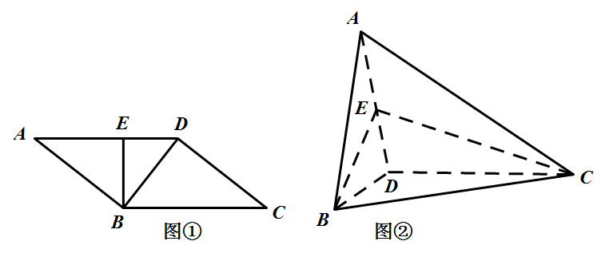

# Mathematics - 题目 1356

**ID**: 17bd6eeb0c2f4252bdb42fdd3b89eff5
**年级**: Grade 12
**难度**: Medium
**题型**: Calculation

## 题目
如图①：在平行四边形 $ABCD$ 中, $BD\bot CD$ , $BE\bot AD$ ,将 $ΔABD$ 沿对角线 $BD$ 折起,使 $AB\bot BC$ ,连结 $AC,EC$ ,得到如图②所示三棱锥 $A-BCD$ .​​​​​​​‌（1）证明： $BE\bot $ 平面 $ADC$ ；（2）若 $ED=1$ ,二面角 $C-BE-D$ 的平面角的正切值为 $\sqrt {6}$ ,求直线 $BD$ 与平面 $ADC$ 所成角的正弦值.

## 解答

1. （1）证明：在平行四边形 $ABCD$ 中, $BD\bot CD$ ,
2. 则 $AB\bot BD$ .
3. 在三棱锥 $A-BCD$ 中,因为 $AB\bot BC$ , $BC\cap BD=B$ .
4. 所以 $AB\bot $ 平面 $BCD$ ,所以 $AB\bot CD$ .
5. 又 $BD\bot CD$ , $AB\cap BD=B$ ,所以 $CD\bot $ 平面 $ABD$ .
6. 又 $BE\subset $ 平面 $ABD$ ,所以 $CD\bot BE$ .
7. 因为 $BE\bot AD$ , $AD\cap CD=D$ ,所以 $BE\bot $ 平面 $ADC$ .
8. （2）解：由（1）知 $BE\bot $ 平面 $ADC$ ,
9. 因为 $BC\subset $ 平面 $ADC$ ,所以 $BE\bot EC$ ,
10. 又 $BE\bot ED$ ,所以 $\angle DEC$ 即为二面角 $C-BE-D$ 的平面角,即 ${\rm{t}}{\rm{a}}{\rm{n}}\angle DEC=\sqrt {6}$ .
11. 因为 $CD\bot $ 平面 $ABD$ , $AD\subset $ 平面 $ABD$ .
12. 所以 $CD\bot AD$ ,故 ${\rm{t}}{\rm{a}}{\rm{n}}\angle DEC=\frac {CD}{ED}=\sqrt {6}$ ,
13. 又 $ED=1$ .所以 $AB=CD=\sqrt {6}$ .
14. 在平行四边形 $ABCD$ , $\angle ADB=\angle DBC$ , $\angle BED=\angle BDC=90{}^\circ $ ,
15. 所以 $ΔDEB$ 与 $ΔBDC$ 为相似三角形,则 $\frac {ED}{BD}=\frac {BD}{BC}$ ,
16. 故 $BD=m$ （ $m>0$ ）,解得 $BC=\sqrt {m{^{2}}+6}$ ,
17. 故 $\frac {1}{m}=\frac {m}{\sqrt {m{^{2}}+6}}$ ,解得 $m=\sqrt {3}$ ,
18. 所以 $BD=\sqrt {3}$ , $BC=3$ .
19. 过点 $D$ 作 $DF//AB$ ,以 $D$ 为坐标原点, $\overrightarrow {{DB}}$ , $\overrightarrow {{DC}}$ , $\overrightarrow {{DF}}$ 的方向为 $x$ 轴、 $y$ 轴、 $z$ 轴的正方向,建立空间直角坐标系,如图所示.
20. 
21. 则 $D\left ({0,0,0}\right )$ , $A\left ({\sqrt {3},0,\sqrt {6}}\right )$ , $C\left ({0,\sqrt {6},0}\right )$ , $B\left ({\sqrt {3},0,0}\right )$ .
22. 所以 $\overrightarrow {{DA}}=\left ({\sqrt {3},0,\sqrt {6}}\right )$ , $\overrightarrow {{DC}}=\left ({0,\sqrt {6},0}\right )$ , $\overrightarrow {{DB}}=\left ({\sqrt {3},0,0}\right )$ .
23. 设平面 $ADC$ 的法向量为 $\overrightarrow {{n}}=\left ({x,y,z}\right )$ ,
24. 则 $\begin{cases}\overrightarrow n\cdot \overrightarrow {{DA}}=\sqrt {3}x+\sqrt {6}z=0\\\overrightarrow n\cdot \overrightarrow {{DC}}=\sqrt {6}y=0\end{cases}$
25. 令 $z=-\sqrt {6}$ ,得 $\overrightarrow {{n}}=\left ({2\sqrt {3},0,-\sqrt {6}}\right )$ .
26. 设直线 $BD$ 与平面 $ADC$ 所成角为 $θ$ ,
27. ${\sin}θ=\left |{{\cos}\left \langle {\overrightarrow {{DB}},\overrightarrow {{n}}}\right \rangle }\right |=\frac {\left |{\overrightarrow {{DB}}\cdot \overrightarrow {{n}}}\right |}{\left |{\overrightarrow {{DB}}}\right |\cdot \left |{\overrightarrow {{n}}}\right |}=\frac {6}{\sqrt {3}\cdot \sqrt {18}}=\frac {\sqrt {6}}{3}$
28. 即直线 $BD$ 与平面 $ADC$ 所成角为 $\frac {\sqrt {6}}{3}$ .

## 知识点

**中文**:
  - 向量法求线面角
  - 直线与平面垂直的判定
  - 翻折问题

**English**:
  - Line-Plane Angle
  - Line-Plane Perpendicularity Determination
  - Folding Problems

---
