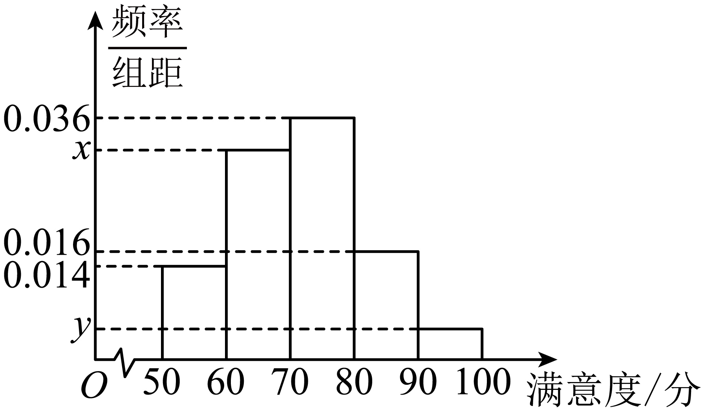

# Mathematics - 题目 1950

**ID**: 18a9d5c4ba894cbc8ca3c4fa2d126c7b
**年级**: Grade 12
**难度**: Medium
**题型**: Calculation

## 题目
随着人民生活水平的不断提高，“衣食住行”愈发被人们所重视，其中对饮食的要求也愈来愈高．某地区为了解当地餐饮情况，随机抽取了100人对该地区的餐饮情况进行了问卷调查．请根据下面尚未完成并有局部污损的频率分布表和频率分布直方图（如图）解决下列问题．组别分组频数频率第1组$\left [{50,60}\right )$140.​​​​​​​‌14第2组$\left [{60,70}\right )$m第3组$\left [{70,80}\right )$360.36第4组$\left [{80,90}\right )$0.16第5组$\left [{90,100}\right )$4n合计(1)求 $m,n,x,y$ 的值；(2)求中位数；(3)若将满意度在80分以上的人群称为“美食客”，将频率视为概率，用样本估计总体，从该地区中随机抽取3人，记其中“美食客”的人数为 $ξ$ ，求 $ξ$ 的分布列和数学期望．

## 解答

1. （1）由题意可得第四组的人数为 $100\times 0.16=16$ ，
2. 所以 $m=100-14-36-16-4=30$ ， $n=\frac {4}{100}=0.04$ ，
3. 又 $[60,70)$ 内的频率为 $\frac {30}{100}=0.3$ ，所以 $x=\frac {0.3}{10}=0.03$ ，
4. $[90,100)$ 内的频率为 $0.04$ ，所以 $y=\frac {0.04}{10}=0.004$ .
5. （2）由频率分布直方图可得第一、二组频率之和为 $(0.014+0.03)\times 10=0.44$ ，
6. 第一、二、三组频率之和为 $(0.014+0.03+0.036)\times 10=0.8$ ，故中位数在 $[70,80)$ 之间，
7. 设中位数为 $x$ ，则： $10\times 0.014+10\times 0.03+(x-70)\times 0.036=0.5$ ，解得 $x=71\frac {2}{3}$ ，
8. 故中位数为 $71\frac {2}{3}$ .
9. （3）由频率分布表可得该地区抽取“美食客”的概率为 $0.16+0.04=0.2$ ，
10. 由题意 $ξ$ 可取 $0,1,2,3$ ，且 $ξ\sim B\left ({3,\frac {1}{5}}\right )$ ，
11. 所以 $P(ξ=0)={\rm{C}}{{}_{3}^{0}}\left ({\frac {1}{5}}\right ){{}^{0}}\left ({\frac {4}{5}}\right ){{}^{3}}=\frac {64}{125}$ ， $P(ξ=1)=C{{}_{3}^{1}}\left ({\frac {1}{5}}\right ){{}^{1}}\left ({\frac {4}{5}}\right ){{}^{2}}=\frac {48}{125}$ ，
12. $P(ξ=2)=C{{}_{3}^{2}}\left ({\frac {1}{5}}\right ){{}^{2}}\left ({\frac {4}{5}}\right ){{}^{1}}=\frac {12}{125}$ ， $P(ξ=3)={\rm{C}}{{}_{3}^{3}}\left ({\frac {1}{5}}\right ){{}^{3}}\left ({\frac {4}{5}}\right ){{}^{0}}=\frac {1}{125}$ ，
13. 所以 $ξ$ 的分布列为
14. $ξ$
15. 0
16. 1
17. 2
18. 3
19. $P$
20. $\frac {64}{125}$
21. $\frac {48}{125}$
22. $\frac {12}{125}$
23. $\frac {1}{125}$
24. $E(ξ)=3\times \frac {1}{5}=\frac {3}{5}$

## 知识点

**中文**:
  - 离散型随机变量的分布列
  - 频率分布直方图

**English**:
  - Probability Distribution Table
  - Frequency Distribution Histogram

---
