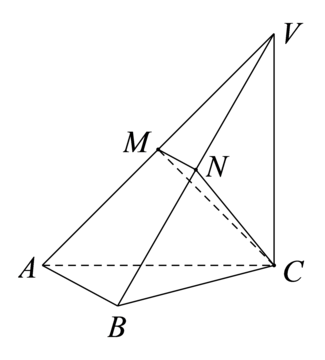

# Mathematics - 题目 1248

**ID**: 2178009efcf44f0486030dfa317f3a08
**年级**: Grade 12
**难度**: Medium
**题型**: Calculation

## 题目
如图，在三棱锥 $V-ABC$ 中，平面 $VAC\bot $ 平面 $ABC$ ， $ΔABC$ 和 $ΔVAC$ 均是等腰直角三角形， $AB=BC$ ， $AC=CV=2$ ， $M$ 、 $N$ 分别为 $VA$ 、 $VB$ 的中点.​​​​​​​‌（Ⅰ）求证： $AB{\rm{/}}{\rm{/}}$ 平面 $CMN$ ；（Ⅱ）求证： $AB\bot VC$ ；（Ⅲ）求直线 $VB$ 与平面 $CMN$ 所成角的正弦值.

## 解答

1. （Ⅰ）在 $\Delta VAB$ 中， $M$ 、 $N$ 分别为 $VA$ 、 $VB$ 的中点，所以 $MN$ 为中位线，所以 $MN{\rm{/}}{\rm{/}}AB$ .
2. 又因为 $AB\not\subset $ 平面 $CMN$ ， $MN\subset $ 平面 $CMN$ ，所以 $AB{\rm{/}}{\rm{/}}$ 平面 $CMN$ ；
3. （Ⅱ）在等腰直角三角形 $ΔVAC$ 中， $AC=CV$ ，所以 $VC\bot AC$ .
4. 因为平面 $VAC\bot $ 平面 $ABC$ ，平面 $VAC\cap $ 平面 $ABC=AC$ ，  $VC\subset $ 平面 $VAC$ ，
5. 所以 $VC\bot $ 平面 $ABC$ .
6. 又因为 $AB\subset $ 平面 $ABC$ ，所以 $AB\bot VC$ ；
7. （Ⅲ）在平面 $ABC$ 内过点 $C$ 作 $CH$ 垂直于 $AC$ ，由（Ⅱ）知， $VC\bot $ 平面 $ABC$ ，
8. 因为 $CH\subset $ 平面 $ABC$ ，所以 $VC\bot CH$ .
9. 如图，以 $C$ 为原点建立空间直角坐标系 $C-xyz$ .
10. 
11. 则 $C\left ({0,0,0}\right )$ ， $V\left ({0,0,2}\right )$ ， $B\left ({1,1,0}\right )$ ， $M\left ({1,0,1}\right )$ ， $N\left ({\frac {1}{2},\frac {1}{2},1}\right )$ .
12. $\overrightarrow {{VB}}=\left ({1,1,-2}\right )$ ， $\overrightarrow {{CM}}=\left ({1,0,1}\right )$ ， $\overrightarrow {{CN}}=\left ({\frac {1}{2},\frac {1}{2},1}\right )$ .
13. 设平面 $CMN$ 的法向量为 $\overrightarrow {{n}}=\left ({x,y,z}\right )$ ，则 $\begin{cases}n\cdot \overrightarrow {{CM}}=0\\n\cdot \overrightarrow {{CN}}=0\end{cases}$ ，即 $\begin{cases}x+z=0\\\frac {1}{2}x+\frac {1}{2}y+z=0\end{cases}$ .
14. 令 $x=1$ 则 $y=1$ ， $z=-1$ ，所以 $\overrightarrow {{n}}=\left ({1,1,-1}\right )$ .
15. 直线 $VB$ 与平面 $CMN$ 所成角大小为 $θ$ ， ${\sin}θ=\left |{{\cos}\left \langle {\overrightarrow {{n}},\overrightarrow {{VB}}}\right \rangle }\right |=\frac {\left |{\overrightarrow {{n}}\cdot \overrightarrow {{VB}}}\right |}{\left |{\overrightarrow {{n}}}\right |\cdot \left |{\overrightarrow {{VB}}}\right |}=\frac {2\sqrt {2}}{3}$ .
16. 所以直线 $VB$ 与平面 $CMN$ 所成角的正弦值为 $\frac {2\sqrt {2}}{3}$ .

## 知识点

**中文**:
  - 向量法求线面角
  - 直线与平面平行的判定
  - 直线与平面垂直的判定
  - 直线与平面垂直的性质

**English**:
  - Line-Plane Angle
  - Line-Plane Parallelism Determination
  - Line-Plane Perpendicularity Determination
  - Properties of Line-Plane Perpendicularity

---
