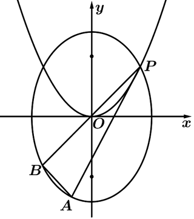

# Mathematics - 题目 1378

**ID**: 2747da7589714466a2006b2a09bfe7f5
**年级**: Grade 12
**难度**: Medium
**题型**: Calculation

## 题目
如图，在平面直角坐标系 $xOy$ 中，已知点 $P$ 是抛物线上的一个点，其横坐标为 $x{{}_{0}}$ ，过点 $P$ 作抛物线 $C{{}_{1}}$ 的切线 $l$ .​​​​​​​‌（1）求直线 $l$ 的斜率（用 $x{{}_{0}}$ 与 $p$ 表示）；（2）若椭圆 $C{{}_{2}}:\frac {y{^{2}}}{2}+x{^{2}}=1$ 过点 $P$ ， $l$ 与 $C{{}_{2}}$ 的另一个交点为 $A$  ， $OP$ 与 $C{{}_{2}}$ 的另一个交点为 $B$ ，求证： $AB\bot PB$ .

## 解答

1. （1）由 $x{^{2}}=2py$ ，得 $y=\frac {1}{2p}x{^{2}}$ ，所以 $y^{′}=\frac {1}{p}x$ ，
2. 所以直线 $l$ 的斜率为 $\frac {1}{p}x{{}_{0}}$ .
3. （2）设，则， $k{{}_{PB}}=\frac {y{{}_{0}}}{x{{}_{0}}}$ ，
4. 由（1）知 $k{{}_{PA}}=\frac {1}{p}x{{}_{0}}=\frac {2y{{}_{0}}}{x{{}_{0}}}$ ，
5. 设，所以 $\frac {y{{}_{0}}{^{2}}}{2}+x{{}_{0}}{^{2}}=1$ ， $\frac {y{{}_{1}}{^{2}}}{2}+x{{}_{1}}{^{2}}=1$ ，
6. 作差得，
7. 即 $\frac {y{{}_{0}}+y{{}_{1}}}{x{{}_{0}}+x{{}_{1}}}\cdot \frac {y{{}_{0}}-y{{}_{1}}}{x{{}_{0}}-x{{}_{1}}}=-2$ ，所以 $k{{}_{PA}}k{{}_{AB}}=-2$ ，
8. 所以 $\frac {2y{{}_{0}}}{x{{}_{0}}}k{{}_{AB}}=-2$ ，即 $\frac {y{{}_{0}}}{x{{}_{0}}}k{{}_{AB}}=-1$ ，
9. 所以 $k{{}_{PB}}k{{}_{AB}}=-1$ ，所以 $AB\bot PB$ .

## 知识点

**中文**:
  - 直线与抛物线的位置关系
  - 直线与椭圆的位置关系

**English**:
  - Line-Parabola Relationship
  - Line-Ellipse Relationship

---
