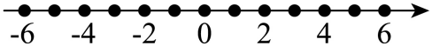

# Mathematics - 题目 2187

**ID**: 276d28832ba24772a0735681ea265a61
**年级**: Grade 12
**难度**: Medium
**题型**: Calculation

## 题目
已知甲箱中有2个白球和4个红球，乙箱中有4个白球和2个红球.​​​​​​​‌质点从原点出发，每次等可能的向左或向右移动一个单位，记事件 $A=$ “质点移动6次，最终在2的位置”.(1)求事件 $A$ 发生的概率；(2)若事件 $A$ 发生，从甲箱中取一球，否则从乙箱中取一球.求取出的球是红球的概率.

## 解答

1. (1)要使质点移动 $6$ 次，最终在 $2$ 的位置，则需质点向左移动 $2$ 次，向右移动 $4$ 次，
2. 所以 $P\left ({A}\right )=\frac {n\left ({A}\right )}{n\left ({{\rm{Ω}}}\right )}=\frac {{\rm{C}}{{}_{6}^{2}}}{2{^{6}}}=\frac {15}{64}$ 或 $P\left ({A}\right )={\rm{C}}{{}_{6}^{2}}{\left({\frac {1}{2}}\right)^{2}}\times {\left({\frac {1}{2}}\right)^{4}}=\frac {15}{64}$ ；
3. (2)设取出的球是红球为事件 $B$ ，则 $B=AB\cup \bar AB$ ，
4. 又有题知： $P\left ({\left .{B}\right |A}\right )=\frac {4}{6}$ ， $P\left ({\left .{B}\right |\bar A}\right )=\frac {2}{6}$ ，
5. 故根据全概率公式得 $P\left ({B}\right )=P\left ({AB}\right )+P\left ({\bar AB}\right )=P\left ({A}\right )P\left ({B∣A}\right )+P\left ({\bar A}\right )P\left ({\left .{B}\right |\bar A}\right )$
6. $=\frac {15}{64}\times \frac {4}{6}+\frac {49}{64}\times \frac {2}{6}=\frac {79}{192}$ .

## 知识点

**中文**:
  - 全概率公式
  - 古典概型的概率计算

**English**:
  - Law of Total Probability
  - Calculation of Classical Probability

---
