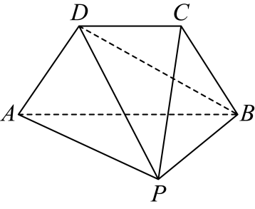

# Mathematics - 题目 3078

**ID**: 332ea29631064ea0a51dc4d85924c2b0
**年级**: Grade 12
**难度**: Medium
**题型**: Calculation

## 题目
如图所示，在四棱锥 $P-ABCD$ 中，四边形 $ABCD$ 为等腰梯形， $AB/\mskip-4mu/CD$ ， $AD=CD=\frac {1}{2}AB=2$ ，平面 $PAB\bot $ 平面 $ABCD$ ， $PA\bot PB$ .​​​​​​​‌（1）若 $PB=2$ ， $PD=2\sqrt {2}$ ，求证： $AD\bot $ 平面 $PBD$ ；（2）若二面角 $P-AD-B$ 的余弦值为 $\frac {\sqrt {21}}{7}$ ，求平面 $PAD$ 与平面 $PBC$ 夹角的余弦值.

## 解答

1. （1） $\because $ 四边形 $ABCD$ 为等腰梯形， $AB/\mskip-4mu/CD$ ， $\therefore \angle BAD+\angle BCD=180{}\degree $ ，
2. 在 $\mathrm{△}ABD$ 中， $BD{^{2}}=AB{^{2}}+AD{^{2}}-2AB\cdot AD\cdot {\cos}\angle BAD=20-16{\cos}\angle BAD$ ①，
3. 在 $\mathrm{△}BCD$ 中， $BD{^{2}}=BC{^{2}}+CD{^{2}}-2BC\cdot CD\cdot {\cos}\angle BCD=8+8{\cos}\angle BAD$ ②，
4. ①＋②×2得 $3BD{^{2}}=36$ ， $\therefore BD{^{2}}=12$ ， $\therefore AB{^{2}}=AD{^{2}}+BD{^{2}}=16$ ， $\therefore AD\bot BD$ ，
5. $\because PB=2$ ， $PA\bot PB$ ， $\therefore PA{^{2}}=AB{^{2}}-BP{^{2}}=12$ ，
6. $\because PD=2\sqrt {2}$ ， $\therefore PA{^{2}}=AD{^{2}}+PD{^{2}}=12$ ， $\therefore AD\bot PD$ ，
7. $\because BD\cap PD=D$ ，又 $BD,PD\subset $ 平面 $PBD$ ， $\therefore AD\bot $ 平面 $PBD$ .
8. （2）过 $D$ 作 $DO\bot AB$ ，垂足为 $O$ ， $\because $ 平面 $PAB\bot $ 平面 $ABCD$ ， $\therefore DO\bot $ 平面 $PAB$ ，
9. 以 $O$ 为原点， $OA$ ， $OD$ 所在直线分别为 $x$ 轴、 $z$ 轴，建立如图所示的空间直角坐标系，则 $A\left ({1,0,0}\right )$ ， $B\left ({-3,0,0}\right )$ ， $C\left ({-2,0,\sqrt {3}}\right )$ ， $D\left ({0,0,\sqrt {3}}\right )$ ，
10. 
11. 设 $P\left ({a,b,0}\right )$ （ $-3<a<1$ ， $b>0$ ）， $\overrightarrow {{DA}}=\left ({1,0,-\sqrt {3}}\right )$ ， $\overrightarrow {{PA}}=\left ({1-a,-b,0}\right )$ ，显然 $\overrightarrow m=\left ({0,1,0}\right )$ 是平面 $ABD$ 的一个法向量，
12. 设 $\overrightarrow n=\left ({x{{}_{1}},y{{}_{1}},z{{}_{1}}}\right )$ 是平面 $PAD$ 的一个法向量，则 $\begin{cases}\overrightarrow n\bot \overrightarrow {{DA}},\\\overrightarrow n\bot \overrightarrow {{PA}},\end{cases}$  $\therefore \begin{cases}x{{}_{1}}-\sqrt {3}z{{}_{1}}=0,\\\left ({1-a}\right )x{{}_{1}}-by{{}_{1}}=0,\end{cases}$
13. 取 $x{{}_{1}}=\sqrt {3}b$ ，则 $y{{}_{1}}=\sqrt {3}\left ({1-a}\right )$ ， $z{{}_{1}}=b$ ， $\therefore \overrightarrow n=\left ({\sqrt {3}b,\sqrt {3}\left ({1-a}\right ),b}\right )$ ，
14. $\because $ 二面角 $P-AD-B$ 的余弦值为 $\frac {\sqrt {21}}{7}$ ，
15. $\therefore {\cos}\left \langle {\overrightarrow m,\overrightarrow n}\right \rangle =\frac {\overrightarrow m\cdot \overrightarrow n}{\left |{\overrightarrow m}\right |\left |{\overrightarrow n}\right |}=\frac {\sqrt {3}\left ({1-a}\right )}{\sqrt {3b{^{2}}+3{\left({1-a}\right)^{2}}+b{^{2}}}}=\frac {\sqrt {21}}{7}$ ， $\therefore {\left({1-a}\right)^{2}}=b{^{2}}$ ，
16. $\because PA\bot PB$ ， $\therefore AB{^{2}}=PA{^{2}}+PB{^{2}}={\left({1-a}\right)^{2}}+b{^{2}}+{\left({a+3}\right)^{2}}+b{^{2}}=16$ ，
17. $\therefore a=-1$ 或 $a=1$ （舍去）， $b=2$ ， $\therefore P\left ({-1,2,0}\right )$ ， $\overrightarrow n=\left ({2\sqrt {3},2\sqrt {3},2}\right )$ ，
18. 设 $\overrightarrow k=\left ({x{{}_{2}},y{{}_{2}},z{{}_{2}}}\right )$ 是平面 $PBC$ 的一个法向量，则 $\begin{cases}\overrightarrow k\bot \overrightarrow {{BC}},\\\overrightarrow k\bot \overrightarrow {{PB}},\end{cases}$  $\therefore \begin{cases}x{{}_{2}}+\sqrt {3}z{{}_{2}}=0,\\-2x{{}_{2}}-2y{{}_{2}}=0,\end{cases}$
19. 取 $x{{}_{2}}=\sqrt {3}$ ，则 $y{{}_{2}}=-\sqrt {3}$ ， $z{{}_{2}}=-1$ ， $\therefore \overrightarrow k=\left ({\sqrt {3},-\sqrt {3},-1}\right )$ ，
20. $\therefore {\cos}\left \langle {\overrightarrow n,\overrightarrow k}\right \rangle =\frac {\overrightarrow n\cdot \overrightarrow k}{\left |{\overrightarrow n}\right |\left |{\overrightarrow k}\right |}=\frac {-2}{\sqrt {28}\cdot \sqrt {7}}=-\frac {1}{7}$ ，
21. $\therefore $ 平面 $PAD$ 与平面 $PBC$ 夹角的余弦值为 $\frac {1}{7}$ .

## 知识点

**中文**:
  - 向量法求二面角
  - 直线与平面垂直的判定

**English**:
  - Dihedral Angle
  - Line-Plane Perpendicularity Determination

---
