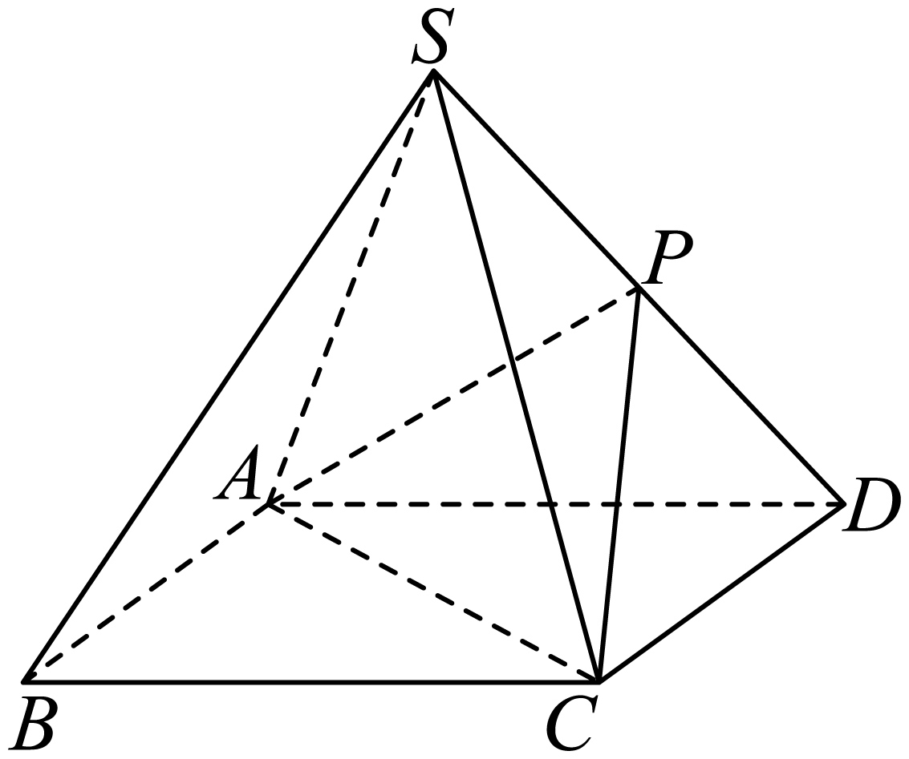

# Mathematics - 题目 3083

**ID**: 4966585a53c94bc4bb7f66dd9563934e
**年级**: Grade 12
**难度**: Medium
**题型**: Calculation

## 题目
如图，正四棱锥 $S-ABCD$ 的底面边长为2，二面角 $S-AB-C$ 的正切值为 $\sqrt {6}$ ， $P$ 为侧棱 $SD$ 上的点，且 $SB\mathrm{/\mskip-4mu/}$ 平面 $PAC$ .​​​​​​​‌(1)求直线 $SB$ 到平面 $PAC$ 的距离.(2)请判断在平面 $PAC$ 上是否存在一点 $E$ ，使得 $\mathrm{△}ESB$ 是以 $SB$ 为底边， $\frac {2{\rm{π}}}{3}$ 为顶角的等腰三角形.若存在，请求出点 $E$ 的轨迹；若不存在，请说明理由.

## 解答

1. （1）连接 $PO$ .
2. ∵ $SB//$ 平面 $PAC$ ， $SB\subset $ 平面 $SBD$ ，平面 $SBD\cap $ 平面 $PAC=PO$ ，∴ $SB\parallel PO$ .
3. 在 $\vartriangle SBD$ 中， $O$ 为 $BD$ 的中点，∴点 $P$ 为 $SD$ 的中点.
4. 
5. 取 $AB$ 中点 $G$ ，由正方形 $ABCD$ 的边长为2，易知 $OG\bot AB$ ， $SG\bot AB$ ， $OG=1$ ，
6. ∴ $\angle SGO$ 即为二面角 $S-AB-C$ 的平面角.
7. 在 ${\rm{R}}{\rm{t}}\vartriangle SGO$ 中，∵二面角 $S-AB-C$ 的正切值为 $\sqrt {6}$ ， $OG=1$ ，
8. ∴ $OS=\sqrt {6}$ ，侧棱的长都是 $2\sqrt {2}$ .
9. 易知直线 $SO$ ， $AC$ ， $BD$ 两两垂直，以点 $O$ 为原点建立空间直角坐标系，如图所示.
10. 
11. ∴ $A\left ({0,-\sqrt {2},0}\right )$ ， $C\left ({0,\sqrt {2},0}\right )$ ， $B\left ({\sqrt {2},0,0}\right )$ ， $D\left ({-\sqrt {2},0,0}\right )$ ， $S\left ({0,0,\sqrt {6}}\right )$ ， $P\left ({-\frac {\sqrt {2}}{2},0,\frac {\sqrt {6}}{2}}\right )$ ，
12. ∴ $\overrightarrow {{AC}}=\left ({0,2\sqrt {2},0}\right )$ ， $\overrightarrow {{AP}}=\left ({-\frac {\sqrt {2}}{2},\sqrt {2},\frac {\sqrt {6}}{2}}\right )$ ， $\overrightarrow {{BC}}=\left ({-\sqrt {2},\sqrt {2},0}\right )$ .
13. 设平面 $PAC$ 的一个法向量为 $\overrightarrow m=\left ({x,y,z}\right )$ ，
14. 则 $\begin{cases}\overrightarrow m\cdot \overrightarrow {{AC}}=0\\\overrightarrow m\cdot \overrightarrow {{AP}}=0\end{cases}$ ，即 $\begin{cases}2\sqrt {2}y=0\\-\frac {\sqrt {2}}{2}x+\sqrt {2}y+\frac {\sqrt {6}}{2}z=0\end{cases}$ ，即 $\begin{cases}y=0\\x=\sqrt {3}z\end{cases}$ ，
15. 令 $x=3\sqrt {2}$ ，则 $z=\sqrt {6}$ ，
16. ∴平面 $PAC$ 的一个法向量为 $\overrightarrow m=\left ({3\sqrt {2},0,\sqrt {6}}\right )$ .
17. ∵ $SB//$ 平面 $PAC$ ，∴直线 $SB$ 到平面 $PAC$ 的距离等于点 $B$ 到平面 $PAC$ 的距离，
18. 又 $\overrightarrow {{BC}}$ 在法向量 $\overrightarrow {{m}}$ 上的投影向量的模为 $\frac {\left |{\overrightarrow {{BC}}\cdot \overrightarrow m}\right |}{\left |{\overrightarrow m}\right |}=\frac {\left |{-\sqrt {2}\times 3\sqrt {2}+\sqrt {2}\times 0+0\times \sqrt {6}}\right |}{\sqrt {{\left({3\sqrt {2}}\right)^{2}}+0{^{2}}+6}}=\frac {\sqrt {6}}{2}$ ，
19. ∴直线 $SB$ 到平面 $PAC$ 的距离为 $\frac {\sqrt {6}}{2}$ .
20. （2）不存在.理由如下：
21. 根据第（1）问可得直线 $SB$ 到平面 $PAC$ 的距离为 $\frac {\sqrt {6}}{2}$ .
22. 又∵ $SB//$ 平面 $PAC$ ，设点 $Q$ 为 $SB$ 的中点，∴点 $Q$ 到平面 $PAC$ 的距离为 $\frac {\sqrt {6}}{2}$ .
23. 假设在平面 $PAC$ 上存在点 $E$ ，使得 $\mathrm{△}ESB$ 是以 $SB$ 为底边， $\frac {2{\rm{π}}}{3}$ 为顶角的等腰三角形，
24. 则有 $EQ=\frac {1}{2}SB\cdot {\tan}\frac {{\rm{π}}}{6}=\frac {\sqrt {6}}{3}$ .
25. ∵ $EQ=\frac {\sqrt {6}}{3}<\frac {\sqrt {6}}{2}$ ，∴不存在满足条件的点E.

## 知识点

**中文**:
  - 向量法求距离-点面距离
  - 直线与平面平行的性质

**English**:
  - Point-Plane Distance
  - Properties of Line-Plane Parallelism

---
