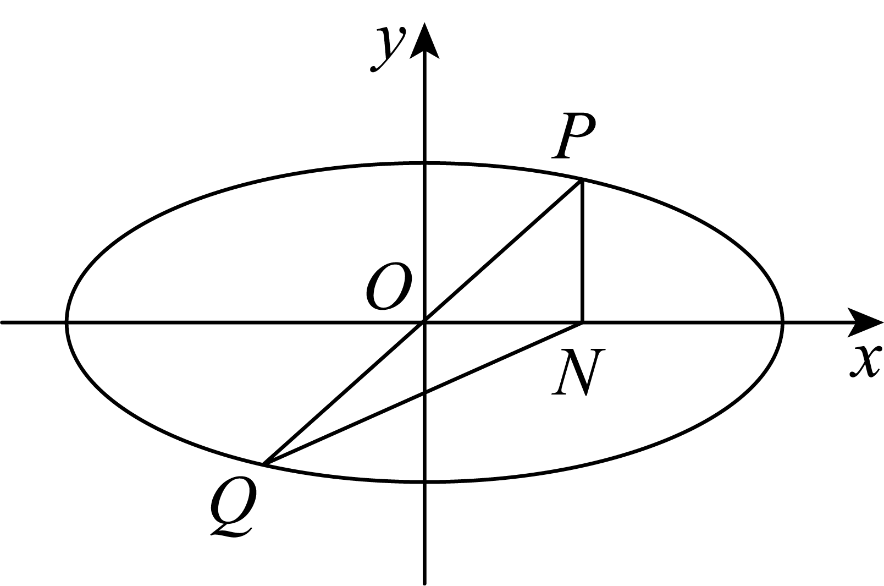

# Mathematics - 题目 2970

**ID**: 4b0a0ce6e3384f268b71152f97ac2b3a
**年级**: Grade 12
**难度**: Medium
**题型**: Calculation

## 题目
如图，在平面直角坐标系 $xOy$ 中，已知直线 $y=\frac {2\sqrt {5}}{5}x$ 与椭圆 $C:\frac {x^{2}}{a^{2}}+\frac {y^{2}}{b^{2}}=1(a>b>0)$ 交于 $P,Q$ 两点（ $P$ 在 $x$ 轴上方），且 $PQ=\frac {6}{5}a$ ，设点 $P$ 在 $x$ 轴上的射影为点 $N$ ， $\vartriangle PQN$ 的面积为 $\frac {2\sqrt {5}}{5}$ ，抛物线 $E:y^{2}=2px(p>0)$ 的焦点与椭圆 $C$ 的焦点重合，斜率为 $k$ 的直线 $l$ 过抛物线 $E$ 的焦点与椭圆 $C$ 交于 $A,B$ 两，点，与抛物线 $E$ 交于 $C,D$ 两点.​​​​​​​‌(1)求椭圆 $C$ 及抛物线 $E$ 的标准方程；(2)是否存在常数 $λ$ ，使 $\frac {\sqrt {5}}{|AB|}+\frac {λ}{|CD|}$ 为常数？若存在，求 $λ$ 的值；若不存在，说明理由.

## 解答

1. （1）由题意可设 $P\left ({x_{0},\frac {2\sqrt {5}}{5}x_{0}}\right )\left ({x_{0}>0}\right )$ ，可得 $S_{△PQN}=2S_{△PON}$ ，
2. 所以 $S_{△PON}=\frac {1}{2}\cdot x_{0}\cdot \frac {2\sqrt {5}}{5}x_{0}=\frac {\sqrt {5}}{5}$ ，所以 $x_{0}=1$ ， $P\left ({1,\frac {2\sqrt {5}}{5}}\right )$ ，
3. 所以 $OP=\sqrt {1^{2}+\left ({\frac {2\sqrt {5}}{5}}\right )^{2}}=\frac {3\sqrt {5}}{5}=\frac {1}{2}PQ=\frac {3}{5}a$ ，所以 $a=\sqrt {5}$ ，
4. 点P坐标代入椭圆方程得 $b=1$ ，所以椭圆C方程为 $\frac {x^{2}}{5}+y^{2}=1$ ，
5. 所以 $c=2$ ，即 $p=4$ ，所以抛物线E方程为 $y^{2}=8x$ .
6. （2）设 $A\left ({x_{1},y_{1}}\right ),B\left ({x_{2},y_{2}}\right ),C\left ({x_{3},y_{3}}\right ),D\left ({x_{4},y_{4}}\right )$ .
7. 直线l的方程为 $y=k(x-2)$ ，与椭圆C的方程联立 $\left\{\begin{array}{l}\begin{array}{}\frac {x^{2}}{5}+y^{2}=1\\y=k\left ({x-2}\right )\end{array}\end{array}\right.$ 得 $\left ({1+5k^{2}}\right )x^{2}-20k^{2}x+20k^{2}-5=0$ ，
8. 则 ${\rm{Δ}}=400k^{4}-20\left ({5k^{2}+1}\right )\left ({4k^{2}-1}\right )=20\left ({k^{2}+1}\right )>0$ 恒成立，所以 $x_{1}+x_{2}=\frac {20k^{2}}{1+5k^{2}},x_{1}x_{2}=\frac {20k^{2}-5}{1+5k^{2}}$
9. 则 $|AB|=\sqrt {1+k^{2}}\sqrt {\left ({x_{1}+x_{2}}\right )^{2}-4x_{1}x_{2}}=\frac {2\sqrt {5}\left ({k^{2}+1}\right )}{1+5k^{2}}$ .
10. 直线l的方程为 $y=k(x-2)$ ，与抛物线E的方程联立 $\left\{\begin{array}{l}\begin{array}{}y^{2}=8x,\\y=k(x-2),\end{array}\end{array}\right.$ 得 $k^{2}x^{2}-\left ({4k^{2}+8}\right )x+4k^{2}=0$ .
11. $x_{3}+x_{4}=\frac {4k^{2}+8}{k^{2}},|CD|=x_{3}+x_{4}+4=\frac {8\left ({k^{2}+1}\right )}{k^{2}}$ .
12. $\frac {\sqrt {5}}{|AB|}+\frac {λ}{|CD|}=\frac {1+5k^{2}}{2\left ({k^{2}+1}\right )}+\frac {λk^{2}}{8\left ({k^{2}+1}\right )}=\frac {(20+λ)k^{2}+4}{8\left ({k^{2}+1}\right )}$ .
13. 要使 $\frac {\sqrt {5}}{|AB|}+\frac {λ}{|CD|}$ 为常数，则 $20+λ=4$ ，得 $λ=-16$ .
14. 故存在 $λ=-16$ ，使 $\frac {\sqrt {5}}{|AB|}+\frac {λ}{|CD|}$ 为常数.

## 知识点

**中文**:
  - 存在性或者探究性问题
  - 由椭圆的几何性质求方程
  - 直线与椭圆的位置关系

**English**:
  - Existence and Inquiry Problems
  - Finding Equation from Properties
  - Line-Ellipse Relationship

---
