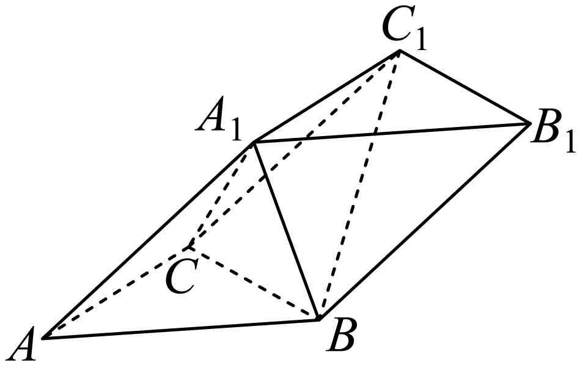

# Mathematics - 题目 923

**ID**: 4d11e62e8a274be2be90e523b8a50ea1
**年级**: Grade 12
**难度**: Medium
**题型**: Calculation

## 题目
如图，三棱柱 $ABC-A{{}_{1}}B{{}_{1}}C{{}_{1}}$ 中，侧面 $BB{{}_{1}}C{{}_{1}}C$ 为矩形， $A{{}_{1}}C\bot A{{}_{1}}B$ ， $\left |{A{{}_{1}}A}\right |=\left |{AB}\right |=2$ ，底面 ${\rm{A}}{\rm{B}}{\rm{C}}$ 为等边三角形.​​​​​​​‌(1)证明：平面 $A{{}_{1}}BC\bot $ 平面 $ABC$ ；(2)求平面 $ABC$ 与平面 $A{{}_{1}}BC{{}_{1}}$ 的夹角的余弦值.

## 解答

1. （1）取 $BC$ ， $B{{}_{1}}C{{}_{1}}$ 的中点为 $O$ ， $M$ ，连接 $OM$ ， $AO$ ， $A{{}_{1}}O$ ，
2. 由于侧面 $BB{{}_{1}}C{{}_{1}}C$ 为矩形，所以 $BB{{}_{1}}\bot BC$ ，∵ $OM//BB{{}_{1}}$ ，∴ $OM\bot BC$ ，
3. 由于底面 $ABC$ 为等边三角形，所以 $AO⊥BC$ ， $AO\cap OM=O$ ， $AO$ ， $MO\subset $ 平面 $AOM$ ，
4. 所以 $BC⊥$ 平面 $AOM$ ，
5. 由于 $AA{{}_{1}}//OM$ ， $\left |{AA}\right |{{}_{1}}=\left |{OM}\right |$ ，故四边形 $AOMA{{}_{1}}$ 为平行四边形，
6. 故 $A{{}_{1}}O\subset $ 平面 $AOM$ ，故 $BC\bot A{{}_{1}}O$ ，
7. 又 $O$ 是 $BC$ 中点，所以 $\left |{A{{}_{1}}B}\right |=\left |{A{{}_{1}}C}\right |$ ，
8. 由于 $\left |{AB}\right |=\left |{BC}\right |=\left |{AC}\right |=2$ ， $AO⊥BC$ ，所以 $\left |{AO}\right |=\sqrt {3}$ ， $\left |{CO}\right |=\left |{BO}\right |=1$ ，
9. 又 $A{{}_{1}}C\bot A{{}_{1}}B$ ，所以 $\left |{A{{}_{1}}C}\right |=\left |{A{{}_{1}}B}\right |=\sqrt {2}$ ， $\left |{A{{}_{1}}O}\right |=1$
10. 由于 $BC\bot A{{}_{1}}O$ ， $BC\bot AO$ ，故 $\angle A{{}_{1}}OA$ 为 $A{{}_{1}}-BC-A$ 的平面角，
11. 由于 $\left |{A{{}_{1}}O}\right |{^{2}}+\left |{AO}\right |{^{2}}=\left |{A{{}_{1}}A}\right |{^{2}}$ ，所以 $\angle A{{}_{1}}OA=\frac {{\rm{π}}}{2}$ ，
12. 故平面 $A{{}_{1}}BC\bot $ 平面 $ABC$ ；
13. 
14. （2）由于 $OA{{}_{1}}$ ， $OA$ ， $OB$ 两两垂直，故建立如图所示的空间直角坐标系，
15. $A{{}_{1}}\left ({0,0,1}\right )$ ， $A\left ({\sqrt {3},0,0}\right )$ ， $B\left ({0,1,0}\right )$ ， $C\left ({0,-1,0}\right )$ ，
16. 则 $\overrightarrow {{CA}}=\left ({\sqrt {3},1,0}\right )$ ， $\overrightarrow {{A{{}_{1}}B}}=\left ({0,1,-1}\right )$ ， $\overrightarrow {{C{{}_{1}}A{{}_{1}}}}=\overrightarrow {{CA}}=\left ({\sqrt {3},1,0}\right )$
17. 设平面 $A{{}_{1}}BC{{}_{1}}$ 的法向量为 $\overrightarrow m=\left ({x,y,z}\right )$ ，
18. 则 $\begin{cases}\overrightarrow {{C{{}_{1}}A{{}_{1}}}}\cdot \overrightarrow m=\sqrt {3}x+y=0\\\overrightarrow {{A{{}_{1}}B}}\cdot \overrightarrow m=y-z=0\end{cases}$ ，取 $x=\sqrt {3}$ ，则 $\overrightarrow m=\left ({\sqrt {3},-3,-3}\right )$ ，
19. 由于平面 $ABC$ 的法向量为 $\overrightarrow {{OA{{}_{1}}}}=\left ({0,0,1}\right )$ ，
20. 故 $\left |{{\rm{c}}{\rm{o}}{\rm{s}}\overrightarrow m,\overrightarrow {{OA{{}_{1}}}}}\right |=\frac {\left |{\overrightarrow m\cdot \overrightarrow {{OA{{}_{1}}}}}\right |}{\left |{\overrightarrow m}\right |\left |{\overrightarrow {{OA{{}_{1}}}}}\right |}=\frac {3}{\sqrt {21}}=\frac {\sqrt {21}}{7}$
21. 故平面 $ABC$ 与平面 $A{{}_{1}}BC{{}_{1}}$ 的夹角的余弦值为 $\frac {\sqrt {21}}{7}$ .

## 知识点

**中文**:
  - 二面角
  - 平面与平面垂直的判定

**English**:
  - Dihedral Angle
  - Plane-Plane Perpendicularity Determination

---
