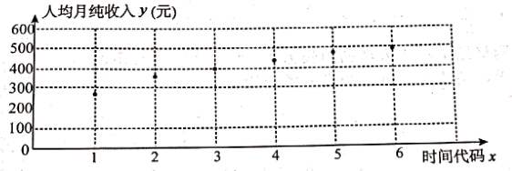

# Mathematics - 题目 3903

**ID**: 53e70ac18f3f4aee84b64a31d8833d47
**年级**: Grade 12
**难度**: Medium
**题型**: Calculation

## 题目
为贯彻落实党中央全面建设小康社会的战略部署，某贫困地区的广大党员干部深入农村积极开展“精准扶贫”工作．经过多年的精心帮扶，截至2018年底，按照农村家庭人均年纯收入8000元的小康标准，该地区仅剩部分家庭尚未实现小康，2019年6月，为估计该地能否在2020年全面实现小康，统计了该地当时最贫困的一个家庭2019年1至6月的人均月纯收入，作出散点如下：根据相关性分析，发现其家庭人均月纯收入 $y$ 与时间代码 $x$ 之间具有较强的线性相关关系（记2019年1月、2月……分别为 $x=1$ ， $x=2$ ，…，依此类推），由此估计该家庭2020年能实现小康生活．但2020年1月突如其来的新冠肺炎疫情影响了奔小康的进展，该家庭2020年第一季度每月的人均月纯收入只有2019年12月的预估值的 $\frac {2}{3}$ ．（1）求 $y$ 关于 $x$ 的线性回归方程；（2）求该家庭2020年3月份的人均月纯收入；（3）如果以该家庭3月份人均月纯收入为基数，以后每月增长率为 $8\%$ ，问该家庭2020年底能否实现小康生活？参考数据： $\sum \limits_{i=1}^{6}\mathop{x{{}_{i}}y{{}_{i}}=9310}$ ， $6{\overline{x}}{\overline{y}}=8610$ ， $1.​​​​​​​‌08{^{10}}\approx 2.16$参考公式： $\widehat {b}=\frac {\sum \limits_{i=1}^{n}\mathop{x{{}_{i}}y{{}_{i}}-n{\overline{x}}{\overline{y}}}}{\sum \limits_{i=1}^{n}\mathop{x{{}_{i}^{2}}-n{\overline{x}}{^{2}}}}$ ， $\widehat {a}={\overline{y}}-\widehat {b}{\overline{x}}$ ．

## 解答

1. （1）依题意得： ${\overline{x}}=\frac {1+2+3+4+5+6}{6}=3.5$ ， ${\overline{y}}=\frac {6{\overline{x}}\cdot {\overline{y}}}{6{\overline{x}}}=\frac {8610}{6\times 3.5}=410$ ，
2. $\sum \limits_{i=1}^{6}\mathop{x{{}_{i}^{2}}=91}$ ， $\sum \limits_{i=1}^{6}\mathop{x{{}_{i}}y{{}_{i}}=9310}$ ，
3. 所以 $\widehat {b}=\frac {\sum \limits_{i=1}^{6}\mathop{x{{}_{i}}y{{}_{i}}-6{\overline{x}}{\overline{y}}}}{\sum \limits_{i=1}^{6}\mathop{x{{}_{i}^{2}}-6{\overline{x}}{^{2}}}}=\frac {9310-8610}{91-6\times 3.5{^{2}}}=40$ ，
4. $\widehat {a}={\overline{y}}-\widehat {b}{\overline{x}}=410-40\times 3.5=270$ ，
5. 所以 $y$ 关于 $x$ 的线性回归方程为 $\widehat {y}=40x+270$ .
6. （2）令 $x=12$ ，得2019年12月该家庭人均月纯收入预估值为 $40\times 12+270=750$ 元
7. 故，2020年3月份该家庭的人均月纯收入为 $750\times \frac {2}{3}=500$ 元．
8. （3）每月的增长率为 $8\%$ ，设从3月开始到12月的纯收入之和为 $S{{}_{10}}$ ，
9. 则 $S{{}_{10}}=500+500\times \left ({1+0.08}\right )+...+500\times {\left({1+0.08}\right)^{9}}$ ，
10. $=\frac {500\times \left [1-{\left({1.08}\right)^{10}}\right ]}{1-1.08}=7250$ ，
11. $S{{}_{12}}=1000+S{{}_{10}}=8250>8000$ ，
12. 故到 $2020$ 年底能如期实现小康．

## 知识点

**中文**:
  - 回归直线与回归方程
  - 等比数列前n项和公式
  - 散点图
  - 最小二乘法

**English**:
  - Regression Line and Equation
  - Sum Formula
  - Scatter Plot
  - Least Squares Method

---
