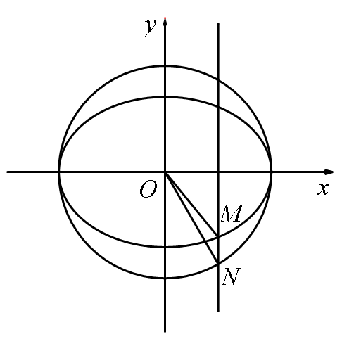

# Mathematics - 题目 884

**ID**: 58c85088f2274a1ba8ce183fd6b76bbf
**年级**: Grade 12
**难度**: Medium
**题型**: Calculation

## 题目
如图，定义：以椭圆中心为圆心，长轴为直径的圆叫做椭圆的“辅助圆”．过椭圆第四象限内一点 $M$ 作 $x$ 轴的垂线交其“辅助圆”于点 $N$ ，当点 $N$ 在点 $M$ 的下方时，称点 $N$ 为点 $M$ 的“下辅助点”．已知椭圆 $E:\frac {x{^{2}}}{a{^{2}}}+\frac {y{^{2}}}{b{^{2}}}=1(a>b>0)$ 上的点 $(1,-\frac {\sqrt {2}}{2})$ 的下辅助点为 $(1,-1)$ ．（1）求椭圆 $E$ 的方程；​​​​​​​‌（2）若 $\vartriangle OMN$ 的面积等于 $\frac {2\sqrt {3}-\sqrt {6}}{8}$ ，求下辅助点 $N$ 的坐标．

## 解答

1. （1） $\because $ 椭圆 $E:\frac {x{^{2}}}{a{^{2}}}+\frac {y{^{2}}}{b{^{2}}}=1(a>b>0)$ 上的点 $(1,-\frac {\sqrt {2}}{2})$ 的下辅助点为 $(1,-1)$ ，
2. $\therefore $ 辅助圆的半径为 $R=\sqrt {1{^{2}}+(-1){^{2}}}=\sqrt {2}$ ，椭圆长半轴为 $a=R=\sqrt {2}$ ，
3. 将点 $(1,-\frac {\sqrt {2}}{2})$ 代入椭圆方程 $\frac {x{^{2}}}{2}+\frac {y{^{2}}}{b{^{2}}}=1$ 中，解得 $b=1$ ，
4. $\therefore $ 椭圆 $E$ 的方程为 $\frac {x{^{2}}}{2}+y{^{2}}=1$ ；
5. （2）设点 $N(x{{}_{0}}$ ， $y{{}_{0}})(y{{}_{0}}<1)$ ，则点 $M(x{{}_{0}}$ ， $y{{}_{1}})(y{{}_{1}}<0)$ ，
6. 将两点坐标分别代入辅助圆方程和椭圆方程可得，
7. $x{{}_{0}^{2}}+y{{}_{0}^{2}}=2$ ， $\frac {x{{}_{0}}{^{2}}}{2}+y{{}_{1}}{^{2}}=1$ ，故 $y{{}_{0}^{2}}=2y{{}_{1}^{2}}$ ，即 $y{{}_{0}}=\sqrt {2}y{{}_{1}}$ ，
8. 又 $S{{}_{\vartriangle OMN}}=\frac {1}{2}x{{}_{0}}\left ({y{{}_{1}}-y{{}_{0}}}\right )=\frac {2\sqrt {3}-\sqrt {6}}{8}$ ，则 $x{{}_{0}}y{{}_{1}}=-\frac {\sqrt {6}}{4}$ ，
9. 将 $x{{}_{0}}y{{}_{1}}=-\frac {\sqrt {6}}{4}$ 与 $\frac {x{{}_{0}}{^{2}}}{2}+y{{}_{1}}{^{2}}=1$ ， $y{{}_{0}}=\sqrt {2}y{{}_{1}}$ 联立可解得 $\left \{\hspace{-0.5em}\begin{array}{l}x{{}_{0}}=\frac {\sqrt {2}}{2}\\y{{}_{0}}=-\frac {\sqrt {6}}{2}\end{array}\hspace{-0.5em}\right.$ 或 $\left \{\hspace{-0.5em}\begin{array}{l}x{{}_{0}}=\frac {\sqrt {6}}{2}\\y{{}_{0}}=-\frac {\sqrt {2}}{2}\end{array}\hspace{-0.5em}\right.$ ，
10. $\therefore $ 下辅助点 $N$ 的坐标为 $(\frac {\sqrt {2}}{2}$ ， $-\frac {\sqrt {6}}{2})$ 或 $(\frac {\sqrt {6}}{2}$ ， $-\frac {\sqrt {2}}{2})$ ；
11. 【点睛】本题考查椭圆的简单性质，圆与椭圆的位置关系的应用，考查转化思想以及计算能力，是中档题．

## 知识点

**中文**:
  - 弦长面积问题
  - 椭圆的标准方程及应用

**English**:
  - Chord Length and Area Problems
  - Standard Equation and Applications

---
