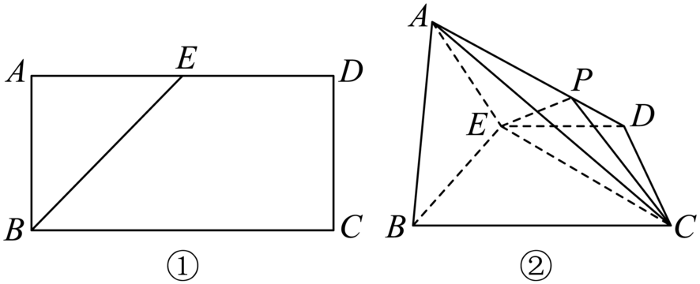

# Mathematics - 题目 1354

**ID**: 5a7960b61cf446b891cf5c7f6dd11293
**年级**: Grade 12
**难度**: Medium
**题型**: Calculation

## 题目
如图①，在矩形中，，为的中点，如图②，沿将折起，点在线段上.​​​​​​​‌(1)若，求证：平面；(2)若平面平面，是否存在点，使得平面与平面的夹角为90°？若存在，求此时三棱锥的体积；若不存在，说明理由.

## 解答

1. （1）连接与交于点，连接,如图所示
2. 
3. 由题意可得,
4. 所以.
5. 又因为,
6. 所以,
7. 所以.
8. 因为平面平面,
9. 所以平面.
10. （2）由（1）知，当时，.
11. 因为,
12. 所以.
13. 取的中点为,连接,如图所示
14. 
15. 由已知得，在矩形中，为的中点，，是的中点，
16. 所以,
17. 因为平面平面，平面平面,平面,
18. 所以平面.
19. 由已知得，在矩形中,是的中点，
20. 所以，
21. 所以.
22. 由已知得，在矩形中，为的中点，.
23. 所以,
24. 所以,
25. 所以,即.
26. 因为平面平面，平面平面,平面,
27. 所以平面.
28. 因为平面,
29. 所以.
30. 又因为,平面,平面,
31. 所以平面.
32. 因为平面,
33. 所以平面平面，即当时，平面与平面的夹角为90°.
34. 此时，.

## 知识点

**中文**:
  - 平面与平面垂直的判定
  - 直线与平面平行的判定
  - 翻折问题

**English**:
  - Plane-Plane Perpendicularity Determination
  - Line-Plane Parallelism Determination
  - Folding Problems

---
