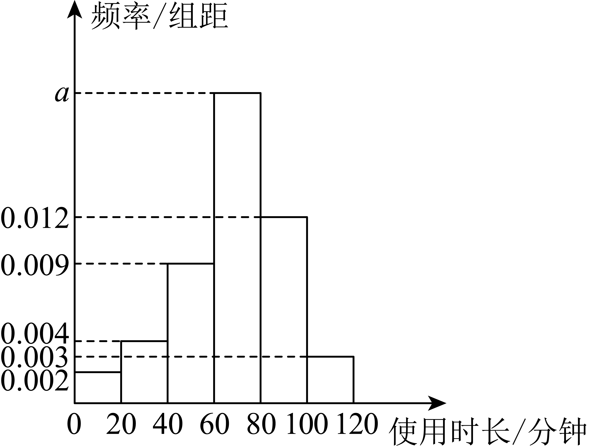

# Mathematics - 题目 3417

**ID**: 5b2a49b937654b559bfb02ce2840c207
**年级**: Grade 12
**难度**: Medium
**题型**: Calculation

## 题目
2025年1月下旬，DeepSeek的R1模型发布，该模型在全球范围内引发广泛关注．现为了对其产品用户的使用行为进行统计分析，收集了1000名用户的每日使用时长（单位：分钟），得到如下所示的频率分布直方图，每日使用时长不小于60分钟的用户称为“忠实粉丝”．(1)估计该产品用户每日的平均使用时长 $\bar x$ （同一组的数据用该组区间的中点值代替）；​​​​​​​‌(2)现采用分层抽样的方法从样本中使用时长在 $\left [{40,60}\right ),\left [{80,100}\right )$ 的用户中随机抽取7人，并从中随机抽取2人作进一步分析，记 $X$ 为2人中忠实粉丝的人数，求 $X$ 的分布列和期望．(3)用样本的频率估计概率，从该产品所有用户中抽取5人， $ξ$ 为忠实粉丝的人数，记 $ξ=k$ 时对应的概率为 $P{{}_{k}}$ ，则 $k$ 为多少时 $P{{}_{k}}$ 最大？

## 解答

1. （1）由 $0.002\times 20+0.004\times 20+0.009\times 20+a\cdot 20{{+}}0{{.}}012\times 20+0.003\times 20=1$ ，解得 $a=0.02$ ．
2. $\bar x=0.002\times 20\times 10+0.004\times 20\times 30+0.009\times 20\times 50+0.02\times 20\times 70+0.012\times 20\times 90+0.003\times 20\times 110$  $=68$
3. （2）由频率分布直方图可知， $\left [{40,60}\right )$ 与 $\left [{80,100}\right )$ 的用户数之比为3：4，
4. 所以用分层抽样抽取的7人中，有4人是忠实粉丝，从7人中任取2人， $X$ 取0，1，2，
5. $P\left ({X=0}\right )=\frac {{\rm{C}}{{}_{3}^{2}}}{{\rm{C}}{{}_{7}^{2}}}=\frac {1}{7}$ ， $P\left ({X=1}\right )=\frac {{\rm{C}}{{}_{3}^{1}}{\rm{C}}{{}_{4}^{1}}}{{\rm{C}}{{}_{7}^{2}}}=\frac {4}{7}$ ， $P\left ({X=2}\right )=\frac {{\rm{C}}{{}_{4}^{2}}}{{\rm{C}}{{}_{7}^{2}}}=\frac {2}{7}$
6. 所以 $X$ 的分布列为
7. $X$
8. 0
9. 1
10. 2
11. $P$
12. $\frac {1}{7}$
13. $\frac {4}{7}$
14. $\frac {2}{7}$
15. 所以 $EX=\frac {8}{7}$
16. （3）用样本的频率估计概率，从该公司所有用户中任取1人，他为忠实粉丝的概率为 $0.02\times 20+0.012\times 20+0.003\times 20=0.7$
17. 所以 $ξ\sim B\left ({5,0.7}\right )$
18. $P\left ({ξ=k}\right )={\rm{C}}{{}_{5}^{k}}0.7{^{k}}{\left({1-0.7}\right)^{5-k}}$
19. $\begin{cases}P\left ({ξ=k}\right )\geqslant P\left ({ξ=k+1}\right )\\P\left ({ξ=k}\right )\geqslant P\left ({ξ=k-1}\right )\end{cases}$ ，解得： $3.2\leqslant k\leqslant 4.2$ ，又 $k\in {\rm{Z}}$ ，故 $k=4$ 时概率最大.

## 知识点

**中文**:
  - 离散型随机变量的分布列
  - 频率分布直方图

**English**:
  - Probability Distribution Table
  - Frequency Distribution Histogram

---
