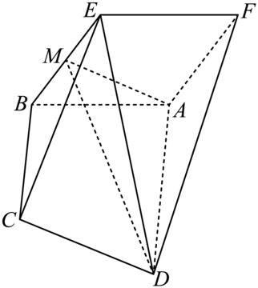

# Mathematics - 题目 1692

**ID**: 5e6f5560dab54c398ec8bd764a2bc298
**年级**: Grade 12
**难度**: Medium
**题型**: Calculation

## 题目
如图所示，在多面体 $ABCDEF$ 中，底面 $ABCD$ 为直角梯形， $AD//BC$ ， $AB⊥BC$ ，侧面 $ABEF$ 为菱形，平面 $ABEF\bot $ 平面 $ABCD$ ，M为棱BE的中点.​​​​​​​‌(1)若 $DE$ 上有一点N满足 $MN//$ 平面 $ABCD$ ，确定点N的位置并证明；(2)若 $AB=BC=\frac {1}{2}AD$ ， $\angle EBA=60{}^\circ $ ，求平面 $MAD$ 与平面 $EFD$ 所成二面角的正弦值.

## 解答

1. （1）点N为DE中点，证明如下：
2. 如图，连接BD，MN，
3. 因为M，N分别为BE，DE的中点，
4. 所以MN为 $\mathrm{△}EBD$ 的中位线，所以 $MN/\mskip-4mu/BD$ ，
5. 又 $MN⊄$ 平面 $ABCD$ ， $BD⊂$ 平面 $ABCD$ ，所以 $MN{\rm{/}}{\rm{/}}$ 平面 $ABCD$ .
6. 所以N为DE的中点时满足条件.
7. （2）
8. 取AB的中点O，连接OE，因为侧面 $ABEF$ 为菱形，且 $\angle EBA=60{}^\circ $ ，
9. 所以在 $\vartriangle EBO$ 中， $EO{{}^{2}}=BO{{}^{2}}+EB{{}^{2}}-2BO\cdot EB{\rm{c}}{\rm{o}}{\rm{s}}60{}^\circ $ ，解得 $EO=\sqrt {3}BO$ ，
10. 所以 $OE{{}^{2}}+OB{{}^{2}}=BE{{}^{2}}$ ，即 $OE\bot AB$ .
11. 又因为平面 $ABEF\bot $ 平面 $ABCD$ ，平面 $ABEF\cap $ 平面 $ABCD=AB$ ， $OE\subset $ 平面 $ABEF$ ，
12. 所以 $OE\bot $ 平面 $ABCD$ .
13. 取 $CD$ 中点为 $H$ ，连结 $OH$ ，则 $OH$ 是梯形 $ABCD$ 的中位线，所以 $OH{\rm{/}}{\rm{/}}BC$ .
14. 因为 $AB⊥BC$ ，所以 $AB⊥OH$ .
15. 分别以OH，OA，OE所在直线为x，y，z轴建立如图所示的空间直角坐标系 $O-xyz$ ，
16. 设 $AD=4$ ，则 $AB=BC=\frac {1}{2}AD=2$ ， $OE=BE{\sin}60{{}^{\circ }}=\sqrt {3}$ ，
17. 故 $E\left ({0,0,\sqrt {3}}\right )$ ， $A\left ({0,1,0}\right )$ ， $D\left ({4,1,0}\right )$ ， $F\left ({0,2,\sqrt {3}}\right )$ ， $B\left ({0,-1,0}\right )$ ，
18. 则 $M\left ({0,-\frac {1}{2},\frac {\sqrt {3}}{2}}\right )$ ， $\overrightarrow {MA}=\left ({0,\frac {3}{2},-\frac {\sqrt {3}}{2}}\right )$ ， $\overrightarrow {MD}=\left ({4,\frac {3}{2},-\frac {\sqrt {3}}{2}}\right )$ ， $\overrightarrow {EF}=\left ({0,2,0}\right )$ ， $\overrightarrow {ED}=\left ({4,1,-\sqrt {3}}\right )$ .
19. 设平面 $MAD$ 的一个法向量为 $\overrightarrow {m}=\left ({x{{}_{1}},y{{}_{1}},z{{}_{1}}}\right )$ .
20. 则有 $\left \{\begin{array}{l}\overrightarrow m\cdot \overrightarrow {MA}=0\\\overrightarrow m\cdot \overrightarrow {MD}=0\end{array}\right.$ ，即 $\left \{\begin{array}{l}\frac {3}{2}y{{}_{1}}-\frac {\sqrt {3}}{2}z{{}_{1}}=0\\4x{{}_{1}}+\frac {3}{2}y{{}_{1}}-\frac {\sqrt {3}}{2}z{{}_{1}}=0\end{array}\right.$ ，化简得 $\left \{\begin{array}{l}x{{}_{1}}=0\\z{{}_{1}}=\sqrt {3}y{{}_{1}}\end{array}\right.$ ，
21. 令 $y{{}_{1}}=1$ ，则 $\overrightarrow {m}=\left ({0,1,\sqrt {3}}\right )$ 是平面 $MAD$ 的一个法向量.
22. 设平面 $EFD$ 的一个法向量为 $\overrightarrow {n}=\left ({x{{}_{2}},y{{}_{2}},z{{}_{2}}}\right )$ ，
23. 则 $\left \{\begin{array}{l}\overrightarrow n\cdot \overrightarrow {EF}=0\\\overrightarrow n\cdot \overrightarrow {ED}=0\end{array}\right.$ ，即 $\left \{\begin{array}{l}2y{{}_{2}}=0\\4x{{}_{2}}+y{{}_{2}}-\sqrt {3}z{{}_{2}}=0\end{array}\right.$ ，化简得 $\left \{\begin{array}{l}y{{}_{2}}=0\\4x{{}_{2}}=\sqrt {3}z{{}_{2}}\end{array}\right.$ ，
24. 令 $z{{}_{2}}=4\sqrt {3}$ ，则 $x{{}_{2}}=3$ ，则 $\overrightarrow {n}=\left ({3,0,4\sqrt {3}}\right )$  是平面 $EFD$ 的一个法向量.
25. 则 ${\rm{c}}{\rm{o}}{\rm{s}}\left \langle {\overrightarrow m,\overrightarrow n}\right \rangle =\frac {\overrightarrow m\cdot \overrightarrow n}{\left |{\overrightarrow m}\right |\left |{\overrightarrow n}\right |}=\frac {4\sqrt {3}\times \sqrt {3}}{\sqrt {0{{}^{2}}+1{{}^{2}}+\left ({\sqrt {3}}\right ){{}^{2}}+}\times \sqrt {3{{}^{2}}+0{{}^{2}}+\left ({4\sqrt {3}}\right ){{}^{2}}}}=\frac {2\sqrt {57}}{19}$ ，
26. 故：平面 $MAD$ 与平面 $EFD$ 所成二面角的正弦值为 $\sqrt {1-\left ({\frac {2\sqrt {57}}{19}}\right ){{}^{2}}}=\frac {\sqrt {133}}{19}$ .

## 知识点

**中文**:
  - 向量法求二面角
  - 直线与平面平行的判定

**English**:
  - Dihedral Angle
  - Line-Plane Parallelism Determination

---
