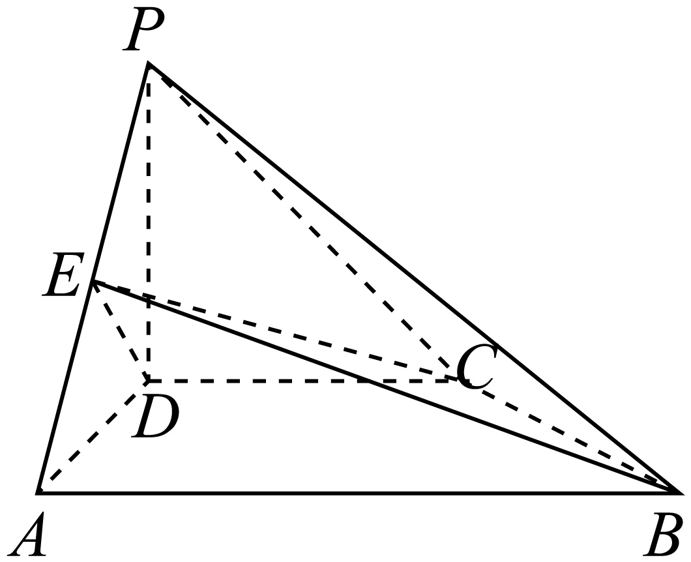

# Mathematics - 题目 1989

**ID**: 63c659365119416484c8b49800a9a6f1
**年级**: Grade 12
**难度**: Medium
**题型**: Calculation

## 题目
如图，在四棱锥 $P-ABCD$ 中， $PD\bot $ 平面 $ABCD,AB//DC$ ， $AB\bot AD,AB=2PD=2CD=2AD=4,E$ 是 $PA$ 的中点.​​​​​​​‌(1)求证： $DE⊥$ 平面 $PAB$ ；(2)求三棱锥 $P-BCE$ 的体积.

## 解答

1. （1）因为 $PD=AD$ ， $E$ 是 $PA$ 的中点，所以 $DE\bot PA$ ，
2. 又 $PD\bot $ 平面 $ABCD$ ， $AB⊂$ 平面 $ABCD$ ，
3. $\therefore PD\bot AB$ ，又 $AB\bot AD$ ， $AD,PD\subset $ 平面 $PAD$ ，
4. $∴AB⊥$ 平面 $PAD$ ， $DE⊂$ 平面 $PAD$ ，
5. $\mathbf{∴}DE\mathrm{⊥}AB$ ， $PA,AB\subset $ 平面 $PAB$ ，
6. $\therefore DE\bot $ 平面 $PAB$ .
7. （2）根据题意，得 $V{{}_{P-BCE}}=V{{}_{C-PBE}}$ ，
8. 又 $CD//AB$ ， $CD\not\subset $ 平面 $PAB$ ， $AB⊂$ 平面 $PAB$ ，
9. 所以 $CD//$ 平面 $PAB$ ，
10. 所以点 $C$ 到平面 $PAB$ 的距离等于点 $D$ 到平面 $PAB$ 的距离，
11. 又 $S{{}_{\vartriangle PBE}}=\frac {1}{2}PE\cdot AB=\frac {1}{2}\times \sqrt {2}\times 4=2\sqrt {2}$ ，又 $DE⊥$ 平面 $PAB$ ， $DE=\sqrt {2}$ ，
12. $\therefore V{{}_{P-BCE}}=V{{}_{C-PBE}}=V{{}_{D-PBE}}=\frac {1}{3}\times 2\sqrt {2}\times \sqrt {2}=\frac {4}{3}$ .

## 知识点

**中文**:
  - 平面与平面垂直的判定
  - 棱柱、棱锥、棱台的体积

**English**:
  - Plane-Plane Perpendicularity Determination
  - Volume of Polyhedra

---
