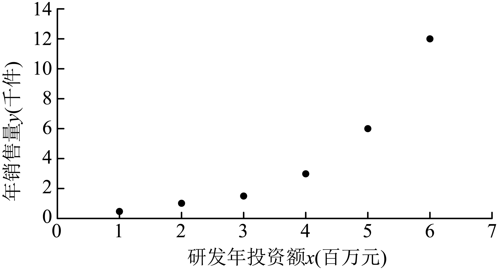

# Mathematics - 题目 2317

**ID**: 658e5130c07c4b98b50bf6c8242faed9
**年级**: Grade 12
**难度**: Medium
**题型**: Calculation

## 题目
某高科技公司对其产品研发年投资额x（单位：百万元）与其年销售量y（单位：千件）的数据进行统计，整理后得到如下统计表和散点图.​​​​​​​‌x123456y0.511.53612$z={\rm{l}}{\rm{n}}y$-0.700.41.11.82.5(1)该公司科研团队通过分析散点图的特征后，计划分别用① $y=bx+a$ 和② $y={\rm{e}}{{}^{dx+c}}$ 两种方案作为年销售量y关于年投资额x的回归分析模型，请根据统计表的数据，确定方案①和②的经验回归方程；（注：系数b，a，d，c按四舍五入保留一位小数）(2)根据下表中数据，用相关指数 $R{{}^{2}}$ （不必计算，只比较大小）比较两种模型的拟合效果哪个更好，并选择拟合精度更高、更可靠的模型，预测当研发年投资额为8百万元时，产品的年销售量是多少？经验回归方程残差平方和$y=bx+a$$y=e{{}^{dx+c}}$$\sum \limits_{i=1}^{5}\mathop{\left ({y{{}_{i}}-\widehat {y}{{}_{i}}}\right )}{{}^{2}}$18.290.65参考公式及数据： $\hat b=\frac {\sum \limits_{i=1}^{n}\mathop{\left ({x{{}_{i}}-\bar x}\right )}\left ({y{{}_{i}}-\bar y}\right )}{\sum \limits_{i=1}^{n}\mathop{\left ({x{{}_{i}}-\bar x}\right ){{}^{2}}}}=\frac {\sum \limits_{i=1}^{n}\mathop{x{{}_{i}}}y{{}_{i}}-n\bar x\bar y}{\sum \limits_{i=1}^{n}\mathop{x{{}_{i}^{2}}}-n\bar x{{}^{2}}}$ ， $\hat a=\bar y-\hat b\bar x$ ，$R{{}^{2}}=1-\frac {\sum \limits_{i=1}^{n}\mathop{\left ({y{{}_{i}}-\hat y{{}_{i}}}\right ){{}^{2}}}}{\sum \limits_{i=1}^{n}\mathop{\left ({y{{}_{i}}-\bar y}\right ){{}^{2}}}}=1-\frac {\sum \limits_{i=1}^{n}\mathop{\left ({y{{}_{i}}-\hat y{{}_{i}}}\right ){{}^{2}}}}{\sum \limits_{i=1}^{n}\mathop{y{{}_{i}^{2}}}-n\bar y{{}^{2}}}$ ，$\sum \limits_{i=1}^{6}\mathop{x{{}_{i}}z{{}_{i}}}=-1\times 0.7+2\times 0+3\times 0.4+4\times 1.1+5\times 1.8+6\times 2.5=28.9$ ， ${\rm{e}}{{}^{3.4}}=30$ .

## 解答

1. （1）由题可得 $\bar x=\frac {1}{6}\left ({1+2+3+4+5+6}\right )=3.5$ ， $\bar y=\frac {1}{6}\left ({0.5+1+1.5+3+6+12}\right )=4$ ，
2. $\sum \limits_{i=1}^{6}\mathop{x{{}_{i}}y{{}_{i}}}=1\times 0.5+2\times 1+3\times 1.5+4\times 3+5\times 6+6\times 12=121$ ， $\sum \limits_{i=1}^{6}\mathop{x{{}_{i}^{2}}}=1+4+9+16+25+36=91$  ，
3. 所以 $b=\frac {\sum \limits_{i=1}^{6}\mathop{x{{}_{i}}}y{{}_{i}}-6\bar x\bar y}{\sum \limits_{i=1}^{6}\mathop{x{{}_{i}^{2}}}-6\bar x{{}^{2}}}=\frac {121-5\times 4\times 3.5}{91-6\times 3.5{{}^{2}}}\approx 2.11$ ，  $a=\bar y-b\bar x=4-2.11\times 3.5\approx -3.4$ ，
4. 方案①回归方程 $y=2.1x-3.4$ ，
5. 对 $y={\rm{e}}{{}^{dx+c}}$ 两边取对数得： ${\rm{l}}{\rm{n}}y=dx+c$ ，令 $z={\rm{l}}{\rm{n}}y$ ， $z=dx+c$ 是一元线性回归方程.
6. $\bar z=\frac {1}{6}\left ({-0.7+0+0.4+1.1+1.8+2.5}\right )=0.85$  ，
7. $d=\frac {\sum \limits_{i=1}^{6}\mathop{x{{}_{i}}}y{{}_{i}}-6\bar x\bar y}{\sum \limits_{i=1}^{6}\mathop{x{{}_{i}^{2}}}-6\bar x{{}^{2}}}=\frac {28.9-6\times 3.5\times 0.85}{91-6\times 3.5{{}^{2}}}\approx 0.63$ ，
8. $c=\bar z-d\bar x=0.85-0.63\times 3.5\approx -1.4$ ，
9. 方案②回归方程 $y={\rm{e}}{{}^{0.6x-1.4}}$  ；
10. （2）方案①相关指数 $R{{}_{1}^{2}}=1-\frac {18.29}{\sum \limits_{i=1}^{n}\mathop{y{{}_{i}^{2}}-n{\overline{y}}{{}^{2}}}}$ ；
11. 方案②相关指数 $R{{}_{2}^{2}}=1-\frac {0.65}{\sum \limits_{i=1}^{n}\mathop{y{{}_{i}^{2}}-n{\overline{y}}{{}^{2}}}}$ ，
12. $R{{}_{1}^{2}}<R{{}_{2}^{2}}$ （有此结论即给分），
13. 故模型②的拟合效果更好，精度更高.
14. 当研发年投资额为8百万元时，产品的年销售量 $y={\rm{e}}{{}^{4.8-1.4}}={\rm{e}}{{}^{3.4}}=30$ （千件）.

## 知识点

**中文**:
  - 回归直线与回归方程
  - 最小二乘法
  - 相关系数r

**English**:
  - Regression Line and Equation
  - Least Squares Method
  - Correlation Coefficient r

---
