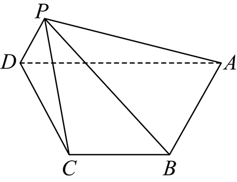

# Mathematics - 题目 1467

**ID**: 6fc15788e1584983972b32c5825bb38a
**年级**: Grade 12
**难度**: Medium
**题型**: Calculation

## 题目
如图，在四棱锥  $P-ABCD$  中，底面  $ABCD$  为梯形，且  $BC=\frac {1}{2}AD=1，BC//AD$  ， 等边三角形  $PCD$  所在的平面垂直于底面  $ABCD，BC\bot PD$  ．（1）求证：  $BC\bot $ 面 $PCD$  ．（2）若四棱锥 $P-ABCD$ 的体积为 $\sqrt {3}$ ，求二面角 $P-AB-D$ 的余弦值．​​​​​​​‌

## 解答

1. （1）如图所示：取CD中点H，连接PH，
2. $\because \vartriangle PCD$ 是等边三角形， $\therefore PH\bot CD$ ，
3. $\because $ 平面 $ABCD⊥$ 平面 $PCD$ ，平面 $ABCD\cap $ 平面 $PCD=CD$ ，
4. $PH\subset $ 平面 $PCD$ ， $PH\bot CD$ ， $\therefore PH\bot $ 平面 $ABCD$ ，
5. $\because BC\subset $ 平面 $ABCD$ ， $\therefore PH\bot BC$ ，
6. 又 $\because BC\bot PD,PH\cap PD=P,PH,PD\subset $ 平面 $PCD$ ， $\therefore BC\bot $ 平面 $PCD{\rm \mathit{.}}$
7. （2）由（1）结合 $CD\subset $ 平面 $PCD$ 可得 $CD\bot BC$ ，故四边形 $ABCD$ 为直角梯形.
8. 设等边三角形 $PDC$ 的边长为 $a$ ，则 $PH=\frac {\sqrt {3}}{2}a$ ，即四棱锥 $P-ABCD$ 的高为 $\frac {\sqrt {3}}{2}a$ ，
9. 故 $V{{}_{P-ABCD}}=\frac {1}{3}\times \frac {\sqrt {3}}{2}a\times \frac {1+2}{2}\times a=\sqrt {3}$ ，故 $a=2$ ，故 $PH=\sqrt {3}$ .
10. 如图，连接BH，AH，在平面 $ABCD$ 内过点H作 $HE\bot AB$ ， 垂足为 $E$ ，
11. $\because PH\bot $ 平面 $ABCD$ ，而 $AB\subset $ 平面 $ABCD$ ，
12. $\therefore PH\bot AB$ ，且 $HE\bot AB,HE\cap PH=H,HE,PH\subset $ 平面 $PHE$ ，
13. $∴AB⊥$ 平面 $PHE$ ， $PE\subset $ 平面 $PHE$ ， $\therefore AB\bot PE$ ，
14. $\therefore \angle PEH$ 为二面角 $P-AB-D$ 的平面角.
15. 在直角梯形 $ABCD$ 中， $AB=\sqrt {4+1}=\sqrt {5}$ ，
16. $S{{}_{\vartriangle AHB}}=\frac {1}{2}\times 2\times \left ({1+2}\right )-\frac {1}{2}\times 1\times \left ({1+2}\right )=\frac {3}{2}$ ，故 $\frac {1}{2}\times \sqrt {5}\times EH=\frac {3}{2}$ ，
17. 故 $EH=\frac {3}{\sqrt {5}}=\frac {3\sqrt {5}}{5}$ ，故 $PE=\sqrt {\frac {9}{5}+3}=\frac {2\sqrt {30}}{5}$ ，故 ${\cos}\angle PEH=\frac {\frac {3\sqrt {5}}{5}}{\frac {2\sqrt {30}}{5}}=\frac {\sqrt {6}}{4}$ .

## 知识点

**中文**:
  - 二面角
  - 直线与平面垂直的判定

**English**:
  - Dihedral Angle
  - Line-Plane Perpendicularity Determination

---
