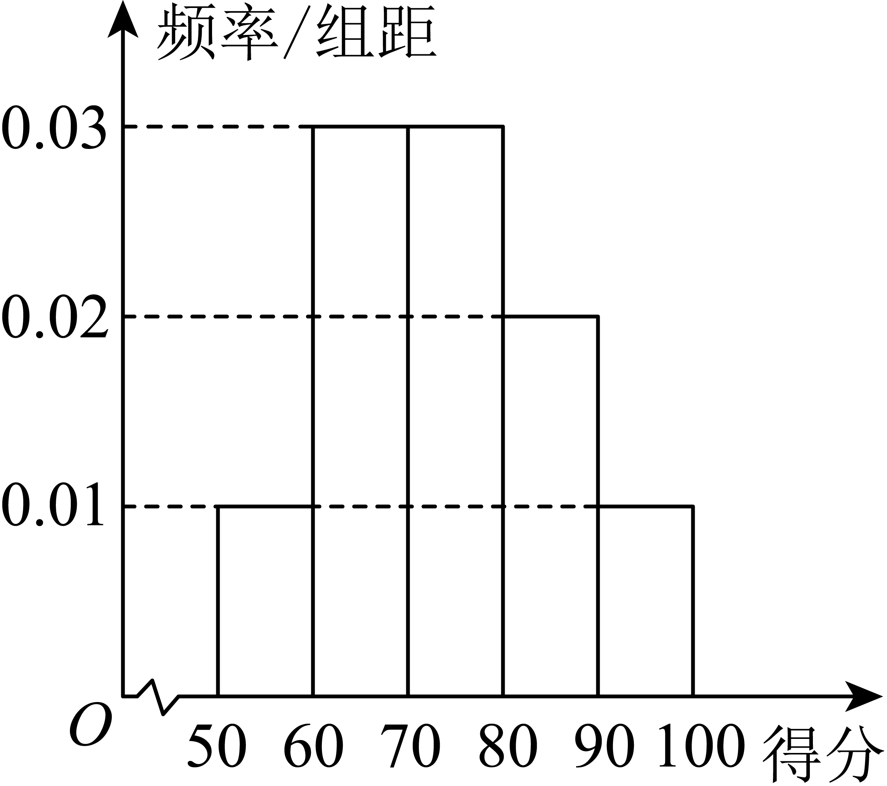

# Mathematics - 题目 3345

**ID**: 7485e83478e54d73bccd9ed7f961798e
**年级**: Grade 12
**难度**: Medium
**题型**: Calculation

## 题目
某小区开展了两会知识问答活动，现将该小区参与该活动的 $240$ 位居民的得分（满分 $100$ 分）进行了统计，得到如下的频率分布直方图.​​​​​​​‌(1)若此次知识问答的得分 $X$ 服从 $\mathbf{N}\left ({μ,8{^{2}}}\right )$ ，其中 $μ$ 近似为参与本次活动的 $240$ 位居民的平均得分（同一组中的数据用该组区间的中点值代表），求 $P\left ({66<X\leqslant 90}\right )$ 的值；参考数据： $P\left ({μ-σ<X\leqslant μ+σ}\right )\approx 0.6827$ ， $P\left ({μ-2σ<X\leqslant μ+2σ}\right )\approx 0.9545$ ， $P\left ({μ-3σ<X\leqslant μ+3σ}\right )\approx 0.9973$ .(2)本次活动，制定了如下奖励方案：以上面频率分布直方图中的频率作为概率，参与本次活动得分低于 $80$ 分的居民获得一次抽奖机会，参与本次活动得分不低于 $80$ 分的居民获得两次抽奖机会，每位居民每次有 $\frac {2}{3}$ 的机会抽中一张 $10$ 元的话费充值卡，有 $\frac {1}{3}$ 的机会抽中一张 $20$ 元的话费充值卡，假设每次抽奖相互独立，假设该小区居民王先生参与本次活动，求王先生获得的话费充值卡的总金额 $Y$ 的概率分布列，并估计本次活动需要准备的话费充值卡的总金额.

## 解答

1. （1）依题意， $μ=55\times 0.1+65\times 0.3+75\times 0.3+85\times 0.2+95\times 0.1=74$ ，
2. 所以 $X\sim N\left ({74,8{^{2}}}\right )$ ，则 $σ=8$ ，所以 $66=μ-σ$ ， $90=μ+2σ$ ，
3. 故 $P\left ({66<X\leqslant 90}\right )=P\left ({μ-σ<X\leqslant μ+2σ}\right )$
4. $=\frac {P\left ({μ-σ<X\leqslant μ+σ}\right )+P\left ({μ-2σ<X\leqslant μ+2σ}\right )}{2}=\frac {0.6827+0.9545}{2}=\frac {1.6372}{2}$
5. $=\frac {0.6827+0.9545}{2}=\frac {1.6372}{2}$  $=0.8186$ .
6. （2）参与活动的每位居民得分低于 $80$ 分的概率为 $\frac {7}{10}$ ，得分不低于 $80$ 分的概率为 $\frac {3}{10}$
7. $Y$ 的所有可能取值分别为 $10$ 、 $20$ 、 $30$ 、 $40$ ，
8. $P\left ({Y=10}\right )=\frac {7}{10}\times \frac {2}{3}=\frac {7}{15}$ ， $P\left ({Y=20}\right )=\frac {7}{10}\times \frac {1}{3}+\frac {3}{10}\times {\left({\frac {2}{3}}\right)^{2}}=\frac {11}{30}$ ，
9. $P\left ({Y=30}\right )=\frac {3}{10}\times {\rm{C}}{{}_{2}^{1}}\times \frac {1}{3}\times \frac {2}{3}=\frac {2}{15}$ ， $P\left ({Y=40}\right )=\frac {3}{10}\times \frac {1}{3}\times \frac {1}{3}=\frac {1}{30}$ ，
10. 所以 $Y$ 的概率分布列如表所示：
11. $Y$
12. $10$
13. $20$
14. $30$
15. $40$
16. $P$
17. $\frac {7}{15}$
18. $\frac {11}{30}$
19. $\frac {2}{15}$
20. $\frac {1}{30}$
21. 所以 $E\left ({Y}\right )=10\times \frac {7}{15}+20\times \frac {11}{30}+30\times \frac {2}{15}+40\times \frac {1}{30}=\frac {52}{3}$ ，
22. 所以本次活动需要准备的话费充值卡的总金额为 $240\times \frac {52}{3}=4160$ 元.

## 知识点

**中文**:
  - 正态分布的“3σ”原则
  - 离散型随机变量的分布列
  - 频率分布直方图

**English**:
  - Three-Sigma Rule
  - Probability Distribution Table
  - Frequency Distribution Histogram

---
