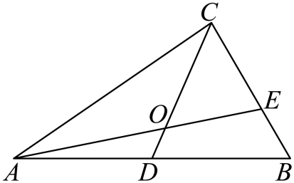

# Mathematics - 题目 3210

**ID**: 7b00ae418b2d45cfb18cccdbf777b038
**年级**: Grade 12
**难度**: Medium
**题型**: Calculation

## 题目
如图，在 $\vartriangle ABC$ 中， $D$ 是 $AB$ 的中点， $\overrightarrow {{BE}}=\frac {1}{3}\overrightarrow {{BC}}$ ．(1)若 $AC=2BC=2$ ， $\angle ACB=60{}\degree $ ，求 $\left |{CD}\right |$ ；​​​​​​​‌(2)若 $\overrightarrow {{CO}}=x\overrightarrow {{CA}}+y\overrightarrow {{CB}}$ ，求 $x+y$ 的值；(3)过点 $O$ 作直线分别于边 $CA$ 、 $CB$ 交于 $M$ 、 $N$ 两点（点 $M$ 、 $N$ 与点 $B$ 、 $C$ 不重合），设 $CA=λCM$ ， $CB=μCN$ ，求 $\frac {1}{λ-1}+\frac {2}{μ-1}$ 的最小值．

## 解答

1. （1）因为 $D$ 为 $AB$ 中点， $AC=2BC=2,\angle ACB=60\degree $ ,
2. 所以 $\overrightarrow {{CD}}=\frac {1}{2}\overrightarrow {{CA}}+\frac {1}{2}\overrightarrow {{CB}}$ ,
3. 所以 $|\overrightarrow {{CD}}|{^{2}}=\frac {1}{4}|\overrightarrow {{CA}}|{^{2}}+\frac {1}{2}\overrightarrow {{CA}}\cdot \overrightarrow {{CB}}+\frac {1}{4}|\overrightarrow {{CB}}|{^{2}}=1+\frac {1}{2}\times 2\times 1\times {\cos}60\degree +\frac {1}{4}=\frac {7}{4}$ ，
4. 所以 $|CD|=\frac {\sqrt {7}}{2}$ .
5. （2）因为 $\overrightarrow {{BE}}=\frac {1}{3}\overrightarrow {{BC}}$ ，所以 $\overrightarrow {{CE}}=\frac {2}{3}\overrightarrow {{CB}}$ ,
6. 设 $\overrightarrow {{CO}}=n\overrightarrow {{CD}}$ ,
7. 则 $\overrightarrow {{CO}}=n\overrightarrow {{CD}}=n(\frac {1}{2}\overrightarrow {{CA}}+\frac {1}{2}\overrightarrow {{CB}})=\frac {n}{2}\overrightarrow {{CA}}+\frac {n}{2}\times \frac {3}{2}\overrightarrow {{CE}}$ ，
8. 又因为 $A,O,E$ 三点共线，
9. 所以 $\frac {n}{2}+\frac {3}{4}n=1$ ，即 $n=\frac {4}{5}$ .
10. 所以 $\overrightarrow {{CO}}=\frac {4}{5}\overrightarrow {{CD}}=\frac {4}{5}(\frac {1}{2}\overrightarrow {{CA}}+\frac {1}{2}\overrightarrow {{CB}})=\frac {2}{5}\overrightarrow {{CA}}+\frac {2}{5}\overrightarrow {{CB}}$ ,
11. 因为 $\overrightarrow {{CO}}=x\overrightarrow {{CA}}+y\overrightarrow {{CB}}$ ,
12. 所以 ${\LARGE x}{\LARGE =}{\LARGE y}{\LARGE =}\frac {2}{5}$ ，即 $x+y=\frac {4}{5}$ .
13. （3）由（2）可知， $\overrightarrow {{CO}}=\frac {2}{5}\overrightarrow {{CA}}+\frac {2}{5}\overrightarrow {{CB}}$ ，
14. 
15. 因为 $\overrightarrow {{CA}}=λ\overrightarrow {{CM}},\overrightarrow {{CB}}=μ\overrightarrow {{CN}}$ ,
16. 所以 $\overrightarrow {{CO}}=\frac {2}{5}\times λ\overrightarrow {{CM}}+\frac {2}{5}\times μ\overrightarrow {{CN}}$ ,
17. 因为 $M,O,N$ 三点共线，
18. 所以 $\frac {2}{5}\times λ+\frac {2}{5}\times μ=1$ ， $λ+μ=\frac {5}{2}$ ，
19. 即 $(λ-1)+(μ-1)=\frac {1}{2}$ ,
20. 所以 $\frac {1}{λ-1}+\frac {2}{μ-1}=2(\frac {1}{λ-1}+\frac {2}{μ-1})[(λ-1)+(μ-1)]$
21. $=2[1+\frac {μ-1}{λ-1}+\frac {2(λ-1)}{μ-1}+2]\geqslant 2(3+2\sqrt {\frac {μ-1}{λ-1}\times \frac {2(λ-1)}{μ-1}})=6+4\sqrt {2}$ ，
22. 当且仅当 $\frac {μ-1}{λ-1}=\frac {2(λ-1)}{μ-1}$ 时，即 $λ=\frac {\sqrt {2}+1}{2},μ=\frac {4-\sqrt {2}}{2}$ 取等号，
23. 所以 $\frac {1}{λ-1}+\frac {2}{μ-1}$ 的最小值为 $6+4\sqrt {2}$ .

## 知识点

**中文**:
  - 向量的共线定理
  - 基本不等式在最值问题中的应用
  - 数量积的定义和性质
  - 向量线性综合运算

**English**:
  - Collinearity Theorem
  - Application in Extremum Problems
  - Definition and Properties
  - Comprehensive Linear Operations

---
