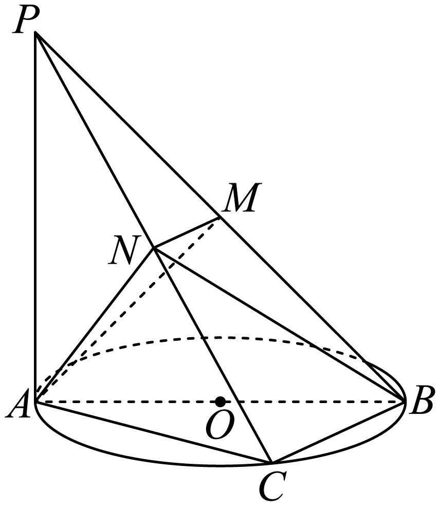

# Mathematics - 题目 3442

**ID**: 836906457b8a40e89176b959de628b2b
**年级**: Grade 12
**难度**: Medium
**题型**: Calculation

## 题目
如图， $AB$ 是 $\odot O$ 的直径 ${\rm .​​​​​​​‌}PA$ 与 $\odot O$ 所在的平面垂直， $PA=AB=2{\rm ，\mathit{C}}$ 是 $\odot O$ 上的一动点（不同于A，B），M为线段 $PB$ 的中点，点N在线段 $PC$ 上，且 $AN\bot PC$ .（1）求证： $AN\bot MN$ ；（2）当 $AC=BC$ 时，求直线 $PC$ 与直线 $AM$ 所成角的余弦值.

## 解答

1. （1）因为 $PA\bot $ 平面 $ABC$ ， $BC\subset $ 平面 $ABC$ ，所以 $PA\bot BC$ ，
2. 因为 $AB$ 是 $\odot O$ 的直径，所以 $BC\bot AC$ ，
3. 又 $PA\cap AC=A$ ，且 $PA$ ， $AC\subset $ 平面 $PAC$ ，所以 $BC\bot $ 平面 $PAC$ .
4. 又因为 $AN\subset $ 平面 $PAC$ ，所以 $AN\bot BC$ .
5. 因为 $AN\bot PC$ ，且 $PC\cap BC=C$ ， $PC$ ， $BC\subset $ 平面 $PBC$ ，所以 $AN⊥$ 平面 $PBC$ ，
6. 因为 $MN\subset $ 平面 $PBC$ ，所以 $AN\bot MN$ .
7. 故 $AN\bot MN$ .
8. （2）解法一：因为 $AC=BC$ ，所以在等腰直角三角形 $ABC$ 中， $AB=2$ ，得 $AC=\sqrt {2}$ .
9. 又在直角三角形 $PAC$ 中， $PA=2$ ，得 $PC=\sqrt {6}$ .
10. 因为 $\vartriangle PAB$ 为等腰直角三角形，M为 $PB$ 的中点，且 $PA=AB=2$ ，得 $PB=2\sqrt {2}$ ，所以 $AM=\sqrt {2}$ ，
11. 取 $BC$ 的中点为S，连接 $MS$ ，则 $MS{\rm{/}}{\rm{/}}PC$ ，且 $MS=\frac {\sqrt {6}}{2}$ ，
12. 所以 $\angle AMS$ 为异面直线 $PC$ 与 $AM$ 所成的角或其补角，
13. 在 ${\rm{R}}{\rm{t}}\vartriangle ACS$ 中， $AC=\sqrt {2}$ ， $CS=\frac {\sqrt {2}}{2}$ ，所以 $AS=\frac {\sqrt {10}}{2}$ ，
14. 在 $\mathrm{△}AMS$ 中， $AM=\sqrt {2}$ ， $MS=\frac {\sqrt {6}}{2}$ ， $AS=\frac {\sqrt {10}}{2}$ ，所以 ${\cos}\angle AMS=\frac {AM{^{2}}+MS{^{2}}-AS{^{2}}}{2AM\cdot MS}=\frac {2+\frac {3}{2}-\frac {5}{2}}{2\sqrt {2}\times \frac {\sqrt {6}}{2}}=\frac {\sqrt {3}}{6}$ ，
15. 故直线 $PC$ 与直线 $AM$ 所成角的余弦值为 $\frac {\sqrt {3}}{6}$ .
16. 解法二：当 $AC=BC$ 时， $CO\bot AB$ ， $O,M$ 分别是 $AB$ 和 $PB$ 的中点，所以 $OM{\rm{/}}{\rm{/}}PA$ .
17. 又 $PA$ 与 $\odot O$ 所在的平面 $ABC$ 垂直，所以 $OM\bot $ 平面 $ABC$ ， $AB\subset $ 平面 $ABC$ ，所以 $OM\bot AB$ .
18. 此时 $CO$ ， $OB$ ， $OM$ 两两垂直.
19. 分别以 $CO,OB,OM$ 所在直线为 $x$ 轴， $y$ 轴， $z$ 轴建立空间直角坐标系，如图：
20. 
21. 得 $P\left ({0,-1,2}\right )$ ， $C\left ({-1,0,0}\right )$ ， $A\left ({0,-1,0}\right )$ ， $M\left ({0,0.1}\right )$ ，
22. 故 $\overrightarrow {{PC}}=\left ({-1,1,-2}\right )$ ， $\overrightarrow {{AM}}=\left ({0,1,1}\right )$ .
23. 则 $\left |{{\cos}\left \langle {\overrightarrow {{PC}},\overrightarrow {{AM}}}\right \rangle \left |{=}\right |\frac {\overrightarrow {{PC}}\cdot \overrightarrow {{AM}}}{\left |{\overrightarrow {{PC}}}\right |\left |{\overrightarrow {{AM}}}\right |}\left |{=}\right |\frac {0+1-2}{\sqrt {6}\times \sqrt {2}}}\right |=\frac {\sqrt {3}}{6}$ ，
24. 故直线PC与直线AM所成角的余弦值为 $\frac {\sqrt {3}}{6}$ .

## 知识点

**中文**:
  - 向量法求线面角
  - 直线与平面垂直的判定
  - 直线与平面垂直的性质

**English**:
  - Line-Plane Angle
  - Line-Plane Perpendicularity Determination
  - Properties of Line-Plane Perpendicularity

---
