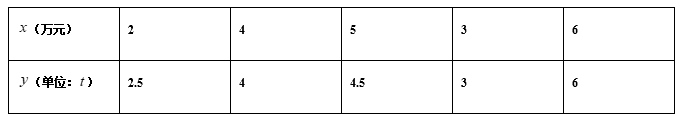

# Mathematics - 题目 2433

**ID**: 86058eb0db014b06a852985de64bcca7
**年级**: Grade 12
**难度**: Medium
**题型**: Calculation

## 题目
某公司为确定下一年度投入某种产品的宣传费，需了解年宣传费对年销售量（单位： $t$ ）的影响.​​​​​​​‌该公司对近5年的年宣传费和年销售量数据进行了研究，发现年宣传费 $x$ （万元）和年销售量 $y$ （单位： $t$ ）具有线性相关关系，并对数据作了初步处理，得到下面的一些统计量的值.（1）根据表中数据建立年销售量 $y$ 关于年宣传费 $x$ 的回归方程；（2）已知这种产品的年利润 $z$ 与 $x$ ， $y$ 的关系为 $z=y-0.05x{^{2}}-1.85$ ，根据（1）中的结果回答下列问题：①当年宣传费为10万元时，年销售量及年利润的预报值是多少？②估算该公司应该投入多少宣传费，才能使得年利润与年宣传费的比值最大.附：问归方程 $\hat y=\hat bx+\hat a$ 中的斜率和截距的最小二乘估计公式分别为 $\hat b=\frac {\sum \limits_{i=1}^{n}\mathop{x{{}_{1}}y{{}_{1}}-n{\overline{x}}{\overline{y}}}}{\sum \limits_{i=1}^{n}\mathop{x{{}_{1}^{2}}-n{\overline{x}}{^{2}}}}=\frac {\sum \limits_{i=1}^{n}\mathop{\left ({x{{}_{1}}-{\overline{x}}}\right )\left ({y{{}_{1}}-{\overline{y}}}\right )}}{\sum \limits_{i=1}^{n}\mathop{{\left({x{{}_{1}}-{\overline{x}}}\right)^{2}}}}$ ， $\hat a={\overline{y}}-\hat b{\overline{x}}$ .参考数据： $\sum \limits_{i=1}^{S}\mathop{x{{}_{1}}y{{}_{1}}}=88.5$ ， $\sum \limits_{i=1}^{S}\mathop{x{{}_{1}^{2}}=90}$ .

## 解答

1. （1）由题意 ${\overline{x}}=\frac {2+4+5+3+6}{5}=4$ ， ${\overline{y}}=\frac {2.5+4.5+4+3+6}{5}=4$ ，
2. $\therefore \hat b=\frac {\sum \limits_{i=1}^{n}\mathop{x{{}_{i}}y{{}_{i}}-n{\overline{x}}{\overline{y}}}}{\sum \limits_{i=1}^{n}\mathop{x{{}_{i}^{2}}-n{\overline{x{^{2}}}}}}=\frac {88.5-5\times 4{^{2}}}{90-5\times 4{^{2}}}=0.85$ ，
3. $\hat a={\overline{y}}-\hat b{\overline{x}}=4-0.85\times 4=0.6$ ，
4. $\therefore \hat y=0.85x+0.6$ .
5. （2）①由（1）得 $z=y-0.05x{^{2}}-1.85=-0.05x{^{2}}+0.85x-1.25$ ，
6. 当 $x=10$ 时， $\therefore \hat y=0.85\times 10+0.6=9.1$ ， $z=-0.05\times 10{^{2}}+0.85\times 10-1.25=2.25$ .
7. 即当年宣传费为10万元时，年销售量为9.1，年利润的预报值为2.25.
8. ②令年利润与年宣传费的比值为 $w$ ，则 $w=-0.05x-\frac {1.25}{x}+0.85\left ({x>0}\right )$ ， $w=-0.05x-\frac {1.25}{x}+0.85=-\left ({0.05x+\frac {1.25}{x}}\right )+0.85\leqslant -$  $2\sqrt {0.05x\cdot \frac {1.25}{x}}+0.85=0.35$ .
9. 当且仅当 $0.05x=\frac {1.25}{x}$ 即 $x=5$ 时取最大值.故该公司应该投入5万元宣传费，才能使得年利润与年宣传费的比值最大.

## 知识点

**中文**:
  - 回归直线与回归方程
  - 基本不等式的实际应用

**English**:
  - Regression Line and Equation
  - Real-world Applications

---
