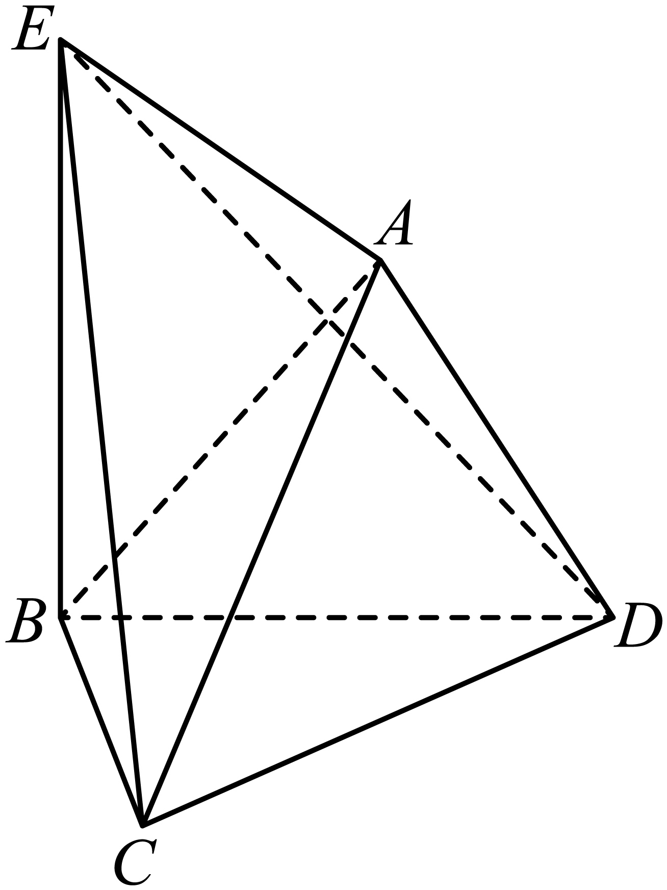

# Mathematics - 题目 3201

**ID**: 888a338b378b47a6adaea90902e221d9
**年级**: Grade 12
**难度**: Medium
**题型**: Calculation

## 题目
如图， $\vartriangle ACD$ 和 $\mathrm{△}BCD$ 都是边长为2的等边三角形，平面 $ACD\bot $ 平面 $BCD$ ， $EB\bot $ 平面 $BCD$ ．(1)证明： $EB{\rm{/}}{\rm{/}}$ 平面 $ACD$ ；​​​​​​​‌(2)若点E到平面 $ABC$ 的距离为 $\sqrt {5}$ ，求平面 $ECD$ 与平面 $BCD$ 夹角的正切值．

## 解答

1. （1）如图，取 $CD$ 的中点，连接 $AO$ ，则 $AO\bot CD$ ，
2. 又因为平面 $ACD\bot $ 平面 $BCD$ ，且平面 $ACD\cap $ 平面 $BCD{\rm{=}}CD$ ， $AO\subset $ 平面 $ACD$ ，
3. 则 $AO\bot $ 平面 $BCD$ ，
4. 又 $EB\bot $ 平面 $BCD$ ，所以 $EB{\rm{/}}{\rm{/}}AO$ ，
5. 又 $EB\not\subset $ 平面 $ACD$ ， $AO\subset $ 平面 $ACD$ ，所以 $EB{\rm{/}}{\rm{/}}$ 平面 $ACD$ ．
6. 
7. （2）如图，连接 $EO$ ， $BO$ ，取 $BC$ 的中点 $F$ ，连接 $DF$ ，则 $DF\bot BC$ ，
8. 
9. 因为 $\left |{AB}\right |=\sqrt {\left |{AO}\right |{{}^{2}}+\left |{BO}\right |{{}^{2}}}=\sqrt {6}$ ，
10. 则等腰 $\vartriangle BAC$ 的面积为 $S{{}_{\vartriangle BAC}}=\frac {1}{2}\times \sqrt {6}\times \frac {\sqrt {10}}{2}=\frac {\sqrt {15}}{2}$ ，
11. 所以三棱锥 $E-ABC$ 的体积为 $V{{}_{E-ABC}}=\frac {1}{3}\times \frac {\sqrt {15}}{2}\times \sqrt {5}=\frac {5\sqrt {3}}{6}$ ，
12. 因为 $EB\bot $ 平面 $BCD$ ， $DF\subset $ 平面 $BCD$ ，则 $DF\bot EB$ ，
13. 又因为 $DF\bot BC$ ， $EB\cap BC=B$ ， $EB\subset $ 平面 $EBC$ ， $BC⊂$ 平面 $EBC$ ，则 $DF⊥$ 平面 $EBC$ ，
14. 因为 $EB{\rm{/}}{\rm{/}}AO$ ，则点 $A$ 到平面 $EBC$ 的距离等于点 $O$ 到平面 $EBC$ 的距离等于 $\frac {1}{2}\left |{DF}\right |{\rm{=}}\frac {\sqrt {3}}{2}$ ，
15. 因为 $S{{}_{\vartriangle EBC}}=\frac {1}{2}\times 2\times \left |{EB}\right |=\left |{EB}\right |$ ，则 $V{{}_{A-EBC}}=\frac {1}{3}\times \left |{EB}\right |\times \frac {\sqrt {3}}{2}=\frac {\sqrt {3}}{6}\left |{EB}\right |$ ，
16. 又 $V{{}_{E-ABC}}=V{{}_{A-EBC}}$ ，所以 $\left |{EB}\right |{\rm{=}}5$ ，
17. 因为 $EB\bot $ 平面 $BCD$ ， $BC⊂$ 平面 $BCD$ ， $BD⊂$ 平面 $BCD$ ，则 $EB\bot BC$ ， $EB\bot BD$ ，
18. 所以 $\left |{EC}\right |=\left |{ED}\right |$ ，所以 $EO\mathrm{⊥}CD$ ，
19. 所以平面 $ECD$ 与平面 $BCD$ 夹角的平面角为 $\angle EOB$ ，
20. 则 ${\tan}\angle EOB=\frac {\left |{EB}\right |}{\left |{OB}\right |}=\frac {5}{\sqrt {3}}=\frac {5\sqrt {3}}{3}$ ，
21. 所以平面 $ECD$ 与平面 $BCD$ 夹角的正切值为 $\frac {5\sqrt {3}}{3}$ ．

## 知识点

**中文**:
  - 向量法求二面角
  - 直线与平面平行的判定

**English**:
  - Dihedral Angle
  - Line-Plane Parallelism Determination

---
