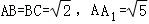
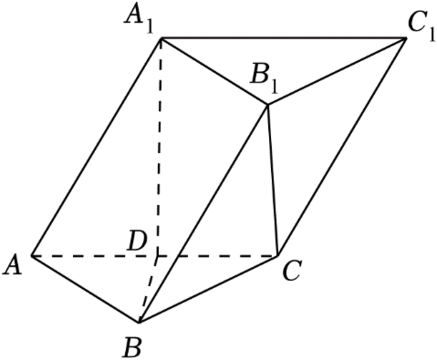

# Mathematics - 题目 1567

**ID**: 8acc7c299e334059ae60cb5468139ddd
**年级**: Grade 12
**难度**: Medium
**题型**: 解答题（共6小题，满分0分）

## 题目
如图，在三棱柱ABC﹣A${\rm _{1}}$B${\rm _{1}}$C${\rm _{1}}$ 中，底面 ${\rm △\mathit{ABC}}$ 为等腰直角三角形，侧面AA${\rm _{1}}$C${\rm _{1}}$C⊥底面ABC，D为AC中点，．（1）求证：BD⊥A${\rm _{1}}$D；​​​​​​​‌（2）再从条件①、条件②这两个条件中选择一个作为已知，求二面角A﹣CC${\rm _{1}}$ ﹣B的余弦值．条件①：A${\rm _{1}}$C${\rm _{1}}$  ${\rm ⊥\mathit{B}}$  ${\rm _{1}}$C；条件②：AA${\rm _{1}}$  ${\rm ＝\mathit{B}}$  ${\rm _{1}}$C．

## 解答

1. 证明：（1）因为AB＝BC，D为AC中点，
2. 所以BD⊥AC，
3. 又因为面AA${\rm _{1}}$C${\rm _{1}}$C⊥面ABC，面AA${\rm _{1}}$C${\rm _{1}}$C∩面ABC＝AC，BD⊂面ABC，
4. 所以BD⊥平面AA${\rm _{1}}$C${\rm _{1}}$C，
5. 又A${\rm _{1}}$D⊂平面AA${\rm _{1}}$C${\rm _{1}}$C，所以BD⊥A${\rm _{1}}$D；
6. 解：（2）选①，取A${\rm _{1}}$C${\rm _{1}}$ 的中点E，连接B${\rm _{1}}$E，CE，
7. 则A${\rm _{1}}$E∥DC且A${\rm _{1}}$E＝DC，
8. 所以四边形A${\rm _{1}}$DCE为平行四边形，所以A${\rm _{1}}$D∥CE，
9. 因为A${\rm _{1}}$B${\rm _{1}}$  ${\rm ＝\mathit{B}}$  ${\rm _{1}}$C${\rm _{1}}$ ，E为A${\rm _{1}}$C${\rm _{1}}$ 的中点，
10. 所以A${\rm _{1}}$C${\rm _{1}}$  ${\rm ⊥\mathit{B}}$  ${\rm _{1}}$E，
11. 又A${\rm _{1}}$C${\rm _{1}}$  ${\rm ⊥\mathit{B}}$  ${\rm _{1}}$C，B${\rm _{1}}$C∩B${\rm _{1}}$E＝B${\rm _{1}}$ ，B${\rm _{1}}$C，B${\rm _{1}}$E⊂平面CB${\rm _{1}}$E，
12. 所以A${\rm _{1}}$C${\rm _{1}}$ ⊥平面CB${\rm _{1}}$E，
13. 又AC∥A${\rm _{1}}$C${\rm _{1}}$ ，所以AC⊥平面CB${\rm _{1}}$E，
14. 又CE⊂平面CB${\rm _{1}}$E，所以AC⊥CE，
15. 因为A${\rm _{1}}$D∥CE，所以AC⊥A${\rm _{1}}$D，
16. 如图，以点D为原点，建立空间直角坐标系，
17. 由，得AC＝2，A${\rm _{1}}$D＝2，
18. 则D（0，0，0），B（0，1，0），C（﹣1，0，0），C${\rm _{1}}$ （﹣2，0，2），则，
19. 因为BD⊥平面AA${\rm _{1}}$C${\rm _{1}}$C，
20. 所以即为平面AA${\rm _{1}}$C${\rm _{1}}$C的一条法向量，
21. 设平面BCC${\rm _{1}}$ 的法向量为，
22. 则有，可取＝（2，﹣2，1），
23. 则，
24. 由图可知，二面角A﹣CC${\rm _{1}}$ ﹣B为锐二面角，
25. 所以二面角A﹣CC${\rm _{1}}$ ﹣B的余弦值为；
26. 选②，取A${\rm _{1}}$C${\rm _{1}}$ 的中点E，连接B${\rm _{1}}$E，CE，DE，
27. 则A${\rm _{1}}$E∥DC且A${\rm _{1}}$E＝DC，
28. 所以四边形A${\rm _{1}}$DCE为平行四边形，所以A${\rm _{1}}$D∥CE且A${\rm _{1}}$D＝CE，
29. 因为C${\rm _{1}}$E∥DC且C${\rm _{1}}$E＝DC，
30. 所以四边形A${\rm _{1}}$DCE为平行四边形，所以BD∥B${\rm _{1}}$E且BD＝B${\rm _{1}}$E，
31. 又因为BD⊥A${\rm _{1}}$D，所以CE⊥B${\rm _{1}}$E，
32. 又，
33. 所以CE＝2，则A${\rm _{1}}$D＝CE＝2，
34. 在 ${\rm △\mathit{ADA}}$  ${\rm _{1}}$ 中，因为，
35. 所以AD⊥A${\rm _{1}}$D，
36. 如图，以点D为原点，建立空间直角坐标系，
37. 下同选①的答案．
38. 
39. 

## 知识点

**中文**:
  - 向量法求二面角
  - 直线与平面垂直的性质

**English**:
  - Dihedral Angle
  - Properties of Line-Plane Perpendicularity

---
