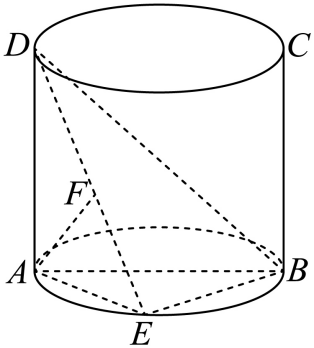

# Mathematics - 题目 2165

**ID**: 8e6df0258715407a816a5f9da0099f23
**年级**: Grade 12
**难度**: Medium
**题型**: Calculation

## 题目
如图，在圆柱中，底面直径 $AB$ 等于母线 $AD$ ，点 $E$ 在底面的圆周上，且 $AF\bot DE$ ， $F$ 是垂足．(1)求证： $AF\bot DB$ ；​​​​​​​‌(2)若圆柱与三棱锥 $D-ABE$ 的体积的比等于 $3π$ ，求直线 $DE$ 与平面 $ABD$ 所成角的大小．

## 解答

1. （1）证明：根据圆柱性质， $DA\bot $ 平面 $ABE$ ，
2. 因为 $EB\subset $ 平面 $ABE$ ，所以 $DA\bot EB$ ，
3. 又因为 $AB$ 是圆柱底面的直径，点 $E$ 在圆周上，所以 $AE\bot EB$ ，
4. 因为 $AE\cap DA=A$ 且 $AE,DA\subset $ 平面 $DAE$ ，所以 $EB\bot $ 平面 $DAE$ ，
5. 又因为 $AF\subset $ 平面 $DAE$ ，所以 $EB\bot AF$ ，
6. 因为 $AF\bot DE$ ，且 $EB\cap DE=E$ ，且 $EB,DE\subset $ 平面 $DEB$ ，所以 $AF\bot $ 平面 $DEB$ ，
7. 又因为 $DB⊂$ 平面 $DEB$ ，所以 $AF\bot DB$ ．
8. （2）解：过点 $E$ 作 $EH\bot AB$ ， $H$ 是垂足，连接 $DH$ ，
9. 根据圆柱性质，平面 $ABD\bot $ 平面 $ABE$ ，且平面 $ABD\cap $ 平面 $ABE=AB$ ,
10. 且 $EH\subset $ 平面 $ABE$ ，所以 $EH\bot $ 平面 $ABD$ ，
11. 因为 $DH\subset $ 平面 $ABD$ ，所以 $DH$ 是 $ED$ 在平面 $ABD$ 上的射影，
12. 从而 $\angle EDH$ 是 $DE$ 与平面 $ABD$ 所成的角，
13. 设圆柱的底面半径为 $R$ ，则 $DA=AB=2R$ ，
14. 所以圆柱的体积为 $V=2{\rm{π}}R{^{3}}$ ，且 $V{{}_{D-ABE}}=\frac {1}{3}AD\cdot S{{}_{\vartriangle ABE}}=\frac {2R{^{2}}}{3}\cdot EH$ ，
15. 由 $V:V{{}_{D-ABE}}=3{\rm{π}}$ ，可得 $EH=R$ ，可知 $H$ 是圆柱底面的圆心，且 $AH=R$ ，
16. 且 $DH=\sqrt {DA{^{2}}+AH{^{2}}}=\sqrt {5}R$ ，
17. 在直角 $\vartriangle EDH$ 中，可得 ${\tan}\angle EDH=\frac {EH}{DH}=\frac {\sqrt {5}}{5}$ ，所以 $\angle EDH={\arctan}\frac {\sqrt {5}}{5}$ ．
18. 

## 知识点

**中文**:
  - 直线与平面平行的判定
  - 直线与平面平行的性质
  - 直线与平面所成的角

**English**:
  - Line-Plane Parallelism Determination
  - Properties of Line-Plane Parallelism
  - Line-Plane Angle

---
