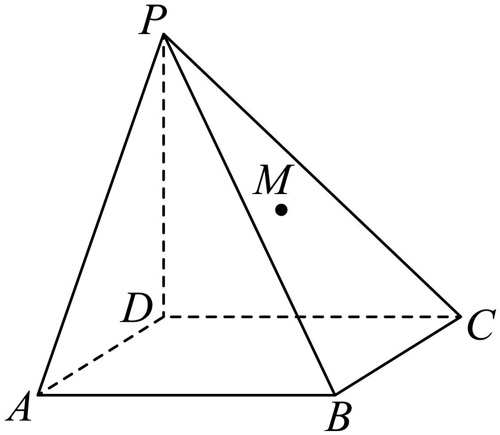

# Mathematics - 题目 347

**ID**: 9a83ffad6ed34dbea697b5c4abbdeb19
**年级**: Grade 12
**难度**: Medium
**题型**: Calculation

## 题目
如图，四棱锥的底面为正方形，平面，，是侧面上一点．(1)过点作一个截面，使得与都与平行．作出与四棱锥表面的交线，并证明；​​​​​​​‌(2)设，其中．若与平面所成角的正弦值为，求的值．

## 解答

1. （1）过点作的平行线，分别交于点，
2. 过作的平行线，交于点，过作的平行线交于点，
3. 则截面为所求截面，证明如下：
4. 因为截面,截面,所以截面,
5. 因为截面,截面,所以截面.
6. 
7. （2）因为平面，平面，所以，
8. 且，所以以为坐标原点，为轴建系如图，
9. 则
10. 所以，
11. 所以，
12. 又因为，所以，
13. 设平面的法向量为，
14. 所以令，
15. 所以，
16. 设与平面所成角为，
17. 则，
18. 整理得，解得（舍），.

## 知识点

**中文**:
  - 向量法求线面角
  - 直线与平面平行的判定

**English**:
  - Line-Plane Angle
  - Line-Plane Parallelism Determination

---
