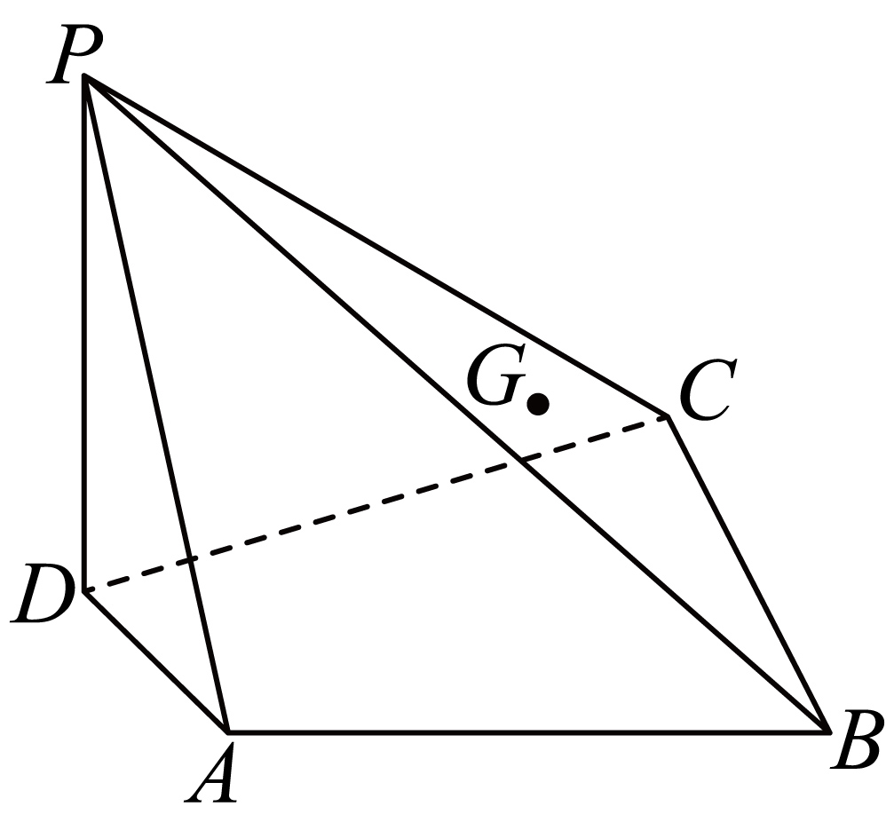

# Mathematics - 题目 482

**ID**: a21b06d3de3543a29ceb1a9f40927618
**年级**: Grade 12
**难度**: Medium
**题型**: Calculation

## 题目
如图，已知在四棱锥 $P-ABCD$ 中， $AD=1,AB=2$ ， $PD\bot $ 平面 $ABCD$ ，平面 $PAB\bot $ 平面 $PAD$ .​​​​​​​‌（1）证明： $AB\bot AD$ ；（2）若 $AC=PD=2\sqrt {2}，$ 且 $BD=CD{\rm ，\mathit{G}}$ 为 $\mathrm{△}PBC$ 的重心，求直线 $DG$ 与平面 $PAB$ 所成角的正弦值.

## 解答

1. （1） $\because PD\bot $  平面  $ABCD$  ,  $AB\subset $ 平面  $ABCD$ , $\therefore PD\bot AB$  .
2. 过  $D$  作  $DM\bot AP$  ,交  $AP$  于点  $M$  ,
3. $\because $  平面  $PAB\bot $  平面 $PAD$  ,平面  $PAB\cap $  平面  $PAD=PA,$  $DM⊂$ 平面 $PAD$ ,
4. ∴所以 $DM\bot $  平面  $PAB,$   $AB\subset $ 平面 $PAB$ ， $\therefore DM\bot AB$ ,
5. 又  $PD\subset $ 平面  $PAD$ ， $DM⊂$ 平面  $PAD$ ， $PD\cap DM=D,$
6. $∴AB⊥$  平面  $PAD$ ， $AD\subset $ 平面  $PAD$  $,\therefore AB\bot AD$
7. 
8. （2）以 $\mathrm{A}$ 为坐标原点,  $AB$  ,  $AD$  为  $x$  轴、  $y$  轴,过 $\mathrm{A}$ 平行于 $PD$  的直线为 $z$ 轴,建立如图所示的空间直角坐标系，
9. 则  $A\left ({0,0,0}\right ),B\left ({2,0,0}\right ),D\left ({0,1,0}\right )$  , $P\left ({0,1,2\sqrt {2}}\right ),\overrightarrow {{AP}}=\left ({0,1,2\sqrt {2}}\right ),\overrightarrow {{AB}}=\left ({2,0,0}\right )$  .
10. 设  $C\left ({x,y,0}\right )$  ,  $BD=CD=\sqrt {5}$ ， $AC=2\sqrt {2}，$
11. 由题意可得  $\begin{cases}\sqrt {x{^{2}}+{\left({y-1}\right)^{2}}}=\sqrt {5},\\x{^{2}}+y{^{2}}=8,\end{cases}$
12. 解得  $C\left ({2,2,0}\right ),$G为 $\mathrm{△}PBC$ 的重心， $\therefore G\left ({\frac {4}{3},1,\frac {2\sqrt {2}}{3}}\right ),$
13. $\therefore \overrightarrow {{DG}}=\left ({\frac {4}{3},0,\frac {2\sqrt {2}}{3}}\right ).$
14. 设平面  $PAB$  的一个法向量为  $\overrightarrow n=\left ({x{{}_{0}},y{{}_{0}},z{{}_{0}}}\right )$ ,则 $\begin{cases}\overrightarrow n\cdot \overrightarrow {{AP}}=0\\\overrightarrow n\cdot \overrightarrow {{AB}}=0\end{cases}$  ,
15. ∴ $\begin{cases}y{{}_{0}}+2\sqrt {2}z{{}_{0}}=0\\2x{{}_{0}}=0\end{cases}$ ，令  $y{{}_{0}}=-2\sqrt {2}$  ,则  $x{{}_{0}}\mathrm{=}0,z{{}_{0}}\mathrm{=}1$ ，∴ $\overrightarrow n=\left ({0,-2\sqrt {2},1}\right )$  ，
16. 设直线  $DG$  与平面  $PAB$  所成角为 $θ$ ，
17. 则 ${\rm{s}}{\rm{i}}{\rm{n}}θ=\left |{\frac {\overrightarrow {{DG}}\cdot \overrightarrow n}{\left |{\overrightarrow {{DG}}}\right |\cdot \left |{\overrightarrow n}\right |}}\right |=\frac {\frac {2\sqrt {2}}{3}}{3\times \frac {2\sqrt {6}}{3}}=\frac {\sqrt {3}}{9}$  .
18. 

## 知识点

**中文**:
  - 向量法求线面角
  - 直线与平面垂直的性质

**English**:
  - Line-Plane Angle
  - Properties of Line-Plane Perpendicularity

---
