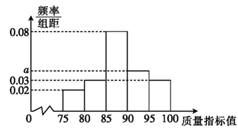

# Mathematics - 题目 193

**ID**: a52a15cc0f044bbbb982bb4a4a6fa8a3
**年级**: Grade 12
**难度**: Medium
**题型**: Calculation

## 题目
随着日益增长的市场需求，某公司最初设计的生产能力已不能满足生产的需求，公司新安装了A，B两条生产线．在生产线试运行阶段，为检测生产线生产的产品的合格率，对两条生产线生产的产品采取不同的方式进行检测．其中A生产线生产的产品分三次随机抽检，经统计，第一次抽取了30件产品，合格率为 $\frac {2}{3}$ ，第二次抽取了40件，合格率为 $\frac {3}{4}$ ，第三次抽取了30件产品，合格率为 $\frac {5}{6}$ ；​​​​​​​‌对B生产线生产的产品随机抽取了100件，并测量了每件产品的某项指标值 $n\in \left [75,100\right ]$ ．经统计，得到如图所示的频率分布直方图，已知产品的质量以该项指标值为衡量标准，且指标值 $n\in \left [85,95\right ]$ 时为合格产品．两条生产线之间生产的产品及各生产线上生产的产品合格与否相互独立．(1)估计A，B两条生产线在试运行阶段产品的合格率．(2)以（1）中的估计值为A，B两条生产线试运行阶段生产的产品的合格率．在A，B两条生产线生产的产品中各随机抽取2件产品，记合格产品的个数和为X．若其中至少有3件产品合格，则可判定两条生产线生产状况安全稳定．（i）求 $P\left ({X=2}\right )$ ；（ii）求可判定两条生产线生产状况稳定的概率．

## 解答

1. （1）应用古典概型的概率求法求A生产线的合格率，根据直方图及频率与概率关系求B生产线合格率；
2. （2）（i）（ii）应用独立事件乘法公式及互斥事件加法求 $P\left ({X=2}\right )$ 、两条生产线稳定生产的概率；
3. (1)
4. 设A，B两条生产线在试运行阶段产品的合格率分别为 $p{{}_{1}}$ ， $p{{}_{2}}$ ，
5. $p{{}_{1}}=\frac {30\times \frac {2}{3}+40\times \frac {3}{4}+30\times \frac {5}{6}}{30+40+30}=\frac {3}{4}$ ，
6. 由直方图得： $(0.02+0.03+a+0.08+0.03)\times 5=1$ ，解得 $a=0.04$ ，
7. $p{{}_{2}}=(0.08+0.04)\times 5=0.6=\frac {3}{5}$ ．
8. (2)
9. 由题意知，试运行阶段A，B两条生产线生产的产品的合格率分别为 $\frac {3}{4}$ ， $\frac {3}{5}$ ，
10. （i） $P\left ({X=2}\right )={\rm{C}}{{}_{2}^{1}}\cdot \frac {1}{4}\cdot \frac {3}{4}\cdot {\rm{C}}{{}_{2}^{1}}\cdot \frac {2}{5}\cdot \frac {3}{5}+{\left({\frac {3}{4}}\right)^{2}}\cdot {\left({\frac {2}{5}}\right)^{2}}+{\left({\frac {1}{4}}\right)^{2}}{\left({\frac {3}{5}}\right)^{2}}=\frac {117}{400}$ ．
11. （ii）记事件C表示：可判定两条生产线生产状况稳定．
12. $P\left ({C}\right )={\left({\frac {3}{4}}\right)^{2}}\cdot {\rm{C}}{{}_{2}^{1}}\cdot \frac {2}{5}\cdot \frac {3}{5}+{\rm{C}}{{}_{2}^{1}}{\rm{·}}\frac {1}{4}\cdot \frac {3}{4}\cdot {\left({\frac {3}{5}}\right)^{2}}+{\left({\frac {3}{4}}\right)^{2}}\cdot {\left({\frac {3}{5}}\right)^{2}}=\frac {243}{400}$ ．

## 知识点

**中文**:
  - 事件的相互独立性
  - 古典概型的概率计算
  - 频率分布直方图

**English**:
  - Independence of Events
  - Calculation of Classical Probability
  - Frequency Distribution Histogram

---
