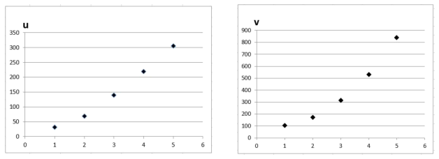

# Mathematics - 题目 1861

**ID**: a5c5339602764971abccd4ea0576e8b9
**年级**: Grade 12
**难度**: Medium
**题型**: Calculation

## 题目
十四五发展纲要提出要推进能源革命，建设清洁低碳、安全高效的能源体系，加快发展非化石能源，大力提升风电、光伏发展规模，有序发展海上风电．海上风电相比与陆上风电有着一定的优势，海上风电可装的风机更大，风资源利用率更高，近几年我国海上风电事业发展良好．下面是近五年我国海上风电发展情况表和对应的散点图．2016-2020年中国海上风电新增装机容量及累计装机容量表（单位：万千瓦）年份20162017201820192020年份代号t12345新增装机容量u3169140219306累计装机容量v104173313532838（1）为了分析中国海上风电装机容量的情况，建立了 $\hat u=bt+a$ 和 $\hat v=dt+c$ 两个线性回归模型，你认为用哪个线性回归模型更可靠？并说明理由．（2）根据（1）的判断结果及表中数据，求出回归方程，并根据这个回归模型回答下列问题：①2021年我国海上风电新增装机容量的预测值是多少？②预计至少要到哪一年，我国海上风电累计装机容量超过2000万千瓦？参考数据：$\sum \limits_{i=1}^{5}\mathop{u{{}_{i}}}$$\sum \limits_{i=1}^{5}\mathop{u{{}_{i}}}t{{}_{i}}$$\sum \limits_{i=1}^{5}\mathop{v{{}_{i}}}$$\sum \limits_{i=1}^{5}\mathop{v{{}_{i}}}t{{}_{i}}$765299519607707参考公式：回归方程 $\hat y=\hat bx+\hat a$ 中 $\hat b=\frac {\sum \limits_{i=1}^{n}\mathop{\left ({x{{}_{i}}-\bar x}\right )}\left ({y{{}_{i}}-\bar y}\right )}{\sum \limits_{i=1}^{n}\mathop{{\left({x{{}_{i}}-\bar x}\right)^{2}}}}=\frac {\sum \limits_{i=1}^{n}\mathop{x{{}_{i}}}y{{}_{i}}-n\bar x\bar y}{\sum \limits_{i=1}^{n}\mathop{x{{}_{i}^{2}}}-n\bar x{^{2}}},\hat a=\bar y-\hat b\bar x$ ．​​​​​​​‌

## 解答

1. （1）模型 $\hat u=bt+a$ 更可靠．
2. 原因：从散点图可以看出，左边的散点图上的点比右边散点图上的点更集中在一条直线的附近，说明变量u和t具有更强的线性相关关系．
3. （2）依题意得 $\bar t=\frac {1+2+3+4+5}{5}=3$ ， $\bar u=\frac {31+69+140+219+306}{5}=153$ ， $\sum \limits_{i=1}^{5}\mathop{t{{}_{i}^{2}}}=1+4+9+16+25=55$ ， $\sum \limits_{i=1}^{5}\mathop{t{{}_{i}}}u{{}_{i}}=2995$ ，
4. 所以 $\hat b=\frac {\sum \limits_{i=1}^{5}\mathop{t{{}_{i}}}u{{}_{i}}-5\bar t\bar u}{\sum \limits_{i=1}^{5}\mathop{t{{}_{i}^{2}}}-n\bar t{^{2}}}=\frac {2995-5\times 3\times 153}{55-5\times 9}=\frac {700}{10}=70$ ，则 $\hat a=\bar u-\hat b\bar t=153-70\times 3=-57$ ，
5. 所以 $\hat u=70t-57$ ；
6. ①当 $t=6$ 时，2021年我国海上风电新增装机容量的预测值是 $\hat u=70\times 6-57=363$ ．
7. ②当 $t=7$ 时，2022年我国海上风电新增裝机容量的预测值是 $\hat u=70\times 7-57=433$ ．
8. 当 $t=8$ 时，2023年我国海上风电新增装机量的预测值是 $\hat u=70\times 8-57=503$
9. 因为 $838+363+433=1634<2000$ ， $838+363+433+503=1634+503=2137>2000$ ；
10. 所以预计至少要到2023年，我国海上风电累计装机量超过2000万千瓦.

## 知识点

**中文**:
  - 最小二乘法
  - 线性回归分析

**English**:
  - Least Squares Method
  - Linear Regression Analysis

---
