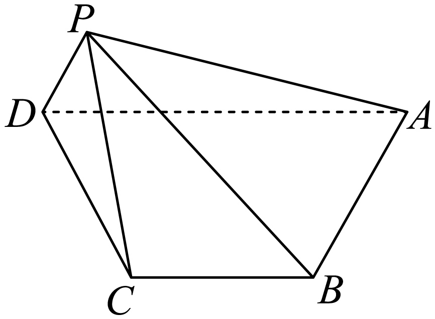

# Mathematics - 题目 3364

**ID**: abb30904dfdc47f097863dac550dfef4
**年级**: Grade 12
**难度**: Medium
**题型**: Calculation

## 题目
如图，在四棱锥P-ABCD中，底面ABCD为梯形，且 $BC=\frac {1}{2}AD$ ， $BC/\mskip-4mu/AD$ ，等边三角形PCD所在的平面垂直于底面 ${\rm \mathit{ABCD}，}BC\bot PD$ ．（1）求证： $BC\bot $ 面 $PCD$ ．（2）若直线PB与平面ABCD所成角的正切值为 $\frac {\sqrt {6}}{2}$ ，求二面角P-AB-D的余弦值．​​​​​​​‌

## 解答

1. （1）如图所示：
2. 
3. 取CD中点H，连接PH，
4. $\because \vartriangle PCD$ 是等边三角形， $\therefore PH\bot CD$ ，
5. $\because $ 面ABCD⊥面PCD，且交线为 ${\rm \mathit{CD}，}PH\subset $ 面 ${\rm \mathit{PCD}，}PH\bot CD$ ，
6. $\therefore PH\bot $ 面 ${\rm \mathit{ABCD}，}\because BC\subset $ 面ABCD，
7. $\therefore PH\bot BC$ ，
8. 又 $\because BC\bot PD,PH\cap PD=P,PH,PD\subset $ 平面 $PCD$ ，
9. $\therefore BC\bot $ 面PCD.
10. （2）连接BH，AH，过点H作 $HE\bot AB$ ，
11. $\because PH\bot $ 面ABCD，所以直线PB在底面ABCD上的射影为直线BH，
12. $\therefore $ 直线PB与面ABCD所成的角为 $\angle PBH$ ，
13. 设 $PC=2a,(a>0)$ ，则 $PH=\sqrt {3}a$ ， ${\rm{t}}{\rm{a}}{\rm{n}}\angle PBH=\frac {PH}{HB}=\frac {\sqrt {6}}{2}$ ，
14. $\therefore HB=\sqrt {2}a$ ，
15. $\therefore BC=a$ ， $AD=2a$ ， $AH=AB=\sqrt {5}a$ ，
16. $\because PH\bot $ 面ABCD，而 $AB\subset $ 平面 $ABCD$ ，
17. $\therefore PH\bot AB$ ，且 $HE\bot AB,HE\cap PH=H,HE,PH\subset $ 平面 $PHE$ ，
18. $∴AB⊥$ 面 ${\rm \mathit{PHE}，}PE\subset $ 面 ${\rm \mathit{PHE}，}\therefore AB\bot PE$ ，
19. $\therefore \angle PEH$ 为二面角P-AB-D的平面角，
20. 在 $\vartriangle ABH$ 中， $S{{}_{\vartriangle ABH}}=\frac {1}{2}\cdot HE\cdot AB=\frac {1}{2}\cdot HB\cdot \sqrt {AH{^{2}}-\frac {1}{2}{\left({HB}\right)^{2}}}=\frac {1}{2}\cdot \sqrt {2}a\cdot \frac {3\sqrt {2}a}{2}=\frac {3}{2}a$ ，
21. 解得 $HE=\frac {\frac {3}{2}a}{\frac {\sqrt {5}a}{2}}=\frac {3\sqrt {5}a}{5}$ ，
22. 在 $△PEH$ 中， $PE=\sqrt {PH{^{2}}+HE{^{2}}}=\frac {2\sqrt {30}}{5}a$ ，
23. $\therefore {\rm{c}}{\rm{o}}{\rm{s}}\angle PEH=\frac {HE}{PE}=\frac {\sqrt {6}}{4}$ ，
24. 所以二面角P-AB-D的余弦值为 $\frac {\sqrt {6}}{4}$ .

## 知识点

**中文**:
  - 二面角
  - 直线与平面垂直的判定

**English**:
  - Dihedral Angle
  - Line-Plane Perpendicularity Determination

---
