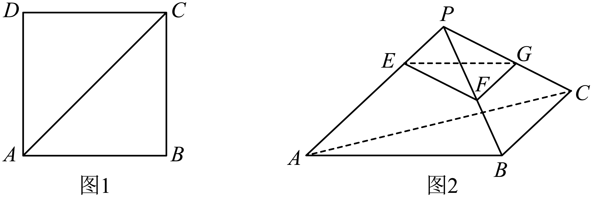

# Mathematics - 题目 3739

**ID**: b76acb5fdbd047f483bbb8cbe849a617
**年级**: Grade 12
**难度**: Medium
**题型**: Calculation

## 题目
如图1所示，在边长为3的正方形ABCD中，将△ADC沿AC折到△APC的位置，使得平面 $APC\bot $ 平面ABC，得到图2所示的三棱锥 $P-ABC$ .​​​​​​​‌点E，F，G分别在PA，PB，PC上，且 $AE=2EP$ ， $PF=2FB$ ， $PG=2GC$ .记平面EFG与平面ABC的交线为l.(1)在图2中画出交线l，保留作图痕迹，并写出画法.(2)求点 $A$ 到平面 $EFG$ 的距离.

## 解答

1. （1）作图步骤：延长EF、AB交于M，延长AC、EG交于N，连接MN，则直线MN即为交线l.
2. 如下图示：
3. 
4. （2）记 $O$ 为 $AC$ 的中点，则 $PO\bot AC,BO\bot AC$ ，
5. 由面 $APC\bot $ 面ABC，面 $APC\bot $ 面ABC$=AC$ ， $PO⊂$ 面 $APC$ ，
6. 所以 $PO⊥$ 面ABC， $BO⊂$ 面ABC，故 $PO\bot BO$ ，
7. 由ABCD为正方形，故 $OA=OP=OB=OC$ ，易知 $\vartriangle PAO\cong \vartriangle PBO\cong \vartriangle PCO$ ，
8. 所以 $PB=PA=AB=3$ ，而 $PE=1,PG=PF=2$ ，
9. 在△ $PEF$ 中 $∠EPF=60{{}^{\circ }},PE=1,PF=2$ ，则 $EF=\sqrt {PE{{}^{2}}+PF{{}^{2}}-2PE\cdot PF{\cos}\angle EPF}=\sqrt {3}$ .
10. 在 $\vartriangle EFG$ 中 $FG=\frac {PF\cdot BC}{PB}=2,EG=\sqrt {PE{{}^{2}}+PG{{}^{2}}}=\sqrt {5}$ ，
11. 则 ${\rm{c}}{\rm{o}}{\rm{s}}∠FEG=\frac {3+5-4}{2\times \sqrt {3}\times \sqrt {5}}=\frac {2\sqrt {15}}{15}$ ，故 ${\rm{s}}{\rm{i}}{\rm{n}}∠FEG=\frac {\sqrt {165}}{15}$ ，
12. $\therefore S{{}_{\vartriangle EFG}}=\frac {1}{2}\cdot EF\cdot EG\cdot {\rm{s}}{\rm{i}}{\rm{n}}∠FEG=\frac {\sqrt {11}}{2}$ ，又 $V{{}_{A-EFG}}=V{{}_{F-AEG}}$ ，令 $A$ 到面 $EFG$ 距离为 $h$ ，
13. 所以 $\frac {1}{3}\cdot S{{}_{\vartriangle EFG}}\cdot h=\frac {1}{3}\cdot S{{}_{\vartriangle AEG}}\cdot \frac {2}{3}OB$ ，则 $h=\frac {S{{}_{\vartriangle AEG}}\cdot \frac {2}{3}OB}{S{{}_{\vartriangle EFG}}}=\frac {2\sqrt {2}}{\frac {\sqrt {11}}{2}}=\frac {4\sqrt {22}}{11}$ ，
14. 故点 $A$ 到平面 $EFG$ 的距离为 $\frac {4\sqrt {22}}{11}$ .

## 知识点

**中文**:
  - 点与面之间的距离
  - 等积变换法

**English**:
  - Point-Plane Distance
  - Method of Equal Volume Transformation

---
