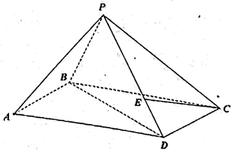

# Mathematics - 题目 935

**ID**: b88ca5b4cd9b4383ad1825e013e8d93b
**年级**: Grade 12
**难度**: Medium
**题型**: Calculation

## 题目
如图，在四棱锥 $P-ABCD$ 中，底面 $ABCD$ 为平行四边形， $PB=AB=1,AD=PD=2,∠BAD=60{^{\circ }}$ .​​​​​​​‌(1)求证：平面 $PAB\bot $ 平面 $ABCD$ ；(2)若二面角 $P-BD-A$ 的大小为 $120{^{\circ }}$ ，点 $E$ 在棱 $PD$ 上，且 $PE=2ED$ ，求直线 $CE$ 与平面 $PBC$ 所成角的正弦值.

## 解答

1. （1）证明:由余弦定理得 $BD=\sqrt {1{^{2}}+2{^{2}}-2\cdot 1\cdot 2{\cos}60^\circ }=\sqrt {3}$ ，
2. 所以 $AD{^{2}}=AB{^{2}}+BD{^{2}},PD{^{2}}=PB{^{2}}+BD{^{2}}$ ，
3. 因此 $AB\bot BD,PB\bot BD$ ，
4. 又因为 $AB\cap PB=B,AB,PB\subset $ 平面 $PAB$ ，
5. 所以 $BD⊥$ 面 $PAB$ ，
6. 又因为 $BD⊂$ 平面 $ABCD$ ，
7. 故平面 $PAB\bot $ 平面 $ABCD$ .
8. （2）由于 $AB\bot BD,PB\bot BD$ ，
9. 所以二面角 $P-BD-A$ 的平面角为 $\angle PBA$ ，即 $\angle PBA=120^\circ $ ，
10. 在平面 $PAB$ 内过点 $B$ 作 $AB$ 的垂线，交 $AP$ 于 $F$ ，
11. 由平面 $PAB\bot $ 平面 $ABCD$ ，且 $BF⊂$ 平面 $PAB$ ，平面 $PAB\cap $ 平面 $ABCD=AB$ ，得 $BF\bot $ 平面 $ABCD$ ，
12. 以 $B$ 为坐标原点， $\overrightarrow {{BA}},\overrightarrow {{BD}},\overrightarrow {{BF}}$ 为 $x$ ， $y$ ， $z$ 轴正方向，
13. 建立如图所示的空间直角坐标系 $B-xyz$ ，
14. 则 $B(0,0,0),D(0,\sqrt {3},0),C(-1,\sqrt {3},0),P\left ({-\frac {1}{2},0,\frac {\sqrt {3}}{2}}\right )$ ，
15. 设平面 $PBC$ 的法向量为 $\overrightarrow n=(x,y,z)$ ，由于
16. $\overrightarrow {{BC}}=(-1,\sqrt {3},0),\overrightarrow {{BP}}=\left ({-\frac {1}{2},0,\frac {\sqrt {3}}{2}}\right )$ 则 $\begin{cases}\overrightarrow n\cdot \overrightarrow {{BC}}=0\\\overrightarrow n\cdot \overrightarrow {{BP}}=0\end{cases}$ ，即 $\begin{cases}-x+\sqrt {3}y=0\\-\frac {1}{2}x+\frac {\sqrt {3}}{2}z=0\end{cases}$ ，
17. 令 $x=\sqrt {3}$ ，则 $y=z=1$ ，
18. 所以 $\overrightarrow n=(\sqrt {3},1,1)$
19. 设直线 $CE$ 与平面 $PBC$ 所成角为 $θ$ ，
20. $\because \overrightarrow {{CE}}=\overrightarrow {{CP}}+\overrightarrow {{PE}}=\overrightarrow {{CP}}+\frac {2}{3}\overrightarrow {{PD}}=\left ({\frac {5}{6},-\frac {\sqrt {3}}{3},\frac {\sqrt {3}}{6}}\right )$ ，
21. $\therefore {\sin}θ=|{\cos}\left \langle {\overrightarrow {{CE}},\overrightarrow n}\right \rangle |=\frac {|\overrightarrow {{CE}}\cdot \overrightarrow n|}{|\overrightarrow {{CE}}|\cdot |\overrightarrow n|}=\frac {\frac {2\sqrt {3}}{3}}{\sqrt {5}\sqrt {\frac {25}{36}+\frac {1}{3}+\frac {3}{36}}}=\frac {\sqrt {6}}{5}$ ，
22. 因此直线 $CE$ 与平面 $PBC$ 所成角的正弦值为 $\frac {\sqrt {6}}{5}$ .
23. 

## 知识点

**中文**:
  - 向量法求二面角
  - 平面与平面垂直的判定
  - 向量法求线面角

**English**:
  - Dihedral Angle
  - Plane-Plane Perpendicularity Determination
  - Line-Plane Angle

---
