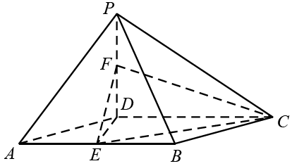

# Mathematics - 题目 3179

**ID**: bb92b0036420454f820774e2fc478483
**年级**: Grade 12
**难度**: Medium
**题型**: Calculation

## 题目
如图.​​​​​​​‌在四棱锥 ${\rm \mathit{P-ABCD}}$ 中， $PD\bot $ 平面 $ABCD$ ，底面 ${\rm \mathit{ABCD}}$ 为菱形， ${\rm \mathit{E}}$ 、 ${\rm \mathit{F}}$ 分别为 ${\rm \mathit{AB}}$ 、 ${\rm \mathit{PD}}$ 的中点.(1)求证： $EF/\mskip-4mu/$ 平面 $PBC$ ；(2)若 $AD=2\sqrt {3}$ ， $PD=12$ ， $PB=PC$ ，求直线 ${\rm \mathit{CD}}$ 与平面 ${\rm \mathit{EFC}}$ 所成角的正弦值.

## 解答

1. （1）取 ${\rm \mathit{PC}}$ 中点 ${\rm \mathit{M}}$ ，连接 ${\rm \mathit{FM}，\mathit{BM}}$ .
2. 在 $\vartriangle PCD$ 中，因为 ${\rm \mathit{M}，\mathit{F}}$ 分别为 ${\rm \mathit{PC}，\mathit{PD}}$ 的中点，
3. 所以 $MF/\mskip-4mu/DC$ ， $MF=\frac {1}{2}DC$ .
4. 在菱形 ${\rm \mathit{ABCD}}$ 中，因为 $AB/\mskip-4mu/DC$ ， $BE=\frac {1}{2}DC$ ，
5. 所以 $BE/\mskip-4mu/MF$ ， $BE=MF$ ，
6. 所以四边形 $BEFM$ 为平行四边形，
7. 因此 $EF/\mskip-4mu/BM$ .
8. 又因为 $EF\not\subset 平面PBC$ ， $BM\subset 平面PBC$
9. 所以 $EF/\mskip-4mu/平面PBC$ .
10. （2）因为 $PD\bot 平面ABCD$ ， $DC、DE\subset 平面ABCD$
11. 所以 $PD\bot DC$ ， $PD\bot DE$ .
12. 因为 $PB=PC$ ，所以 $BD=DC$ .
13. 在菱形 ${\rm \mathit{ABCD}}$ 中， $AB=BD=AD$ ，
14. 因为 ${\rm \mathit{E}}$ 为 ${\rm \mathit{AB}}$ 中点，所以 $DE\bot DC$ .
15. 建立如图空间直角坐标系 ${\rm \mathit{D-xyz}}$ .
16. 
17. 在正三角形 $\vartriangle ADB$ 中， $DE=3$ .
18. 因为 $F(0,0,6)$ ， $E(3,0,0)$ ，  $C(0,2\sqrt {3},0)$ ， $\overrightarrow {{EC}}=(-3,2\sqrt {3},0)$ ，
19. 所以向量 $\overrightarrow {{EF}}=(-3,0,6)$ ， $\overrightarrow {{DC}}=(0,2\sqrt {3},0)$ .
20. 设平面 ${\rm \mathit{EFC}}$ 的法向量为 $\overrightarrow {{n}}=(x,y,z)$ ，则 $\begin{cases}\overrightarrow n\cdot \overrightarrow {{EF}}=0\\\overrightarrow n\cdot \overrightarrow {{EC}}=0\end{cases}$ ，即 $\begin{cases}-3x+6z=0\\-3x+2\sqrt {3}y=0\end{cases}$ .
21. 取 $z=1$ 得 $x=2,y=\sqrt {3}$ , $\overrightarrow {{n}}=(2,\sqrt {3},1)$ .
22. 设直线 ${\rm \mathit{CD}}$ 与平面 ${\rm \mathit{EFC}}$ 所成角为 $θ$ ，
23. $\sin θ=\left |{{\cos}\left \langle {\overrightarrow {{DC}},\overrightarrow n}\right \rangle }\right |=\frac {\left |{\overrightarrow {{DC}}\cdot \overrightarrow n}\right |}{\left |{\overrightarrow {{DC}}\cdot \overrightarrow n}\right |}=\frac {\sqrt {6}}{4}$ .

## 知识点

**中文**:
  - 直线与平面平行的判定
  - 直线与平面所成的角

**English**:
  - Line-Plane Parallelism Determination
  - Line-Plane Angle

---
