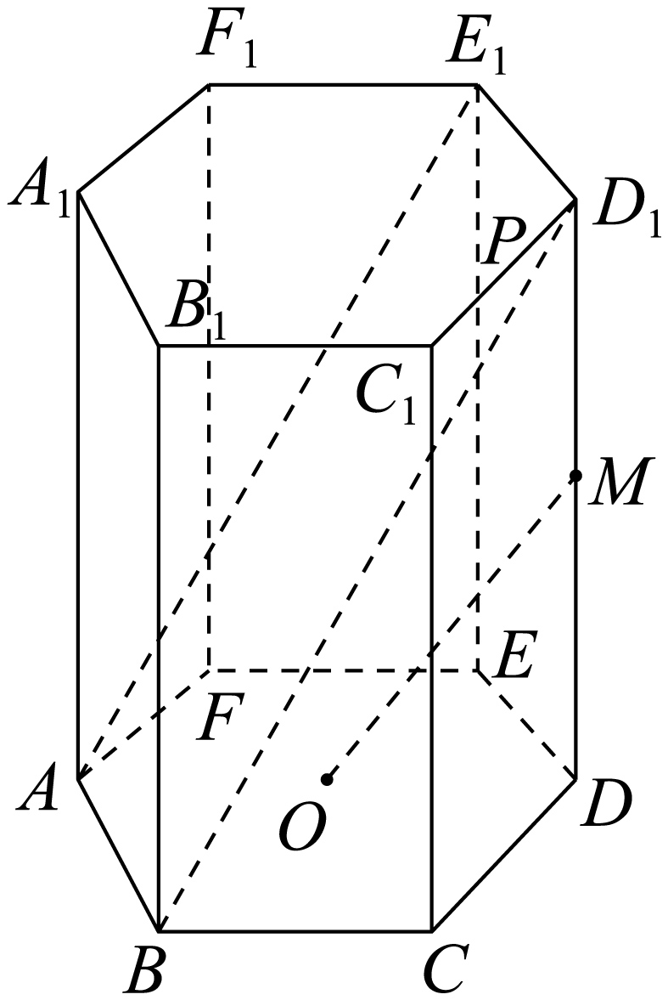

# Mathematics - 题目 3115

**ID**: bc4acb1e6f1741a3830500fdb8f532aa
**年级**: Grade 12
**难度**: Medium
**题型**: Calculation

## 题目
在正六棱柱 $ABCDEF-A{{}_{1}}B{{}_{1}}C{{}_{1}}D{{}_{1}}E{{}_{1}}F{{}_{1}}$ 中， $AB=2$ ， $AA{{}_{1}}=4$ ， $M$ 为侧棱 $DD{{}_{1}}$ 的中点， $P$ 为棱 $C{{}_{1}}D{{}_{1}}$ 上一点， $O$ 为下底面 $ABCDEF$ 的中心.​​​​​​​‌（1）求证： $MO{\rm{/}}{\rm{/}}$ 平面 $ABD{{}_{1}}E{{}_{1}}$ ；（2）求四棱锥 $P-A{{}_{1}}F{{}_{1}}DC$ 的体积.

## 解答

1. （1）证明：连接 $AD{{}_{1}}$ 和 $AD$ ，构成 $\vartriangle ADD{{}_{1}}$ ，
2. 因为 $O$ 为面 $ABCDEF$ 的中心，所以 $O$ 为 $AD$ 中点，又 $M$ 为 $DD{{}_{1}}$ 中点，
3. 所以 $OM//AE{{}_{1}}$ ，且 $OM{\rm{=}}\frac {1}{2}AE{{}_{1}}$ ，
4. 又 $AE{{}_{1}}\subset $ 面 $ABD{{}_{1}}E{{}_{1}}$ ， $OM\not\subset $ 面 $ABD{{}_{1}}E{{}_{1}}$ ，
5. 所以 $MO//$ 平面 $ABD{{}_{1}}E{{}_{1}}$ .
6. 
7. （2） $V{{}_{P-A{{}_{1}}F{{}_{1}}DC}}=2V{{}_{P-A{{}_{1}}CD}}$ ，将四棱分割为两个相等的三棱锥，
8. 则 $V{{}_{P-A{{}_{1}}CD}}=V{{}_{A{{}_{1}}-PCD}}=\frac {1}{3}\times d\times S{{}_{\vartriangle PCD}}=\frac {d}{3}\times \frac {1}{2}\times 2\times 4=\frac {4d}{3}$ ，
9. 连 $AC,AD$ ，则 $AD=2AB=4$ ， $AC=2\times 2{\sin}60^\circ =2\sqrt {3}$ ，
10. 则 $AD{^{2}}=AC{^{2}}+CD{^{2}}$ ，故 $AC\bot CD$ ，
11. 则 $AC\bot $ 平面 $PCD$ ，
12. 因为 $AA{{}_{1}}//$ 平面 $PCD$ ，
13. 所以 $d=AC=2\times 2{\sin}60^\circ =2\sqrt {3}$ ，
14. 所以 $V{{}_{P-A{{}_{1}}F{{}_{1}}DC}}=2V{{}_{P-A{{}_{1}}CD}}=\frac {8d}{3}=\frac {16\sqrt {3}}{3}$ .
15. 

## 知识点

**中文**:
  - 棱柱、棱锥、棱台的体积
  - 直线与平面平行的判定

**English**:
  - Volume of Polyhedra
  - Line-Plane Parallelism Determination

---
