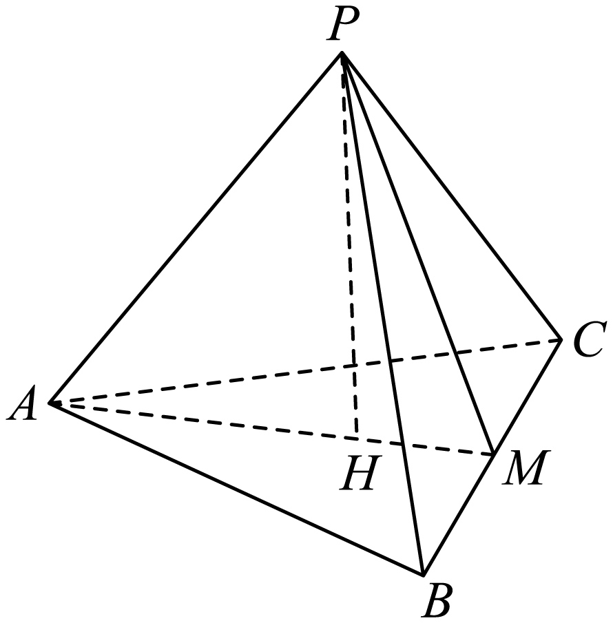

# Mathematics - 题目 1749

**ID**: bdce0b4e2d2f43148f1d60c9749724e1
**年级**: Grade 12
**难度**: Medium
**题型**: Calculation

## 题目
如图，在三棱锥 $P-ABC$ 中，H为 $\vartriangle ABC$ 的内心，直线AH与BC交于M， $\angle PAB=\angle PAC$ ， $\angle PCA=\angle PCB$ .​​​​​​​‌(1)证明：平面 $PAM\bot $ 平面ABC；(2)若 $AB⊥BC$ ， $PA=AB=3$ ， $BC=4$ ，求三棱锥 $M-PAC$ 的体积.

## 解答

1. （1）如图，设 $PN\bot $ 平面ABC于点N，过N作 $NE\bot AB$ 于E， $NF\bot AC$ 于F，连接PE，PF．
2. ∵ $PN\bot $ 平面ABC， $AB⊂$ 平面ABC
3. ∴ $PN\bot AB$
4. 又∵ $NE\bot AB$    ∴ $AB⊥$ 平面PNE∴ $AB\bot PE$ ，
5. 同理 $AC\bot PF$
6. 在 $Rt\vartriangle PAE$ ， $Rt\vartriangle PAF$ 中， $\angle PAE=\angle PAF$ ， $PA=PA$
7. ∴ $△PAE≌△PAF$    ∴ $AF=AE$
8. 在 $Rt△ANE$ ， $Rt△ANF$ 中， $AF=AE$ ， $AN=AN$
9. ∴ $△ANE≌△ANF$ ，∴ $NE=NF$ ，即N到AB，AC的距离相等
10. 同理N到BC，AC的距离相等，故N为 $\vartriangle ABC$ 的内心，N与H重合
11. ∴ $PH\bot $ 平面ABC
12. 又∵ $PH\subset $ 平面APM∴平面 $PAM\bot $ 平面ABC
13. 
14. （2）由已知可得 $AC=5$ ，设 $\vartriangle ABC$ 的内切圆半径为r，
15. 则 $S_{△ABC}=\frac {1}{2}\times 4\times 3=\frac {1}{2}r\left ({3+4+5}\right )$ ，故 $r=1$ ，
16. 因为H为 $\vartriangle ABC$ 的内心，所以AH平分 $∠BAC$ ，所以 $\frac {BM}{CM}=\frac {AB}{AC}=\frac {3}{5}$ ，
17. $BM+CM=4$ ，所以 $CM=\frac {5}{2}$ ， $BM=\frac {3}{2}$ ，
18. 故 $\vartriangle AMC$ 的面积为 $\frac {1}{2}CM\cdot AB=\frac {15}{4}$ ，
19. 因为 $HE\bot AB$ ， $AB⊥BC$   所以 $HE\textit{∥}BC$ ，所以 $\frac {AE}{HE}=\frac {AB}{BM}$ ，得 $AE=2$ ，
20. 所以 $AH=\sqrt {r^{2}+AE^{2}}=\sqrt {5}$ ， $PH=\sqrt {AP^{2}-AH^{2}}=2$ ，
21. 故三棱锥 $M-PAC$ 的体积为 $V_{P-AMC}=\frac {1}{3}\times S_{△AMC}\cdot PH=\frac {1}{3}\times \frac {15}{4}\times 2=\frac {5}{2}$ ．

## 知识点

**中文**:
  - 平面与平面垂直的判定
  - 棱柱、棱锥、棱台的体积

**English**:
  - Plane-Plane Perpendicularity Determination
  - Volume of Polyhedra

---
