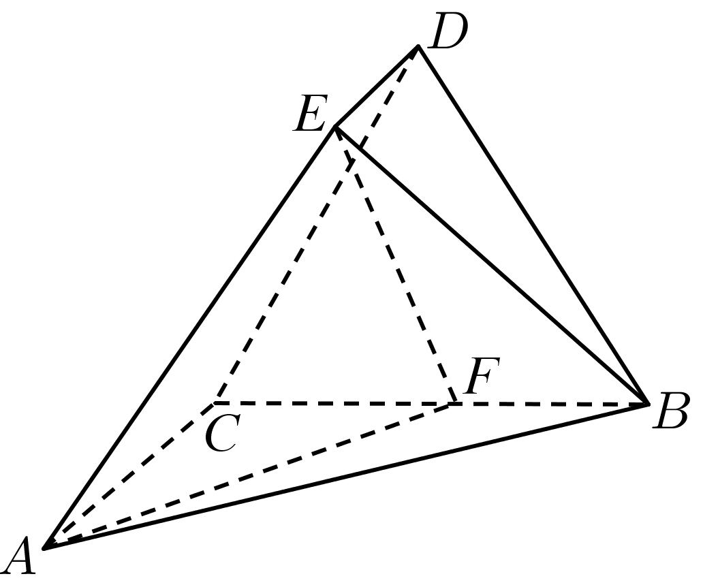

# Mathematics - 题目 2864

**ID**: c545d76bbafb449da012da3b6342a793
**年级**: Grade 12
**难度**: Medium
**题型**: Calculation

## 题目
如图，在五面体 ${\rm \mathit{ABCDE}}$ 中，已知 $AC⊥BC$ ， $ED{\rm{/\mskip-4mu/}}AC$ ，且 $AC=BC=AE=2ED=2$ ， $DC=DB=\sqrt {3}$ .​​​​​​​‌(1)求证：平面 $BCD\bot $ 平面 ${\rm \mathit{ABC}}$ ；(2)线段 ${\rm \mathit{BC}}$ 上是否存在点 ${\rm \mathit{F}}$ ，使得二面角 $B-AE-F$ 的余弦值为 $\frac {2\sqrt {2}}{3}$ ，若存在，求 ${\rm \mathit{CF}}$ 的长度；若不存在，请说明理由.

## 解答

1. （1）取 ${\rm \mathit{AC}}$ 中点 ${\rm \mathit{G}}$ ，连接 ${\rm \mathit{EG}}$ ，因为 $ED{\rm{/\mskip-4mu/}}AC$ ， $CG=\frac {1}{2}AC=ED$ ，
2. 所以 $EG{\underline{{\underline{{\rm{/\mskip-4mu/}}}}}}CD$ ，所以四边形 ${\rm \mathit{EDCG}}$ 为平行四边形，所以 $EG=DC=\sqrt {3}$ ，
3. 又因为 $AG=\frac {1}{2}AC=1$ ， $AE=2$ ，所以 $AG{^{2}}+EG{^{2}}=AE{^{2}}$ ，所以 $AG\bot EG$ ，
4. 又因为 $CD{\rm{/\mskip-4mu/}}EG$ ，所以 $AC\bot CD$ .
5. 因为 $AC⊥BC{\rm ，\mathit{BC}，\mathit{CD}}$ 是平面 ${\rm \mathit{BCD}}$ 内的两条相交直线，所以 $AC\bot $ 平面 ${\rm \mathit{BCD}}$ ，
6. 因为 $AC⊂$ 平面 ${\rm \mathit{ABC}}$ ，所以平面 $ABC⊥$ 平面 ${\rm \mathit{BCD}}$ .
7. （2）解法一：
8. 在平面 ${\rm \mathit{BCD}}$ 内过点 ${\rm \mathit{C}}$ 作 ${\rm \mathit{BC}}$ 的垂线 ${\rm \mathit{l}}$ ，因为 $AC\bot $ 平面 ${\rm \mathit{BCD}}$ ，
9. 所以 ${\rm \mathit{l}}$ ､ ${\rm \mathit{CA}，\mathit{CB}}$ 两两相互垂直，故以 ${\rm \mathit{C}}$ 为坐标原点.
10. 如图所示，建立空间直角坐标系，
11. 则 $A\left ({2,0,0}\right )$ ， $B\left ({0,2,0}\right )$ ， $D\left ({0,1,\sqrt {2}}\right )$ ， $E\left ({1,1,\sqrt {2}}\right )$ ，
12. 
13. 设在线段 ${\rm \mathit{BC}}$ 上存在点 $F\left ({0,t,0}\right )\left ({0\leqslant t\leqslant 2}\right )$ ，使二面角 $B-AE-F$ 的余弦值为 $\frac {2\sqrt {2}}{3}$ ，
14. 则 $\overrightarrow {{AE}}=\left ({-1,1,\sqrt {2}}\right )$ ， $\overrightarrow {{AB}}=\left ({-2,2,0}\right )$ ， $\overrightarrow {{AF}}=\left ({-2,t,0}\right )$
15. 设平面 ${\rm \mathit{AEF}}$ 的法向量 $\overrightarrow n{{}_{1}}=\left ({x{{}_{1}},y{{}_{1}},z{{}_{1}}}\right )$ .
16. 则 $\begin{cases}\overrightarrow {{AE}}\cdot \overrightarrow n{{}_{1}}=0\\\overrightarrow {{AF}}\cdot \overrightarrow n{{}_{1}}=0\end{cases}$ ，即 $\begin{cases}-x{{}_{1}}+y{{}_{1}}+\sqrt {2}z{{}_{1}}=0\\-2x{{}_{1}}+ty{{}_{1}}=0\end{cases}$ ，不妨令 $y{{}_{1}}=2$ ，则 $x{{}_{1}}=t$ ， $z{{}_{1}}=\frac {\sqrt {2}\left ({t-2}\right )}{2}$ ，所以 $\overrightarrow n{{}_{1}}=\left ({t,2,\frac {\sqrt {2}\left ({t-2}\right )}{2}}\right )$ .
17. 设平面 ${\rm \mathit{ABE}}$ 的一个法向量为 $\overrightarrow n{{}_{2}}=\left ({x{{}_{2}},y{{}_{2}},z{{}_{2}}}\right )$ ，
18. 则 $\begin{cases}\overrightarrow {{AE}}\cdot \overrightarrow n{{}_{2}}=-x{{}_{2}}+y{{}_{2}}+\sqrt {2}z{{}_{2}}=0\\\overrightarrow {{AB}}\cdot \overrightarrow n{{}_{2}}=-2x{{}_{2}}+2y{{}_{2}}=0\end{cases}$ ，即 $\begin{cases}-x{{}_{2}}+y{{}_{2}}+\sqrt {2}z{{}_{2}}=0\\-2x{{}_{2}}+2y{{}_{2}}=0\end{cases}$
19. 不妨令 $x{{}_{2}}=1$ ， $y{{}_{2}}=1$ ， $z{{}_{2}}=0$ ，所以 $\overrightarrow n{{}_{2}}=\left ({1,1,0}\right )$
20. 所以 $\left |{{\cos}\left \langle {\overrightarrow n{{}_{1}},\overrightarrow n{{}_{2}}}\right \rangle }\right |=\frac {\left |{\overrightarrow n{{}_{1}}\cdot \overrightarrow n{{}_{2}}}\right |}{\left |{\overrightarrow n{{}_{1}}}\right |\cdot \left |{\overrightarrow n{{}_{2}}}\right |}=\frac {\left |{t+2}\right |}{\sqrt {2}\cdot \sqrt {t{^{2}}+2{^{2}}+\frac {{\left({t-2}\right)^{2}}}{2}}}=\frac {2\sqrt {2}}{3}$ .
21. 化简得： $15t{^{2}}-68t+60=0$ ，解得 $t=\frac {6}{5}$ 或 $\frac {10}{3}$ （舍去），故 $F\left ({0,\frac {6}{5},0}\right )$ ，所以 $CF=\frac {6}{5}$ .
22. 所以存在点 ${\rm \mathit{F}}$ ，当 $CF=\frac {6}{5}$ 时，二面角 $B-AE-F$ 的余弦值为 $\frac {2\sqrt {2}}{3}$ .
23. 解法二：
24. 取 ${\rm \mathit{BC}}$ ､ ${\rm \mathit{AB}}$ 的中点 ${\rm \mathit{O}}$ ､ ${\rm \mathit{H}}$ ，连接 ${\rm \mathit{OD}，\mathit{OH}}$ ，
25. 
26. 因为 $DB=DC{\rm ，\mathit{O}}$ 是 ${\rm \mathit{BC}}$ 中点，所以 $DO\bot BC$ ，
27. 又因为 $DO\subset $ 平面 ${\rm \mathit{BCD}}$ ，平面 $ABC⊥$ 平面 ${\rm \mathit{BCD}}$ 且交于 ${\rm \mathit{BC}}$ ，所以 $DO\bot $ 平面 ${\rm \mathit{ABC}}$ ，
28. 因为 ${\rm \mathit{H}}$ 是 ${\rm \mathit{AB}}$ 中点，即 $OH{\rm{/\mskip-4mu/}}AC$ ，所以 $OH⊥BC$ ，
29. 故 ${\rm \mathit{DO}，\mathit{OH}，\mathit{BC}}$ 两两互相垂直，
30. 则以 ${\rm \mathit{O}}$ 为坐标原点， $\overrightarrow {{OH}}$ ， $\overrightarrow {{OB}}$ ， $\overrightarrow {{OD}}$ 为 ${\rm \mathit{x}，\mathit{y}，\mathit{z}}$ 轴，如图建立空间直角坐标系，
31. 则 $A\left ({2,-1,0}\right )$ ， $B\left ({0,1,0}\right )$ ， $D\left ({0,0,\sqrt {2}}\right )$ ， $E\left ({1,0,\sqrt {2}}\right )$ .
32. 设在线段 ${\rm \mathit{BC}}$ 上存在点 $F\left ({0,t,0}\right )\left ({-1\leqslant t\leqslant 1}\right )$ ，使二面角 $B-AE-F$ 的余弦值为 $\frac {2\sqrt {2}}{3}$ ，
33. 则 $\overrightarrow {{AE}}=\left ({-1,1,\sqrt {2}}\right )$ ， $\overrightarrow {{AB}}=\left ({-2,2,0}\right )$ ， $\overrightarrow {{AF}}=\left ({-2,t+1,0}\right )$ .
34. 设平面 ${\rm \mathit{AEF}}$ 的一个法向量为 $\overrightarrow n{{}_{1}}=\left ({x{{}_{1}},y{{}_{1}},z{{}_{1}}}\right )$ ，
35. 则 $\begin{cases}\overrightarrow {{AE}}\cdot \overrightarrow n{{}_{1}}=0\\\overrightarrow {{AF}}\cdot \overrightarrow n{{}_{1}}=0\end{cases}$ ，即 $\begin{cases}-x{{}_{1}}+y{{}_{1}}+\sqrt {2}z{{}_{1}}=0\\-2x{{}_{1}}+\left ({t+1}\right )y{{}_{1}}=0\end{cases}$ ，不妨令 $y{{}_{1}}=2$ ，则 $x{{}_{1}}=t+1$ ， $z{{}_{1}}=\frac {\sqrt {2}\left ({t-1}\right )}{2}$ ，所以 $\overrightarrow n{{}_{1}}=\left ({t+1,2,\frac {\sqrt {2}\left ({t-1}\right )}{2}}\right )$ .
36. 又因为 $ED{\underline{{\underline{{\rm{/\mskip-4mu/}}}}}}\frac {1}{2}AC$ ， $OH{\underline{{\underline{{\rm{/\mskip-4mu/}}}}}}\frac {1}{2}AC$ ，所以 $OH{\underline{{\underline{{\rm{/\mskip-4mu/}}}}}}DE$ ，所以四边形 ${\rm \mathit{DEHO}}$ 为平行四边形，
37. 即 $EH{\underline{{\underline{{\rm{/\mskip-4mu/}}}}}}DO$ ，因为 $DO\bot $ 平面 ${\rm \mathit{ABC}}$ ，所以 $EH\bot $ 平面 ${\rm \mathit{ABC}}$ ，
38. 因为 $CH\subset $ 平面 ${\rm \mathit{ABC}}$ ，所以 $EH\bot CH$ ，又因为 $AC=BC{\rm ，\mathit{H}}$ 是 ${\rm \mathit{AB}}$ 中点，
39. 所以 $CH\bot AB$ ，因为 ${\rm \mathit{EH}，\mathit{AB}}$ 为平面 ${\rm \mathit{ABE}}$ 内的两条相交直线，所以 $CH\bot $ 平面 ${\rm \mathit{ABE}}$ ，
40. 故 ${\rm \mathit{CH}}$ 是平面 ${\rm \mathit{ABE}}$ 的一个法向量，因为 $\overrightarrow {{CH}}=\left ({1,1,0}\right )$ ，
41. 所以 $\left |{{\cos}\left \langle {\overrightarrow n{{}_{1}},\overrightarrow {{CH}}}\right \rangle }\right |=\frac {\left |{\overrightarrow n{{}_{1}}\cdot \overrightarrow {{CH}}}\right |}{\left |{\overrightarrow n{{}_{1}}}\right |\cdot |\overrightarrow {{CH}}|}=\frac {\left |{t+1+2}\right |}{\sqrt {2}\cdot \sqrt {{\left({t+1}\right)^{2}}+2{^{2}}+\frac {{\left({t-1}\right)^{2}}}{2}}}=\frac {2\sqrt {2}}{3}$ .
42. 化简得： $15t{^{2}}-38t+7=0$ ，解得 $t=\frac {1}{5}$ 或 $\frac {7}{3}$ （舍去），故 $F\left ({0,\frac {1}{5},0}\right )$ ，所以 $CF=1+\frac {1}{5}=\frac {6}{5}$ ，
43. 所以存在点 ${\rm \mathit{F}}$ ，当 $CF=\frac {6}{5}$ 时，二面角 $B-AE-F$ 的余弦值为 $\frac {2\sqrt {2}}{3}$ .
44. 解法三：
45. 取 ${\rm \mathit{BC}}$ ､ ${\rm \mathit{AB}}$ 的中点 ${\rm \mathit{O}}$ ､ ${\rm \mathit{H}}$ ，连接 ${\rm \mathit{OD}，\mathit{OH}}$ ，
46. 
47. 因为 $DB=DC$ ，所以 $DO\bot BC$ ，又因为 $DO\subset $ 平面 ${\rm \mathit{BCD}}$ ，
48. 平面 $ABC⊥$ 平面 ${\rm \mathit{BCD}}$ 且交于 ${\rm \mathit{BC}}$ ，
49. 所以 $DO\bot $ 平面 ${\rm \mathit{ABC}}$ .
50. 因为 $ED{\underline{{\underline{{\rm{/\mskip-4mu/}}}}}}\frac {1}{2}AC$ ， $OH{\underline{{\underline{{\rm{/\mskip-4mu/}}}}}}\frac {1}{2}AC$ ，所以 $OH{\underline{{\underline{{\rm{/\mskip-4mu/}}}}}}DE$ ，所以四边形 ${\rm \mathit{DEHO}}$ 为平行四边形，
51. 即 $EH{\underline{{\underline{{\rm{/\mskip-4mu/}}}}}}DO$ ，因为 $DO\bot $ 平面 ${\rm \mathit{ABC}}$ ，所以 $EH\bot $ 平面 ${\rm \mathit{ABC}}$ ，
52. 因为 $CH\subset $ 平面 ${\rm \mathit{ABC}}$ ，所以 $EH\bot CH$ ，又因为 $AC=BC{\rm ，\mathit{H}}$ 是 ${\rm \mathit{AB}}$ 中点，
53. 所以 $CH\bot AB$ ，因为 ${\rm \mathit{EH}，\mathit{AB}}$ 为平面 ${\rm \mathit{ABE}}$ 内的两条相交直线，所以 $CH\bot $ 平面 ${\rm \mathit{ABE}}$ ，
54. 假设在线段 ${\rm \mathit{BC}}$ 上存在点 ${\rm \mathit{F}}$ ，使二面角 $B-AE-F$ 的余弦值为 $\frac {2\sqrt {2}}{3}$ ，
55. 过 ${\rm \mathit{F}}$ 作 $FM\bot AB$ 于点 ${\rm \mathit{M}}$ ，则 $FM\bot $ 平面 ${\rm \mathit{ABE}}$ ，
56. 过 ${\rm \mathit{M}}$ 作 $MN\bot AE$ 于点 ${\rm \mathit{N}}$ ，连接 ${\rm \mathit{NF}}$ ，
57. 则 $\angle FNM$ 为二面角 $B-AE-F$ 的平面角.
58. 设 $FB=2x\left ({0<t\leqslant 1}\right )$ ，则 $FM=BM=\sqrt {2}x$ ， $AM=2\sqrt {2}-\sqrt {2}x$ ，所以 $NM=2-x$ ，
59. 在 $Rt\vartriangle FMN$ 中， $NF=\sqrt {NM{^{2}}+FM{^{2}}}=\sqrt {3x{^{2}}-4x+4}$ ，
60. 所以 ${\cos}\angle FNM=\frac {MN}{NF}=\frac {2-x}{\sqrt {3x{^{2}}-4x+4}}=\frac {2\sqrt {2}}{3}$ .
61. 化简得 $15x{^{2}}+4x-4=0$ ，解得 $x=\frac {2}{5}$ 或 $-\frac {2}{3}$ （舍去），即 $FB=\frac {4}{5}$ ，所以 $CF=2-FB=\frac {6}{5}$ ，
62. 所以存在点 ${\rm \mathit{F}}$ ，当 $CF=\frac {6}{5}$ 时，二面角 $B-AE-F$ 的余弦值为 $\frac {2\sqrt {2}}{3}$

## 知识点

**中文**:
  - 二面角
  - 平面与平面垂直的判定

**English**:
  - Dihedral Angle
  - Plane-Plane Perpendicularity Determination

---
