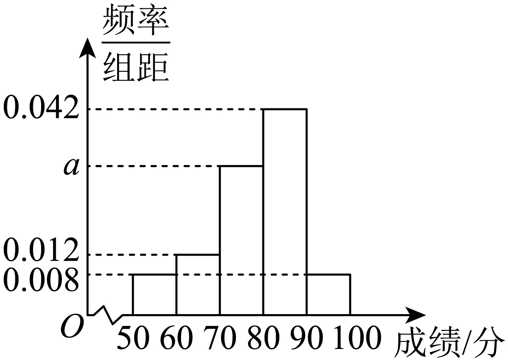

# Mathematics - 题目 1914

**ID**: e1d6463235594bd3ab3b3227882776a3
**年级**: Grade 12
**难度**: Medium
**题型**: Calculation

## 题目
象棋是中华民族优秀的传统文化遗产，为弘扬棋类运动精神，传承中华优秀传统文化，丰富校园文化生活，培养学生良好的心态和认真谨慎的生活观，某学校高一年级举办象棋比赛.​​​​​​​‌比赛分为初赛和决赛.初赛采用线上知识能力竞赛，共有500名学生参加，从中随机抽取了50名学生，记录他们的分数，将数据分成5组： $［50,60）,\left [{60,70}\right ),\left [{70,80}\right ),\left [{80,90}\right ),\left [90,100\right ]$ ，并整理得到如图频率分布直方图：（1）根据直方图，求 $a$ 的值，并估计这次知识能力竞赛的平均数 $\bar x$ ；（2）决赛环节学校决定从知识能力竞赛中抽出成绩最好的两个同学甲和乙进行现场棋艺比拼，比赛采取三局两胜制.若甲每局比赛获胜的概率均为 $\frac {2}{3}$ ，且各轮比赛结果相互独立.求甲最终获胜的概率.

## 解答

1. （1）由频率分布直方图， $[50,60)$ 的频率为 $0.08,[60,70)$ 的频率为 $0.12,[80,90)$ 的频率为0. ${\rm 42，}\left [90,100\right ]$ 的频率为0.08，
2. 所以 $[70,80)$ 的频率为 $1-0.08-0.12-0.42-0.08=0.3$ ，
3. 所以 $a=\frac {0.3}{10}=0.03$ ，
4. 根据平均数的计算公式，估计这次知识能力测评的平均数：
5. $\bar x=55\times 0.08+65\times 0.12+75\times 0.3+85\times 0.42+95\times 0.08=78$ 分.
6. （2）因为甲最终获胜，比分可能是 $2:0$ ， $2:1$ ，
7. 设甲 $2:0$ 获胜为事件 ${\rm \mathit{A}，}2:1$ 获胜为事件 $B$ ，
8. 若甲 $2:0$ 获胜，则概率为 $P(A)={\left({\frac {2}{3}}\right)^{2}}=\frac {4}{9}$ ，
9. 若甲 $2:1$ 获胜，则概率为 $P(B)=\frac {1}{3}\times {\left({\frac {2}{3}}\right)^{2}}+\frac {2}{3}\times \frac {1}{3}\times \frac {2}{3}=\frac {8}{27}$ ，
10. 又A，B两个事件互斥，则甲最终获胜的概率为 $P(A)+P(B)=\frac {20}{27}$ .

## 知识点

**中文**:
  - 平均数
  - 独立重复试验
  - 频率分布直方图

**English**:
  - Mean
  - Independent Repeated Trials (Bernoulli Trials)
  - Frequency Distribution Histogram

---
