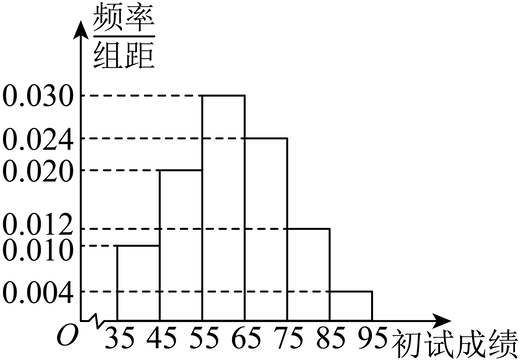

# Mathematics - 题目 106

**ID**: e3592b7c76a94bb7ba62b045fa514182
**年级**: Grade 12
**难度**: Medium
**题型**: Calculation

## 题目
某校为了解学生数学学科核心素养发展水平，组织本校2000名学生进行针对性检测（检测分为初试和复试），并随机抽取了100名学生的初试成绩，绘制了频率分布直方图，如图所示．(1)根据频率分布直方图，求样本平均数的估计值；（同一组数据用该区间的中点值作代表）(2)根据频率分布直方图，求样本的80％分位数（四舍五入精确到整数）；(3)若所有学生的初试成绩 $X$ 近似服从正态分布 $N\left ({μ,σ{^{2}}}\right )$ ，其中 $μ$ 为样本平均数的估计值， $σ\approx 14$ ．初试成绩不低于90分的学生才能参加复试，试估计能参加复试的人数（四舍五入精确到整数）．附：若随机变量 $X$ 服从正态分布 $N\left ({μ,σ{^{2}}}\right )$ ，则 $P\left ({μ-σ\leqslant X\leqslant μ+σ}\right )\approx 0.​​​​​​​‌6827$ ， $P\left ({μ-2σ\leqslant X\leqslant μ+2σ}\right )\approx 0.9545$ ， $P\left ({μ-3σ\leqslant X\leqslant μ+3σ}\right )\approx 0.9973$ ．

## 解答

1. （1）设样本平均数的估计值为 ${\overline{x}}$ ，
2. 则 ${\overline{x}}=10\left ({40\times 0.01+50\times 0.02+60\times 0.03+70\times 0.024+80\times 0.012+90\times 0.004}\right )=62$ .
3. 所以，样本平均数的估计值为62.
4. （2）由图可知，前三组的频率和为 $0.1+0.2+0.3=0.6$ ，第四组的频率为 $0.24$ ，
5. 所以样本的80％分位数为 $65+\frac {0.8-0.6}{0.24}\times 10=65+\frac {25}{3}\approx 73.$
6. （3）由（1）可知，样本平均数的估计值 $μ=62$ ，
7. 所以 $μ+2σ\approx 62+2\times 14=90$ ，
8. 则 $P\left ({X\geqslant 90}\right )=P\left ({X\geqslant μ+2σ}\right )=\frac {1}{2}\left ({1-0.9545}\right )=0.02275.$
9. 所以，估计能参加复试的人数为 $2000\times 0.02275\approx 46.$

## 知识点

**中文**:
  - 平均数
  - 正态曲线及其特点
  - 正态分布
  - 频率分布直方图
  - 百分位数

**English**:
  - Mean
  - Normal Curve and Characteristics
  - Normal Distribution
  - Frequency Distribution Histogram
  - Percentile

---
