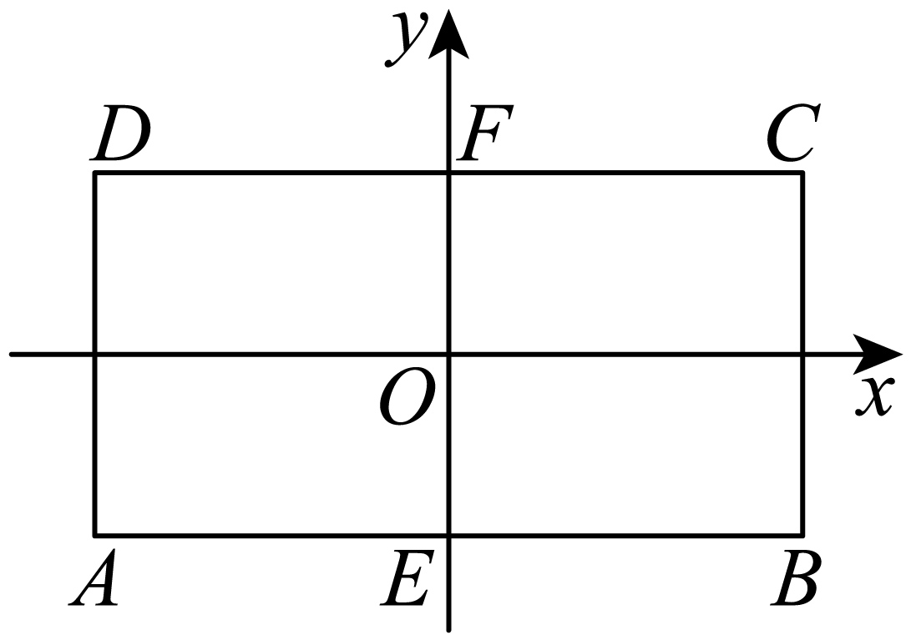

# Mathematics - 题目 2158

**ID**: e7dc2e778e6346f584a62dfe91208f1b
**年级**: Grade 12
**难度**: Medium
**题型**: Calculation

## 题目
已知矩形 $ABCD$ 中， $AB=4$ ， $AD=2$ ．如图，以矩形的中心为坐标原点，分别平行于 $AB$ 、 $AD$ 的直线为 $x$ 、 $y$ 轴建立平面直角坐标系．设 $y$ 轴分别交 $AB$ 、 $DC$ 于点 $E$ 、 $F$ ，点 $P$ 为平面上的动点，且直线 $PE$ 、 $PF$ 的斜率的积为 $-\frac {1}{4}$ ．（1）证明点 $P$ 不在矩形 $ABCD$ 的外部；​​​​​​​‌（2）现将矩形折叠，使 $\mathrm{A}$ 点落在线段 $DC$ 上，设折痕所在直线 $l$ 的斜率为 $k$ ，①求直线 $l$ 的方程；②重新展平矩形 $ABCD$ ，当折痕的长最大时，求折痕被点 $P$ 的轨迹所截得的弦长．

## 解答

1. （1）设 $P\left ({x,y}\right )$ ，由题设知 $E\left ({0,-1}\right )$ 、 $F\left ({0,1}\right )$ ，
2. 从而 $\frac {y-1}{x}\cdot \frac {y+1}{x}=-\frac {1}{4}$ ，整理得 $\frac {x{^{2}}}{4}+y{^{2}}=1\left ({x\ne 0}\right )$ ，
3. 所以点 $P$ 的轨迹为椭圆（去掉上下顶点），其范围是 $-2\leqslant x\leqslant 2$ ， $-1<y<1$ ，
4. 故点 $P$ 不可能在矩形外部；
5. （2）①设折叠后A点落在线段DC上的点为 $G\left ({t,1}\right )\left ({-2\leqslant t\leqslant 2}\right )$ ，
6. 当 $k=0$ 时，易得直线方程为 $y=0$ ；
7. 当 $k\ne 0$ 时，由A与G关于折痕所在的直线对称，有 $k{{}_{AG}}\cdot k=-1$ ，即 $\frac {2}{t+2}\cdot k=-1$ ，
8. 所以 $G\left ({-2k-2,1}\right )\left ({-2\leqslant k<0}\right ){\rm ，\mathit{AG}}$ 中点坐标为 $\left ({-k-2,0}\right )$ ，
9. 从而折痕所在的直线方程 $y=k\left [x-\left ({-k-2}\right )\right ]$ ，即 $y=kx+k\left ({k+2}\right )\left ({-2\leqslant k<0}\right )$ ；
10. 综上：直线方程为： $y=kx+k\left ({k+2}\right ),-2\leqslant k\leqslant 0$ ；
11. ②由题可得，当 $k=0$ 时，折痕的长为4；
12. 当 $k\ne 0$ 时，因直线 $AD,BC$ 所对应方程为： $x=-2，x=2$ .
13. 则直线 $y=kx+k\left ({k+2}\right )$ 与 $x=-2，x=2$ 交点为 $\left ({-2,k{^{2}}}\right )$ ， $\left ({2,k{^{2}}+4k}\right )$ ，
14. （ⅰ）若折痕所在的直线分别与边 $AD$ 、 $BC$ 相交，
15. 则交点坐标为 $N\left ({-2,k{^{2}}}\right )$ ， $M\left ({2,k{^{2}}+4k}\right )$ ，则此时 $\begin{cases}0<k{^{2}}<1\\-1<k{^{2}}+4k<0\end{cases}$
16. 此时， $-2+\sqrt {3}<k<0$ ，且 $MN{^{2}}=16+16k{^{2}}<64\left ({2-\sqrt {3}}\right )$ ；
17. （ⅱ）若折痕所在的直线分别与边 $AD$ 、 $AB$ 相交，
18. 则交点坐标为 $N\left ({-2,k{^{2}}}\right )$ ， $M\left ({-\frac {k{^{2}}+2k+1}{k},-1}\right )$ ，则 $\begin{cases}0<k{^{2}}\leqslant 1\\k{^{2}}+4k\leqslant -1\\-2\leqslant k<0\end{cases}$
19. 此时， $-1\leqslant k\leqslant -2+\sqrt {3}$ ， $MN{^{2}}={\left({\frac {k{^{2}}+1}{k}}\right)^{2}}+{\left({k{^{2}}+1}\right)^{2}}=\frac {{\left({k{^{2}}+1}\right)^{3}}}{k{^{2}}}=f\left ({k}\right )$
20. $f^{′}{\left ({x}\right )}=\frac {3{\left({k{^{2}}+1}\right)^{2}}\cdot 2k\cdot k{^{2}}-{\left({k{^{2}}+1}\right)^{3}}\cdot 2k}{k{^{4}}}=\frac {2{\left({k{^{2}}+1}\right)^{2}}\left ({2k{^{2}}-1}\right )}{k{^{3}}}$ ．
21. 令 $f^{′}{\left ({x}\right )}=0$ 得： $k=-\frac {\sqrt {2}}{2}$ ，
22. 列表得
23. $x$
24. $\left ({-1,-\frac {\sqrt {2}}{2}}\right )$
25. $-\frac {\sqrt {2}}{2}$
26. $\left ({-\frac {\sqrt {2}}{2},-2+\sqrt {3}}\right )$
27. $f^{′}{\left ({x}\right )}$
28. $-$
29. 0
30. $+$
31. $f\left ({x}\right )$
32. $\searrow $
33. $\nearrow $
34. 所以 $f\left ({x}\right ){{}_{{\rm{m}}{\rm{a}}{\rm{x}}}}=\left \{f\left ({-1}\right ),f\left ({-2+\sqrt {3}}\right )\right \}{{}_{{\rm{m}}{\rm{a}}{\rm{x}}}}=f\left ({-2+\sqrt {3}}\right )=64\left ({2-\sqrt {3}}\right )$ ，
35. （ⅲ）若折痕所在的直线分别与边 $CD$ 、 $AB$ 相交，
36. 则交点坐标为 $N\left ({-\frac {k{^{2}}+2k-1}{k},1}\right )$ ， $M\left ({-\frac {k{^{2}}+2k+1}{k},-1}\right )$ ， $\begin{cases}k{^{2}}>1\\k{^{2}}+4k<-1\\-2\leqslant k<0\end{cases}$
37. 此时， $-2\leqslant k<-1$ ， $MN{^{2}}=\frac {4}{k{^{2}}}+4<8$ ，
38. 综上可得，当且仅当 $k=-2+\sqrt {3}$ 时， $MN{{}_{{\rm{m}}{\rm{a}}{\rm{x}}}^{2}}=64\left ({2-\sqrt {3}}\right )$ ，
39. 即折痕长的最大值为 $\sqrt {64\left ({2-\sqrt {3}}\right )}=4\left ({\sqrt {6}-\sqrt {2}}\right )$ ，
40. 由 $\begin{cases}y=kx+k\left ({k+2}\right )\\\frac {x{^{2}}}{4}+y{^{2}}=1\end{cases}$ 得： $\left ({1+4k{^{2}}}\right )x{^{2}}+8k{^{2}}\left ({k+2}\right )x+4k{^{2}}{\left({k+2}\right)^{2}}-4=0$ ，
41. 所以 $x{{}_{1}}+x{{}_{2}}=-\frac {8k{^{2}}\left ({k+2}\right )}{1+4k{^{2}}}$ ， $x{{}_{1}}x{{}_{2}}=\frac {4k{^{2}}{\left({k+2}\right)^{2}}-4}{1+4k{^{2}}}$ ，
42. 故弦长 $d=\sqrt {1+k{^{2}}}\cdot \sqrt {{\left({x{{}_{1}}+x{{}_{2}}}\right)^{2}}-4x{{}_{1}}x{{}_{2}}}=\sqrt {1+k{^{2}}}\cdot \frac {4\sqrt {1-k{^{2}}\left ({k{^{2}}+4k}\right )}}{1+4k{^{2}}}$ ，
43. 又 $k=\sqrt {3}-2$ ， $k{^{2}}=7-4\sqrt {3}$ ， $1+4k{^{2}}=29-16\sqrt {3}$ ， $k{^{2}}+4k=-1$
44. 则 $d=\frac {32-16\sqrt {3}}{29-16\sqrt {3}}=\frac {160+48\sqrt {3}}{73}$

## 知识点

**中文**:
  - 利用导数研究函数的最值
  - 直线的交点坐标
  - 椭圆的标准方程及应用
  - 直线与椭圆的位置关系
  - 弦长面积问题

**English**:
  - Global Extrema (Max/Min) using Derivatives
  - Intersection Coordinates
  - Standard Equation and Applications
  - Line-Ellipse Relationship
  - Chord Length and Area Problems

---
