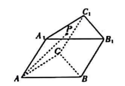

# Mathematics - 题目 402

**ID**: e839367d45c645339d97a89d37cf65d6
**年级**: Grade 12
**难度**: Medium
**题型**: 解答题.

## 题目
如图,在三棱柱 $ABC-A{{}_{1}}B{{}_{1}}C{{}_{1}}$ 中, $AB=AC=\sqrt {5},BC=2$ ,侧面 $BB{{}_{1}}C{{}_{1}}C$ 是正方形, $P$ 是平面 $A{{}_{1}}B{{}_{1}}C{{}_{1}}$ 上一点,且 $AP\bot BC$ .​​​​​​​‌(1)证明:点 $P$ 到直线 $A{{}_{1}}B{{}_{1}}$ 和 $A{{}_{1}}C{{}_{1}}$ 的距离相等.(2)已知二面角 $A-BC-B{{}_{1}}$ 的大小是 $\frac {2π}{3}$ ,求直线AB与平面 $ACC{{}_{1}}A{{}_{1}}$ 所成角的正弦值.

## 解答

1. (1)证明:当 $P$ 和 $A{{}_{1}}$ 重合时,显然符合题意,当 $P$ 和 $A{{}_{1}}$ 不重合时,连接 $A{{}_{1}}P$ ,延长 $A{{}_{1}}P$ 交 $B{{}_{1}}C{{}_{1}}$ 于点 $M{{}_{1}}$ ,因为 $BB{{}_{1}}C{{}_{1}}C$ 是正方形,所以 $BB{{}_{1}}\bot BC$ ,又因为 $BB{{}_{1}}//AA{{}_{1}}$ ,所以 $AA{{}_{1}}\bot BC$
2. 因为 $AP\bot BC,AP\cap A{{}_{1}}A=A$ ,所以 $BC\bot $ 平面 $AA{{}_{1}}P$
3. 又 $A{{}_{1}}P\subset $ 平面 $AA{{}_{1}}P$ ,所以 $BC\bot A{{}_{1}}P$ ,则 $B{{}_{1}}C{{}_{1}}\bot A{{}_{1}}M{{}_{1}}$
4. 因为 $AB=AC$ ,所以 $M{{}_{1}}$ 为 $B{{}_{1}}C{{}_{1}}$ 的中点,且 $A{{}_{1}}M{{}_{1}}$ 为 $\angle C{{}_{1}}A{{}_{1}}B{{}_{1}}$ 的角平分线.
5. 所以点 $P$ 到直线 $A{{}_{1}}B{{}_{1}}$ 和 $A{{}_{1}}C{{}_{1}}$ 的距离相等
6. (2)取BC的中点 $M$ ,连接 $MM{{}_{1}},AM$ ,所以 $MM{{}_{1}}\bot BC,AM\bot BC$ ,
7. 所以 $\angle AMM{{}_{1}}$ 为二面角 $A-BC-B{{}_{1}}$ 的平面角,
8. 因为二面角 $A-BC-B{{}_{1}}$ 的大小是 $\frac {2π}{3}$ ,所以 $\angle AMM{{}_{1}}=\frac {2π}{3}$
9. 过 $M$ 作平面ABC的垂线,交 $A{{}_{1}}M{{}_{1}}$ 于点 $N$ ,分别以 $\overrightarrow {{MA}},\overrightarrow {{MB}},\overrightarrow {{MN}}$ 的方向为 $x$ 轴, $y$ 轴, $z$ 轴的正方向建立空间直角坐标系,由题可得 $A(2,0,0),A{{}_{1}}(1,0,\sqrt {3}),C(0,-1,0),B(0,1,0)$ ,所以 $\overrightarrow {{AC}}=(-2,-1,0),\overrightarrow {{AA{{}_{1}}}}=(-1,0,\sqrt {3}),\overrightarrow {{AB}}=(-2,1,0)$ ,
10. 
11. 设平面 $ACC{{}_{1}}A{{}_{1}}$ 的法向量为 $\bm{n}=(x,y,z)$ ,
12. 则 $\begin{cases}\overrightarrow {{AA{{}_{1}}}}\cdot \bm{n}=0,\\\overrightarrow {{AC}}\cdot \bm{n}=0,\end{cases}$ 即 $\begin{cases}-x+\sqrt {3}z=0,\\-2x-y=0,\end{cases}$ 令 $x=\sqrt {3}$ ,则 $y=-2\sqrt {3},z=1$ ,所以 $\bm{n}=(\sqrt {3},-2\sqrt {3},1)$ ,
13. 直线AB与平面 $ACC{{}_{1}}A{{}_{1}}$ 所成的角为 $α$ ,
14. 则 ${\sin}α=|{\cos}\langle \bm{n},\overrightarrow {{AB}}\rangle |=$  $\frac {|\bm{n}\cdot \overrightarrow {{AB}}|}{|\bm{n}||\overrightarrow {{AB}}|}=\frac {4\sqrt {3}}{\sqrt {16}\times \sqrt {5}}=\frac {\sqrt {15}}{5}$ ,
15. 所以直线AB与平面 $ACC{{}_{1}}A{{}_{1}}$ 所成角的正弦值为 $\frac {\sqrt {15}}{5}$ ．

## 知识点

**中文**:
  - 向量法求线面角
  - 直线与平面垂直的判定

**English**:
  - Line-Plane Angle
  - Line-Plane Perpendicularity Determination

---
