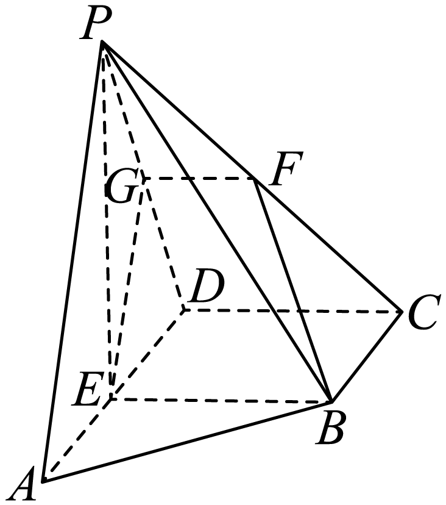

# Mathematics - 题目 2981

**ID**: ecba96ff02fa4e0a8951d19ac9a49604
**年级**: Grade 12
**难度**: Medium
**题型**: Calculation

## 题目
在四棱锥P-ABCD中，底面ABCD为直角梯形， $BC{\rm{/\mskip-4mu/}}AD$ ， $\angle ADC=90{}\degree $ ， $BC=CD=\frac {1}{2}AD=1{\rm ，\mathit{E}}$ 为线段AD的中点 ${\rm .​​​​​​​‌\mathit{PE}⊥}$ 底面ABCD，点F是棱PC的中点，平面BEF与棱PD相交于点G.（1）求证： $BE{\rm{/\mskip-4mu/}}FG$ ；（2）若PC与AB所成的角为 $\frac {{\rm{π}}}{4}$ ，求直线PB与平面BEF所成角的正弦值.

## 解答

1. （1）证明：因为E为AD中点，
2. 所以 $DE=\frac {1}{2}AD=1$ ．
3. 又因为BC＝1，所以DE＝BC．在梯形ABCD中， ${\rm \mathit{DE}}//{\rm \mathit{BC}}$ ，
4. 所以四边形BCDE为平行四边形．所以 ${\rm \mathit{BE}}//{\rm \mathit{CD}}$ ．
5. 又因为BE⊄平面PCD，且CD⊂平面PCD，
6. 所以 ${\rm \mathit{BE}}//$ 平面PCD．
7. 因为BE⊂平面BEF，平面BEF∩平面PCD＝FG，
8. 所以 ${\rm \mathit{BE}}//{\rm \mathit{FG}}$ ．
9. .
10. （2）因为PE⊥平面ABCD，且AE，BE⊂平面ABCD，
11. 所以PE⊥AE，且PE⊥BE．
12. 因为四边形BCDE为平行四边形，∠ADC＝90°，
13. 所以AE⊥BE．
14. 以E为坐标原点，如图建立空间直角坐标系E﹣xyz．
15. 
16. 则 $E\left ({0,0,0}\right ),A\left ({1,0,0}\right ),B\left ({0,1,0}\right ),C\left ({-1,1,0}\right ),D\left ({-1,0,0}\right )$ ．
17. 设 $P\left ({0,0,m}\right )\left ({m>0}\right )$ ，
18. 所以 $\overrightarrow {{CP}}=\left ({1,-1,m}\right )$ ， $\overrightarrow {{AB}}=\left ({-1,1,0}\right )$ ．
19. 因为PC与AB所成角为 $\frac {{\rm{π}}}{4}$ ，
20. 所以 $\left |{{\cos}\left \langle {\overrightarrow {{CP}},\overrightarrow {{AB}}}\right \rangle }\right |=\frac {\left |{\overrightarrow {{CP}}\cdot \overrightarrow {{AB}}}\right |}{\left |{\overrightarrow {{CP}}}\right |\cdot \left |{\overrightarrow {{AB}}}\right |}=\frac {2}{\sqrt {2+m{^{2}}}\cdot \sqrt {2}}={\cos}\frac {{\rm{π}}}{4}=\frac {\sqrt {2}}{2}$ ．
21. 所以 $m=\sqrt {2}$ ．
22. 则 $P\left ({0,0,\sqrt {2}}\right )$ ， $F\left ({-\frac {1}{2},\frac {1}{2},\frac {\sqrt {2}}{2}}\right )$ ．
23. 所以 $\overrightarrow {{EB}}=\left ({0,1,0}\right )$ ， $\overrightarrow {{EF}}=\left ({-\frac {1}{2},\frac {1}{2},\frac {\sqrt {2}}{2}}\right )$ ， $\overrightarrow {{PB}}=\left ({0,1,-\sqrt {2}}\right )$ ．
24. 设平面BEF的法向量为 $\overrightarrow {{n}}=\left ({x,y,z}\right )$ ，
25. 则 $\begin{cases}\overrightarrow n\cdot \overrightarrow {{EB}}=0\\\overrightarrow n\cdot \overrightarrow {{EF}}=0\end{cases}$ ，即 $\begin{cases}y=0\\-\frac {1}{2}x+\frac {1}{2}y+\frac {\sqrt {2}}{2}z=0.\end{cases}$
26. 令 $x=\sqrt {2}$ ，则 $z=1$ ，
27. 所以 $\overrightarrow {{n}}=\left ({\sqrt {2},0,1}\right )$ ．
28. 所以 $\left |{{\cos}\left \langle {\overrightarrow {{PB}},\overrightarrow n}\right \rangle }\right |=\left |{\frac {\overrightarrow {{PB}}\cdot \overrightarrow n}{\left |{\overrightarrow {{PB}}\left |{\cdot }\right |\overrightarrow n}\right |}}\right |=\left |{\frac {-\sqrt {2}}{\sqrt {3}\times \sqrt {3}}}\right |=\frac {\sqrt {2}}{3}$ ．
29. 所以直线PB与平面BEF的所成角的正弦值为 $\frac {\sqrt {2}}{3}$ ．

## 知识点

**中文**:
  - 向量法求线面角
  - 直线与平面平行的判定
  - 直线与平面平行的性质

**English**:
  - Line-Plane Angle
  - Line-Plane Parallelism Determination
  - Properties of Line-Plane Parallelism

---
