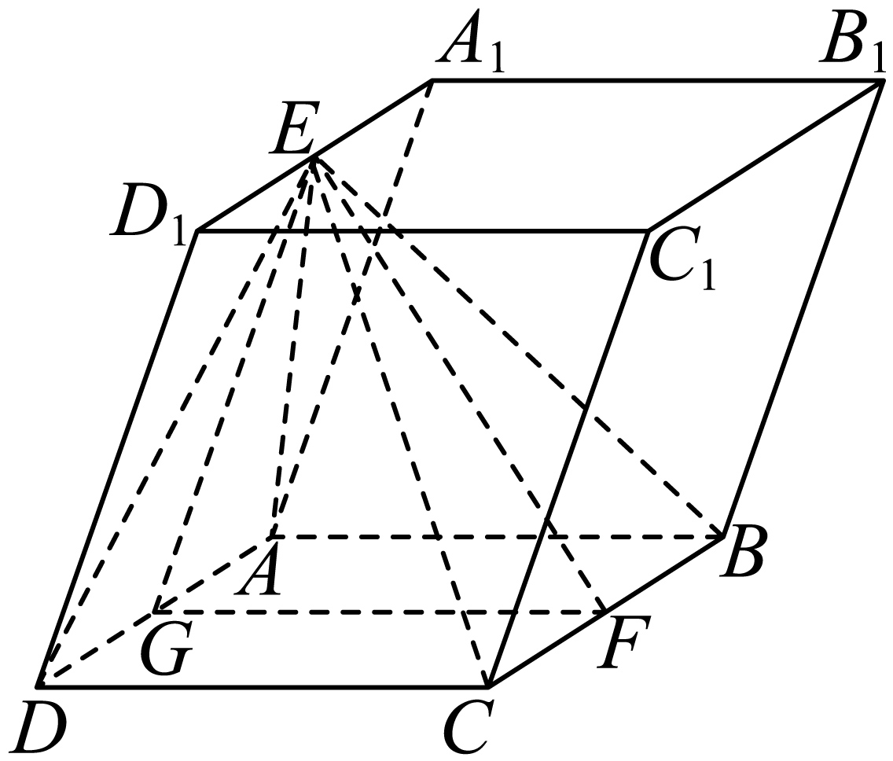

# Mathematics - 题目 2266

**ID**: f2428e2a337c4afdbc2a6f002f83da70
**年级**: Grade 12
**难度**: Medium
**题型**: Calculation

## 题目
如图，在平行六面体  $ABCD-A₁B₁C₁D₁$ 中，E在线段  $A₁D₁$ 上，且  $\angle EDA=\angle EAD，$F，G分别为线段 $BC$ ， $AD$ 的中点，且底面  $ABCD$ 为正方形.​​​​​​​‌(1)求证:平面  $BCC₁B₁\bot $ 平面 $EFG$(2)若 $EF$ 与底面 $ABCD$ 不垂直，直线  $ED$ 与平面 $EBC$ 所成角为  $45{}^\circ ，$ 且  $EB=AB=2，$ 求点A到平面  $A₁B₁C₁D₁$ 的距离.

## 解答

1. （1）因为 $\angle EDA=\angle EAD$ ， $G$ 为 $AD$ 中点，
2. 所以 $EA=ED$ ， $EG\bot AD$ ，即 $EG\bot BC$ ，
3. 因为 $ABCD$ 是正方形，所以 $BC\bot AB$ ，
4. 因为 $F,G$ 分别是 $BC,AD$ 的中点，所以 $GF//AB$ ，所以 $BC\bot GF$ ，
5. 又 $EG\cap GF=G$ ， $EG,GF\subset $ 平面 $EGF$ ，
6. $\therefore BC\bot $ 平面 $EGF$ ，又 $BC⊂$ 平面 $BCC{{}_{1}}B{{}_{1}}$ ，
7. $\therefore $ 平面 $BCC{{}_{1}}B{{}_{1}}\bot $ 平面 $EGF$ .
8. （2）以 $F$ 为坐标原点，过 $F$ 作与平面 $ABCD$ 垂直的直线为 $z$ 轴，以 $\overrightarrow {{FC}},\overrightarrow {{GF}}$ 的方向为 $x,y$ 轴的正方向，建立如图空间直角坐标系，
9. 则 $D\left ({1,-2,0}\right ),C\left ({1,0,0}\right ),B\left ({-1,0,0}\right )$ ，设 $E\left ({0,a,h}\right )\left ({a\ne 0,h>0}\right )$ ，
10. 则 $\overrightarrow {{ED}}=\left ({1,-2-a,-h}\right )$ ， $\overrightarrow {{EB}}=\left ({-1,-a,-h}\right )$ ， $\overrightarrow {{CB}}=\left ({-2,0,0}\right )$ ，
11. 设平面 $EBC$ 的法向量为 $\overrightarrow n=\left ({x,y,z}\right )$ ，
12. 则 $\begin{cases}\overrightarrow n\cdot \overrightarrow {{EB}}=-x-ay-hz=0\\\overrightarrow n\cdot \overrightarrow {{CB}}=-2x=0\end{cases}$ ，令 $y=-h$ ，则 $z=a$ ，
13. 所以 $\overrightarrow n=\left ({0,-h,a}\right )$ ，又 $EB=2$ ，所以 $a{^{2}}+h{^{2}}=3$ ，
14. 设直线 $ED$ 与平面 $EBC$ 所成角为 $θ$ ，
15. 则 ${\sin}θ=\frac {\left |{\overrightarrow {{ED}}\cdot \overrightarrow n}\right |}{\left |{\overrightarrow {{ED}}}\right |\left |{\overrightarrow n}\right |}=\frac {\left |{2h}\right |}{\sqrt {3}\cdot \sqrt {h{^{2}}+{\left({2+a}\right)^{2}}+1}}=\frac {\sqrt {2}}{2}$ ，
16. 解得 $a=-\frac {3}{2}$ 或 $a=0$ （舍）， $h=\frac {\sqrt {3}}{2}$ ，
17. 所以点 $E$ 到平面 $ABCD$ 的距离为 $\frac {\sqrt {3}}{2}$ ，则点 $A$ 到平面 $A{{}_{1}}B{{}_{1}}C{{}_{1}}D{{}_{1}}$ 的距离为 $\frac {\sqrt {3}}{2}$ .
18. 

## 知识点

**中文**:
  - 平面与平面垂直的判定
  - 点与面之间的距离

**English**:
  - Plane-Plane Perpendicularity Determination
  - Point-Plane Distance

---
