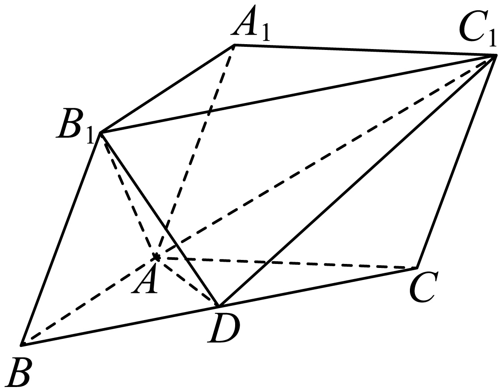

# Mathematics - 题目 213

**ID**: f6288334feeb4347ba8e88e27382922f
**年级**: Grade 12
**难度**: Medium
**题型**: Calculation

## 题目
已知三棱柱 $ABC-A{{}_{1}}B{{}_{1}}C{{}_{1}}$ 中， $AB=AC=2$ ， $\angle BAC=120{}^\circ $ ，且 $BC=2BB{{}_{1}}$ ， $\angle CBB{{}_{1}}=60{}^\circ $ ，侧面 $BCC{{}_{1}}B{{}_{1}}\bot $ 底面 $ABC$ ， $D$ 是 $BC$ 的中点.​​​​​​​‌(1)求证：平面 $C{{}_{1}}AD\bot $ 平面 $B{{}_{1}}AD$ ；(2)在棱 $AA{{}_{1}}$ 上是否存在点 $Q$ ，使得 $BQ$ 与平面 $ACC{{}_{1}}A{{}_{1}}$ 的所成角为60°.如果存在，请求出 $\frac {AQ}{AA{{}_{1}}}$ ；如果不存在，请说明理由.

## 解答

1. （1）在 $\vartriangle ABC$ 中， $AB=AC=2,\angle BAC=120^\circ $ ，由余弦定理，
2. 得 ${\cos}\angle BAC=\frac {AB{^{2}}+AC{^{2}}-BC{^{2}}}{2AB\cdot AC}=\frac {4+4-BC{^{2}}}{8}$ ，解得 $BC=2\sqrt {3}$ ，得 $BB{{}_{1}}=\sqrt {3}$ .
3. 在 $\mathrm{△}BB{{}_{1}}D$ 中， $BB{{}_{1}}=BD=\sqrt {3},\angle DBB{{}_{1}}=60^\circ $ ，则 $\mathrm{△}BB{{}_{1}}D$ 为正三角形，
4. 取BD的中点O，连接 $OB{{}_{1}}$ ，则 $OB{{}_{1}}\bot BD$ ，又平面 $CBB{{}_{1}}C{{}_{1}}$  $\bot $ 平面 $ABC$ ，
5. 平面 $CBB{{}_{1}}C{{}_{1}}$  $\cap $ 平面 $ABC$  $=BC,OB{{}_{1}}\subset $ 平面 $CBB{{}_{1}}C{{}_{1}}$ ，所以 $OB{{}_{1}}\bot $ 平面 $ABC$ .
6. 取 $AB$ 的中点E，连接OE，则 $OE//AD$ ，而 $AD⊥BC$ ，所以 $OE\bot BC$ ，
7. 由 $OE、OC\subset $ 平面 $ABC$ ，所以 $OB{{}_{1}}\bot OE,OB{{}_{1}}\bot OC$ ，
8. 以O为原点，以 $OE,OC,OB{{}_{1}}$ 所在直线为 $x,y,z$ 轴建立如图空间直角坐标系，
9. 则 $B{{}_{1}}(0,0,\frac {3}{2}),A(1,\frac {\sqrt {3}}{2},0),D(0,\frac {\sqrt {3}}{2},0),C{{}_{1}}(0,2\sqrt {3},\frac {3}{2})$ ，
10. 所以 $\overrightarrow {{AD}}=\left ({-1,0,0}\right ),\overrightarrow {{AC{{}_{1}}}}=\left ({-1,\frac {3\sqrt {3}}{2},\frac {3}{2}}\right ),\overrightarrow {{AB{{}_{1}}}}=\left ({-1,-\frac {\sqrt {3}}{2},\frac {3}{2}}\right )$ ，
11. 设平面 $C{{}_{1}}AD$ 和平面 $B{{}_{1}}AD$ 的一个法向量分别为 $\overrightarrow {{n{{}_{1}}}}=(x{{}_{1}},y{{}_{1}},z{{}_{1}}),\overrightarrow {{n{{}_{2}}}}=(x{{}_{2}},y{{}_{2}},z{{}_{2}})$ ，
12. 则 $\begin{cases}\overrightarrow {{n{{}_{1}}}}\cdot \overrightarrow {{AD}}=-x{{}_{1}}=0\\\overrightarrow {{n{{}_{1}}}}\cdot \overrightarrow {{AC{{}_{1}}}}=-x{{}_{1}}+\frac {3\sqrt {3}}{2}y{{}_{1}}+\frac {3}{2}z{{}_{1}}=0\end{cases},\begin{cases}\overrightarrow {{n{{}_{2}}}}\cdot \overrightarrow {{AD}}=-x{{}_{2}}=0\\\overrightarrow {{n{{}_{2}}}}\cdot \overrightarrow {{AB{{}_{1}}}}=-x{{}_{2}}-\frac {\sqrt {3}}{2}y{{}_{2}}+\frac {3}{2}z{{}_{2}}=0\end{cases}$ ，
13. 令 $y{{}_{1}}=\sqrt {3},y{{}_{2}}=\sqrt {3}$ ，则 $x{{}_{1}}=0,z{{}_{1}}=-3,x{{}_{2}}=0,z{{}_{2}}=1$ ，
14. 所以 $\overrightarrow {{n{{}_{1}}}}=(0,\sqrt {3},-3),\overrightarrow {{n{{}_{2}}}}=(0,\sqrt {3},1)$ ，所以 $\overrightarrow {{n{{}_{1}}}}\cdot \overrightarrow {{n{{}_{2}}}}=0$ ，
15. 故平面 $C{{}_{1}}AD$  $\bot $ 平面 $B{{}_{1}}AD$ ；
16. （2）由（1）知， $C(0,\frac {3\sqrt {3}}{2},0)$ ， $B(0,-\frac {\sqrt {3}}{2},0)$ ， $A(1,\frac {\sqrt {3}}{2},0)$ ， $B{{}_{1}}(0,0,\frac {3}{2})$ ， $C{{}_{1}}(0,2\sqrt {3},\frac {3}{2})$ ，
17. 由 $\overrightarrow {{BB{{}_{1}}}}=\overrightarrow {{AA{{}_{1}}}}$ ，即 $(0,\frac {\sqrt {3}}{2},\frac {3}{2})=(x{{}_{A{{}_{1}}}}-1,y{{}_{A{{}_{1}}}}-\frac {\sqrt {3}}{2},z{{}_{A{{}_{1}}}})$ ，得 $A{{}_{1}}(1,\sqrt {3},\frac {3}{2})$ ，
18. 所以 $\overrightarrow {{AC}}=\left ({-1,\sqrt {3},0}\right ),\overrightarrow {{AC{{}_{1}}}}=\left ({-1,\frac {3\sqrt {3}}{2},\frac {3}{2}}\right ),\overrightarrow {{AA{{}_{1}}}}=\left ({0,\frac {\sqrt {3}}{2},\frac {3}{2}}\right )$ ，设 $\overrightarrow {{AQ}}=λ\overrightarrow {{AA{{}_{1}}}}(0<λ<1)$ ，
19. 则 $\overrightarrow {{AQ}}=(0,\frac {\sqrt {3}}{2}λ,\frac {3}{2}λ)$ ，又 $\overrightarrow {{BA}}=(1,\sqrt {3},0)$ ，
20. 所以 $\overrightarrow {{BQ}}=\overrightarrow {{BA}}+\overrightarrow {{AQ}}=(1,\sqrt {3}+\frac {\sqrt {3}}{2}λ,\frac {3λ}{2})$ ，
21. 设平面 $ACC{{}_{1}}A{{}_{1}}$ 的一个法向量为 $\overrightarrow {{n}}=(x,y,z)$ ，
22. 则 $\begin{cases}\overrightarrow n\cdot \overrightarrow {{AC}}=-x+\sqrt {3}y=0\\\overrightarrow n\cdot \overrightarrow {{AC{{}_{1}}}}=-x+\frac {3\sqrt {3}}{2}y+\frac {3}{2}z=0\end{cases}$ ，令 $y=1$ ，得 $x=\sqrt {3},z=-\frac {\sqrt {3}}{3}$ ，
23. 所以 $\overrightarrow n=\left ({\sqrt {3},1,-\frac {\sqrt {3}}{3}}\right )$ ，
24. 所以 ${\sin}60^\circ =\left |{{\cos}\left \langle {\overrightarrow {{BQ}},\overrightarrow n}\right \rangle }\right |=\frac {\left |{\overrightarrow {{BQ}}\cdot \overrightarrow n}\right |}{\left |{\overrightarrow {{BQ}}}\right |\left |{\overrightarrow n}\right |}=\frac {\left |{2\sqrt {3}}\right |}{\sqrt {\frac {13}{3}}\cdot \sqrt {1+{\left({\sqrt {3}+\frac {\sqrt {3}}{2}λ}\right)^{2}}+{\left({\frac {3λ}{2}}\right)^{2}}}}=\frac {\sqrt {3}}{2}$ ，
25. 整理，得 $39λ{^{2}}+39λ+4=0$ ，方程在 $\left [0,1\right ]$ 上无实数解，
26. 所以在 $AA{{}_{1}}$ 上不存在点Q，使得 $BQ$ 与平面 $ACC{{}_{1}}A{{}_{1}}$ 所成角为 $60^\circ $ .
27. 

## 知识点

**中文**:
  - 向量法求线面角
  - 平面与平面垂直的判定

**English**:
  - Line-Plane Angle
  - Plane-Plane Perpendicularity Determination

---
