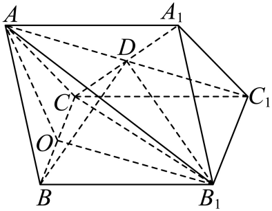

# Mathematics - 题目 3555

**ID**: f921975b7c0e42d28c62cedc9b30ad29
**年级**: Grade 12
**难度**: Medium
**题型**: Calculation

## 题目
如图所示，三棱柱 $ABC-A{{}_{1}}B{{}_{1}}C{{}_{1}}$ 所有棱长都为 ${\rm 2，}O$ 为 $BC$ 中点， $D$ 为 $A{{}_{1}}C$ 与 $AC{{}_{1}}$ 交点， $\angle B{{}_{1}}BC=60{}\degree $ ．(1)证明： $CD//$ 平面 $AOB{{}_{1}}$ ；​​​​​​​‌(2)证明：平面 $BCD\bot $ 平面 $AB{{}_{1}}C{{}_{1}}$ ；(3)若直线 $DB{{}_{1}}$ 与平面 $AOB{{}_{1}}$ 所成角的余弦值为 $\frac {3\sqrt {13}}{13}$ ，求平面 $A{{}_{1}}CB{{}_{1}}$ 与平面 $CB{{}_{1}}C{{}_{1}}$ 的夹角的余弦值．

## 解答

1. （1）取 $AB{{}_{1}}$ 中点 $E$ ，连接 $DE$ ， $BE$ ， $OE$ ；
2. 因为 $D$ ， $E$ 分别为 $AC{{}_{1}}$ 和 $AB{{}_{1}}$ 的中点，所以 $DE{\rm{/}}{\rm{/}}B{{}_{1}}C{{}_{1}}$ 且 $DE=\frac {1}{2}B{{}_{1}}C{{}_{1}}$ ，
3. 又 $OC{\rm{/}}{\rm{/}}B{{}_{1}}C{{}_{1}}$ 且 $OC=\frac {1}{2}B{{}_{1}}C{{}_{1}}$ ，
4. 所以 $DE{\rm{/}}{\rm{/}}CO$ 且 $DE=CO$ ，即四边形 $DEOC$ 为平行四边形，所以 $CD{\rm{/}}{\rm{/}}OE$ ，
5. 又因为 $OE\subset $ 平面 $AOB{{}_{1}}$ ， $CD\not\subset $ 平面 $AOB{{}_{1}}$ ，所以 $CD{\rm{/}}{\rm{/}}$ 平面 $AOB{{}_{1}}$ ．
6. （2）因为三棱柱 $ABC-A{{}_{1}}B{{}_{1}}C{{}_{1}}$ 所有棱长都为 $2$ ， $\angle B{{}_{1}}BC{\rm{=}}{{6}}{{0}}{^{\circ }}$ ，
7. 所以 $AO=B{{}_{1}}O=\sqrt {3}$ ， $AB=BB{{}_{1}}$ ， $E$ 为 $AB{{}_{1}}$ 的中点， $B,C,D,E$ 四点共面，
8. 所以 $OE\bot AB{{}_{1}}$ ，且 $BE\bot AB{{}_{1}}$ ， $BE$ ， $BE,OE\subset $ 平面 $BCD$ ， $OE\cap BE=E$ ，所以 $AB{{}_{1}}\bot $ 平面 $BCD$ ，
9. 又 $AB{{}_{1}}\subset $ 平面 $AB{{}_{1}}C{{}_{1}}$ ，所以平面 $BCD\bot $ 平面 $AB{{}_{1}}C{{}_{1}}$ ．
10. （3）由题意知， $BC\bot AO$ ，且 $BC\bot OB{{}_{1}}$ ， $AO$ ， $OB{{}_{1}}\subset $ 平面 $AOB{{}_{1}}$ ， $OB{{}_{1}}\cap AO=O$ ，
11. 所以 $BC\bot $ 平面 $AOB{{}_{1}}$ ，又 $DE{\rm{/}}{\rm{/}}BC$ ，所以 $DE\bot $ 平面 $AOB{{}_{1}}$ ，
12. 所以 $\angle DB{{}_{1}}E$ 为直线 $DB{{}_{1}}$ 与平面 $AOB{{}_{1}}$ 所成角，
13. 又 $\sin \angle DB{{}_{1}}E=\frac {DE}{DB{{}_{1}}}=\frac {1}{DB{{}_{1}}}=\frac {2\sqrt {13}}{13}$ ，所以 $DB{{}_{1}}=\frac {\sqrt {13}}{2}$ ，
14. 因为 $BC{\rm{/}}{\rm{/}}B{{}_{1}}C{{}_{1}}$ ，所以 $B{{}_{1}}C{{}_{1}}\bot $ 平面 $AOB{{}_{1}}$ ， $AB{{}_{1}}\subset $ 平面 $AOB{{}_{1}}$ ，所以 $B{{}_{1}}C{{}_{1}}\bot AB{{}_{1}}$ ，
15. 所以 $\vartriangle AB{{}_{1}}C{{}_{1}}$ 为直角三角形，所以 $AC{{}_{1}}=2DB{{}_{1}}=\sqrt {13}$ ，所以 $AB{{}_{1}}=\sqrt {A{\rm C}{_{1}^{2}}-B{{}_{1}}{\rm C}{_{1}^{2}}}=3$ ，
16. 在 $\vartriangle AOB{{}_{1}}$ 中， ${\cos}\angle AOB{{}_{1}}=\frac {3+3-9}{2\times 3}=-\frac {1}{2}$ ，所以 $\angle AOB{{}_{1}}=120{}\degree $ ，
17. 以 $O$ 为原点，作 $Oz\bot $ 平面 $BCC{{}_{1}}B{{}_{1}}$ ，以 $\overrightarrow {{OB}}$ ， $\overrightarrow {{OB{{}_{1}}}}$ ， $\overrightarrow {{Oz}}$ 方向为 $x$ ， $y$ ， $z$ 轴正方向，建立空间直角坐标系，如图所示：
18. 则 $C\left ({-1,0,0}\right )$ ， $B{{}_{1}}\left ({0,\sqrt {3},0}\right )$ ， $C{{}_{1}}(-2,\sqrt {3},0)$ ， $A\left ({0,-\frac {\sqrt {3}}{2},\frac {3}{2}}\right )$ ，由 $\overrightarrow {{AA{{}_{1}}}}=\overrightarrow {{CC{{}_{1}}}}$ ，所以 $A{{}_{1}}\left ({-1,\frac {\sqrt {3}}{2},\frac {3}{2}}\right )$ ，
19. 所以 $\overrightarrow {{CA{{}_{1}}}}=\left ({0,\frac {\sqrt {3}}{2},\frac {3}{2}}\right )$ ， $\overrightarrow {{CB{{}_{1}}}}=\left ({1,\sqrt {3},0}\right )$ ，
20. 设平面 $A{{}_{1}}CB{{}_{1}}$ 的一个法向量为 $\overrightarrow n=(x,y,z)$ ，则 $\begin{cases}\overrightarrow {{CB{{}_{1}}}}\cdot \overrightarrow n=0\\\overrightarrow {{CA{{}_{1}}}}\cdot \overrightarrow n=0\end{cases}$ ，即 $\begin{cases}x+\sqrt {3}y=0\\\frac {\sqrt {3}}{2}y+\frac {3}{2}z=0\end{cases}$ ，
21. 令 $z=1$ ，解得 $\overrightarrow n=(3,-\sqrt {3},1)$ ，易得平面 $CB{{}_{1}}C{{}_{1}}$ 的一个法向量为 $\overrightarrow m=(0,0,1)$ ，
22. 记平面 $A{{}_{1}}CB{{}_{1}}$ 与平面 $CB{{}_{1}}C{{}_{1}}$ 的夹角为 $θ$ ，
23. 则 ${\cos}θ=\left |{{\cos}\left \langle {\overrightarrow m,\overrightarrow n}\right \rangle }\right |=\frac {\left |{\overrightarrow m\cdot \overrightarrow n}\right |}{\left |{\overrightarrow m}\right |\cdot \left |{\overrightarrow n}\right |}=\frac {\sqrt {13}}{13}$ ，
24. 即平面 $A{{}_{1}}CB{{}_{1}}$ 与平面 $CB{{}_{1}}C{{}_{1}}$ 的夹角的余弦值为 $\frac {\sqrt {13}}{13}$ ．

## 知识点

**中文**:
  - 向量法求二面角
  - 直线与平面平行的判定
  - 直线与平面垂直的判定
  - 立体几何综合问题

**English**:
  - Dihedral Angle
  - Line-Plane Parallelism Determination
  - Line-Plane Perpendicularity Determination
  - Comprehensive Problems in Solid Geometry

---
