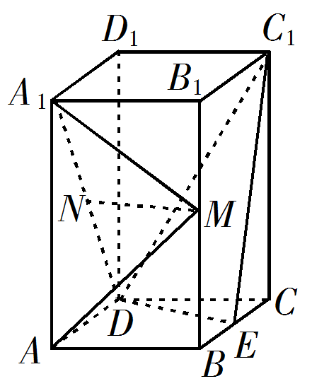

# Mathematics - 题目 3585

**ID**: fe070df6ab2a4fa9b0947dadc9744e93
**年级**: Grade 12
**难度**: Medium
**题型**: Calculation

## 题目
如图，直四棱柱ABCD–A_{1}B_{1}C_{1}D_{1}的底面是菱形，AA_{1}=4，AB=2，∠BAD=60°，E，M，N分别是BC，BB_{1}，A_{1}D的中点.​​​​​​​‌（1）证明：MN∥平面C_{1}DE；（2）求点C到平面C_{1}DE的距离．

## 解答

1. （1）连接 $ME$ ， $B{{}_{1}}C$
2. 
3. $\because M$ ， $E$ 分别为 $BB{{}_{1}}$ ， $BC$ 中点     $\therefore ME$ 为 $\Delta B{{}_{1}}BC$ 的中位线
4. $\therefore ME//B{{}_{1}}C$ 且 $ME=\frac {1}{2}B{{}_{1}}C$
5. 又 $N$ 为 $A{{}_{1}}D$ 中点，且 $A{{}_{1}}D{\underline{{\underline{//}}}}B{{}_{1}}C$   $\therefore ND//B{{}_{1}}C$ 且 $ND=\frac {1}{2}B{{}_{1}}C$
6. $\therefore ME{\underline{{\underline{//}}}}ND$   $\therefore $ 四边形 $MNDE$ 为平行四边形
7. $\therefore MN//DE$ ，又 $MN\not\subset $ 平面 $C{{}_{1}}DE$ ， $DE\subset $ 平面 $C{{}_{1}}DE$
8. $\therefore MN//$ 平面 $C{{}_{1}}DE$
9. （2）在菱形 $ABCD$ 中， $E$ 为 $BC$ 中点，所以 $DE\bot BC$ ，
10. 根据题意有 $DE=\sqrt {3}$ ， $C{{}_{1}}E=\sqrt {17}$ ，
11. 因为棱柱为直棱柱，所以有 $DE\bot $ 平面 $BCC{{}_{1}}B{{}_{1}}$ ，
12. 所以 $DE\bot EC{{}_{1}}$ ，所以 $S{{}_{\Delta DEC{{}_{1}}}}=\frac {1}{2}\times \sqrt {3}\times \sqrt {17}$ ，
13. 设点C到平面 $C{{}_{1}}DE$ 的距离为 $d$ ，
14. 根据题意有 $V{{}_{C{{}_{1}}-CDE}}=V{{}_{C-C{{}_{1}}DE}}$ ，则有 $\frac {1}{3}\times \frac {1}{2}\times \sqrt {3}\times \sqrt {17}\times d=\frac {1}{3}\times \frac {1}{2}\times 1\times \sqrt {3}\times 4$ ，
15. 解得 $d=\frac {4}{\sqrt {17}}=\frac {4\sqrt {17}}{17}$ ，
16. 所以点C到平面 $C{{}_{1}}DE$ 的距离为 $\frac {4\sqrt {17}}{17}$ .

## 知识点

**中文**:
  - 点与面之间的距离
  - 等积变换法
  - 直线与平面平行的判定

**English**:
  - Point-Plane Distance
  - Method of Equal Volume Transformation
  - Line-Plane Parallelism Determination

---
