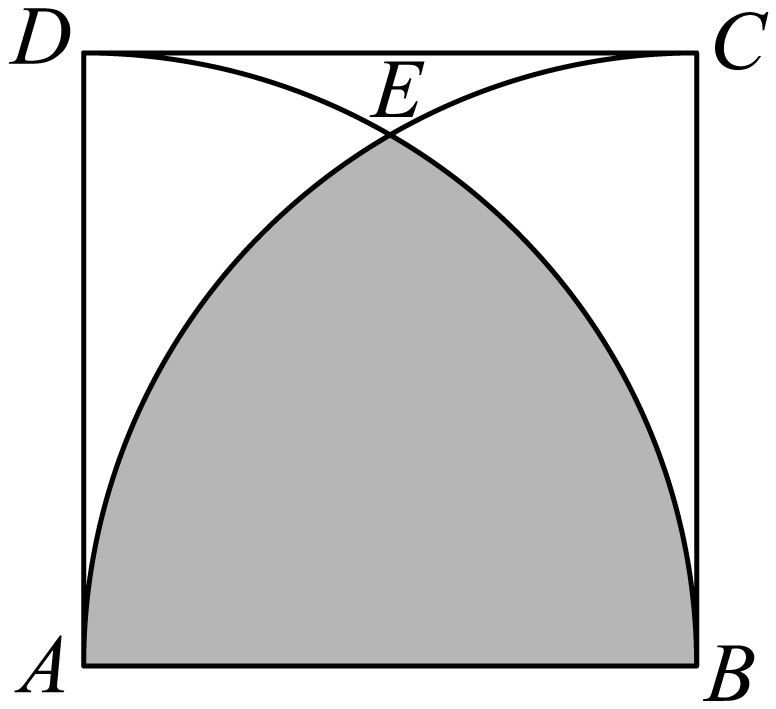

# Mathematics - 题目 1880

**ID**: 2d0885145f5b434cb6414d9efb0c600c
**年级**: Grade 12
**难度**: Medium
**题型**: Fill-in-the-blank

## 题目
如图，在正方形 $ABCD$ 中，分别以 $A,B$ 为圆心， $AB$ 的长为半径画弧，两弧交于点E，若 $\overset{\frown}{{DE}}$ 的长为 $\frac {{\rm{\mathrm{π}}}}{2}$ ，则图中阴影部分的面积为．​​​​​​​‌

## 解答

1. 连接 $AE$ ， $BE$ ，因为在正方形 $ABCD$ 中，分别以 $A,B$ 为圆心， $AB$ 的长为半径画弧，两弧交于点E，
2. 
3. 设 $AE=BE=AB=r$ ，则 $\angle EAB=\frac {{\rm{\mathrm{π}}}}{3}$ ，所以 $\angle DAE=\frac {{\rm{\mathrm{π}}}}{6}$ ，
4. 因为 $\overset{\frown}{{DE}}$ 的长为 $\frac {{\rm{\mathrm{π}}}}{2}$ ，所以 $r=\frac {\frac {{\rm{\mathrm{π}}}}{2}}{\frac {{\rm{\mathrm{π}}}}{6}}=3$ ，即正方形的边长为 $3$ ，
5. 所以 $\vartriangle ABE$ 的面积 $S{{}_{1}}=\frac {\sqrt {3}}{4}\times 3{^{2}}=\frac {9\sqrt {3}}{4}$ ，扇形 $EAB$ 的面积为 $S{{}_{2}}=\frac {1}{2}\times \frac {{\rm{\mathrm{π}}}}{3}\times 3{^{2}}=\frac {3{\rm{\mathrm{π}}}}{2}$ ，
6. 由图形的对称性知，扇形 $EAB$ 与扇形 $EBA$ 的面积相等，
7. 所以图中阴影部分的面积 $S=2S{{}_{2}}-S{{}_{1}}=3{\rm{\mathrm{π}}}-\frac {9\sqrt {3}}{4}=\frac {12{\rm{\mathrm{π}}}-9\sqrt {3}}{4}$ .

## 知识点

**中文**:
  - 弧长公式与扇形面积公式

**English**:
  - Arc Length and Sector Area Formulas

---
