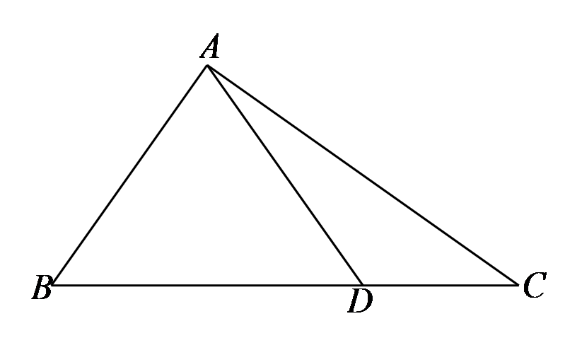

# Mathematics - 题目 269

**ID**: 35b6f9d1b6304de59a1932e10e612868
**年级**: Grade 12
**难度**: Medium
**题型**: Fill-in-the-blank

## 题目
如图，在 $\vartriangle ABC$ 中， $D$ 是边 $BC$ 上一点， $AB=AD=\frac {\sqrt {2}}{2}AC$ ， $f(x)$ ，则 ${\sin}C=$．​​​​​​​‌

## 解答

1. 由题意不妨取 $AC=2$ ，则 $AB=AD=\sqrt {2}$ ，且 $f(x)$ ，
2. 在 $\mathrm{△}ABD$ 中，由余弦定理得 $BD=\sqrt {AB{^{2}}+AD{^{2}}-2AB\cdot AD\cdot {\cos}\angle BAD}=\frac {2\sqrt {6}}{3}$ ， $\because {\sin}\angle BAD=\sqrt {1-{\cos}{^{2}}\angle BAD}=\frac {2\sqrt {2}}{3}$ ，
3. 在 $\mathrm{△}ABD$ 中，由正弦定理 $\frac {AD}{{\sin}B}=\frac {BD}{{\sin}\angle BAD}$ ，得 ${\sin}B=\frac {AD\cdot {\sin}\angle BAD}{BD}=\frac {\sqrt {6}}{3}$ ，
4. 在 $\vartriangle ABC$ 中，由正弦定理 $\frac {AB}{{\sin}C}=\frac {AC}{{\sin}B}$ ，得 ${\sin}C=\frac {AB\cdot {\sin}B}{AC}=\frac {\sqrt {3}}{3}$ ．
5. 故答案为： $\frac {\sqrt {3}}{3}$ ．

## 知识点

**中文**:
  - 利用余弦定理解三角形
  - 利用正弦定理解三角形

**English**:
  - Solving Triangles using Law of Cosines
  - Solving Triangles using Law of Sines

---
