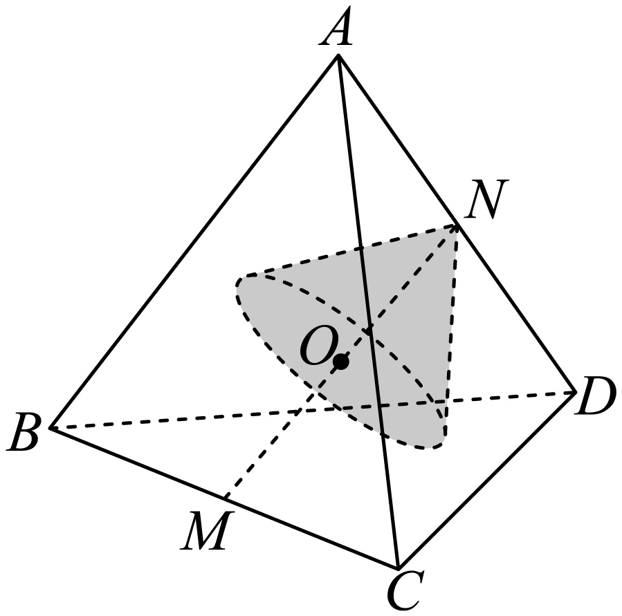

# Mathematics - 题目 531

**ID**: 4af6520781534e12a71b26d8b17c433a
**年级**: Grade 12
**难度**: Medium
**题型**: Fill-in-the-blank

## 题目
如图，已知正四面体 $ABCD$ 的棱长为 $2,M,N$ 分别为棱 $BC,AD$ 的中点.​​​​​​​‌若该正四面体有一内接圆锥 $NO{\rm ，}$ 其中 $N$ 为圆锥的顶点，底面圆心 $O$ 在线段 $MN$ 上，则该圆锥体积的最大值为.

## 解答

1. 如图，连接 $AM,DM{\rm ，}$ 则 $AM=DM=\sqrt {2{^{2}}-1{^{2}}}=\sqrt {3}{\rm ，}$
2. $MN=\sqrt {AM{^{2}}-{\left({\frac {1}{2}AD}\right)^{2}}}=\sqrt {3-1}=\sqrt {2}{\rm ，}$  ${\tan}\angle AMN=\frac {AN}{MN}=\frac {1}{\sqrt {2}}=\frac {\sqrt {2}}{2}{\rm ，}$
3. 设圆锥 $NO$ 与侧面 $ABC$ 的接触点为 $P{\rm ，}$ 连接 $OP{\rm ，}$
4. 根据正四面体的对称性知点 $P$ 一定在 $AM$ 上，且 $OP\bot MN{\rm ，}$ 设 $OM=x(0<x<\sqrt {2}){\rm ，}$
5. 则圆锥底面圆的半径为 $r=OP=OM\cdot {\tan}\angle AMN=\frac {\sqrt {2}}{2}x{\rm ，}$
6. 圆锥的高 $h=ON=MN-OM=\sqrt {2}-x{\rm ，}$
7. 所以圆锥的体积为 $V\left ({x}\right )=\frac {1}{3}{\rm{π}}\times {\left({\frac {\sqrt {2}x}{2}}\right)^{2}}\times \left ({\sqrt {2}-x}\right )=\frac {1}{6}{\rm{π}}\left ({\sqrt {2}x{^{2}}-x{^{3}}}\right ){\rm ，}$
8. 则 $V^{′}{\left ({x}\right )}=-\frac {1}{2}{\rm{π}}x\cdot \left ({x-\frac {2\sqrt {2}}{3}}\right ){\rm ，}$ 当 $0<x<\frac {2\sqrt {2}}{3}$ 时 ${\rm ，}V^{′}{\left ({x}\right )}>0,V\left ({x}\right )$ 单调递增；
9. 当 $\frac {2\sqrt {2}}{3}<x<\sqrt {2}$ 时 ${\rm ，}V^{′}{\left ({x}\right )}<0,V\left ({x}\right )$ 单调递减，所以 $V(x){{}_{{\rm{m}}{\rm{a}}{\rm{x}}}}=V\left ({\frac {2\sqrt {2}}{3}}\right )=\frac {4\sqrt {2}{\rm{π}}}{81}$ .
10. 故答案为： $\frac {4\sqrt {2}{\rm{π}}}{81}$ .
11. 

## 知识点

**中文**:
  - 圆柱、圆锥、圆台的体积

**English**:
  - Volume of Revolving Solids

---
